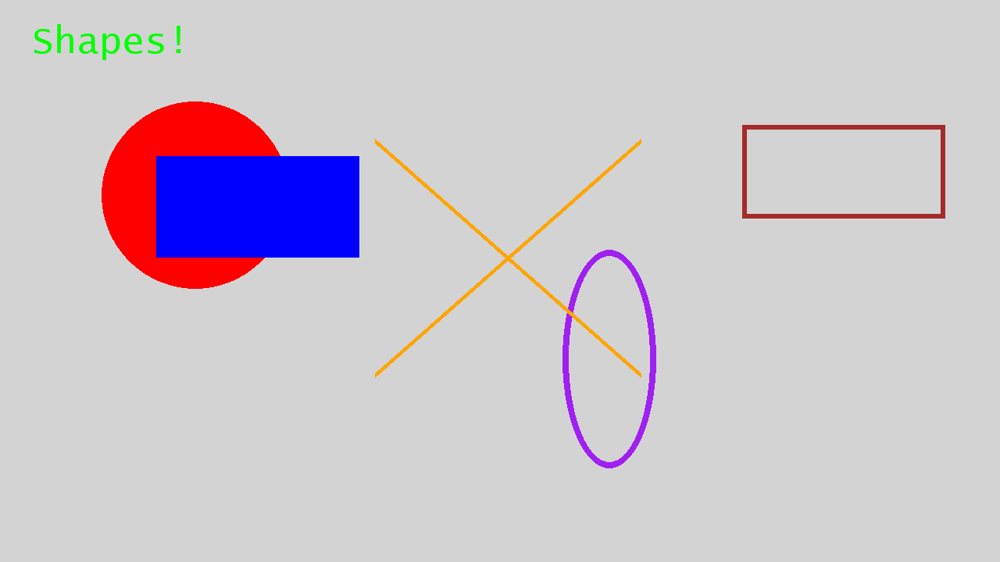

CS1400 - Tuesday, January 13 - Lecture 3 - Module 1

# Topics:
* [🟥Assn 1a - What is CS & Snowman](#assn-1a---what-is-cs--snowman)
* [Code Lab Challenge 0 - Hello, Octothorpe](#code-lab-challenge-0---hello-octothorpe)
* [Code Lab Challenge 1 - Drawly Grid Builder](#code-lab-challenge-1---drawly-grid-builder)
* [Code Lab Challenge 2 - Fix My Bug](#code-lab-challenge-2---fix-my-bug)


------------------------------------------------------------
# Announcements

## *TONIGHT* FSLC - Take Back Your Privacy With Matrix

*   **When**    6:30 PM Tuesday, January 13th
*   **Where**   WIDT 007
*   **Event Info** https://linux.usu.edu/event/7ca758fa-562c-43e7-a3b3-f0f2fa2aaa85
*   **Website** https://linux.usu.edu
*   **Discord** https://discord.gg/PvgG6N2hsU

Take back your privacy when chatting with friends. This meeting is all about Matrix, an open-source, decentralized chat protocol that respects your privacy. Learn about the benefits of federation. Also, get involved with the club by creating an account on our homeserver and joining our new FSLC Space.

There will be ample time to network with other clubmembers and get help with your install after the presentation.

**We will have Pizza at next week's meeting!** Join our Discord and RSVP so I can get an accurate headcount for the Jan 20th meeting.


## Cache Tech Community - RAM Fundamentals & Community Projects Showcase

*   **When**  1:30-3:30 PM Saturday, January 24th
*   **Where** Bridgerland Technical College, West Building, Room 1860, 1410 N 1000 W, Logan, UT 84321
*   **Discord** https://discord.gg/YNkqmVGZbS
In this presentation, you’ll learn about the fundamentals of how RAM works, why we use it, and how systems depend on it. We will also have a community project showcase where our community members are invited to showcase their personal projects! Projects can be anything that interests you and is related to technology!

https://www.cachevalley.co/posts/cache-tech-community-ram-fundementals-community-projects-showcase-january-2026/


## USU Spring STEM Career Fair


*   **When**  January 21st 3:00 PM-7:00 PM
*   **Where** TSC Ballroom

Career Fairs are one of the most important events a student can attend while going to school. It is one of the most personable ways students and employers can network with each other for career opportunities.

The USU STEM Career Fair is open to all majors but is targeted towards Science, Technology, Engineering and Mathematics majors.  The STEM Fair provides students with the opportunity to network/recruit with technology-based companies.


## Global Game Jam 2026

*   **When**  Friday, January 30th - Saturday January 31st
*   **Where** Merrill-Cazier Library

Come test your skills and make a game in 24 hours!  All kinds of games are possible:

*   Video Games
*   Board Games
*   Card Games
*   Yard Games

**It's free!**  Plus, **we'll feed you!**

https://engineering.usu.edu/cs/game-jam/2026-ggj


## HackUSU 2026

*   **When**  February 27th-28th, 2026.
*   **Where** Huntsman Hall

HackUSU is Utah's largest collegiate 24-hour innovation challenge and hackathon. Participants create innovative applications while networking with industry professionals and attending educational workshops.

[Registration](https://huntsman.usu.edu/hackusu/) is open to all college students and high school seniors.

Register with the code `USU26` to save $5!


# [🟥Assn 1a - What is CS & Snowman](https://usu.instructure.com/courses/794745/assignments/5122781)

Welcome to the first *real* assignment of the class.

*   Assignments are usually due at 11:59 PM on Sundays
    *   *Phanon Exercises* are due before assignments; they focus on Python syntax and prepare you to write the code needed on assignments
*   Assignment #1a is due at **11:59 PM on Sunday, January 18th**
*   The next assignment, #1b is due the week afterward at **11:59 PM on Sunday, January 25th**
*   Assignments consist of multiple *tasks*
    *   You can complete them as you go through the course content, or do them after finishing all content for the Unit
    *   You probably noticed the messages in the course content indicating when you're ready to complete a task
*   Read the descriptions *carefully*, and also look at the **rubric** at the bottom of the page
    *   Pay attention to the **file naming scheme**
    *   Use the rubric as a checklist to guide your work
*   Think about how you will answer **code review questions** as you design and write your programs
    *   We will ask you to explain
        *   Your design rationale (why did you do it this way?)
        *   Your program line-by-line (what does this line of code do?  what would happen if we changed it like this?)


Task/Day           | **Tuesday**        | **Wednesday**                | **Thursday**       | **Friday**                       | **Saturday** | **Sunday**                             | **Monday**                                    | **Tuesday**
-------------------|--------------------|------------------------------|--------------------|----------------------------------|--------------|----------------------------------------|-----------------------------------------------|-----------------
**Classroom Time** | Classroom Lab Time | 1.3: First Graphical Program | Classroom Lab Time |                                  |              |                                        | 1.4: Input and Variables,  1.5: On Data Types | Classroom Lab Time
**Items Due**      |                    |                              |                    | Exercise 1.3.2<br/>Quiz 1.2, 1.3 |              | Assignment 1a<br/>Reflection Survey 1a | MLK Jr. Holiday<br/>**NO SCHOOL**             | Code Reviews for <br/>Assn 1a begin


- **Monday, Wednesday:** Study new material on Canvas
    -   Work on Phanon Exercise and Quizzes
- **Tuesday & Thursday:** Collaborative coding labs
    -   Come prepared to work in a small group
    -   Today is training, not a performance: lab time is spent building Python skills by reading and writing code, debugging, and asking focused questions in a helpful environment
    -   Homework is graded **individual** work. Collaborative lab time lets you practice and ask questions so you can do that work independently
    -   Do not work on the homework directly during lab.  If the only time you spend writing code is for assignments, your progress with Python will be slower
    -   Attendance is expected. If you miss out on this practice, you will fall behind
- **Sunday:** Make your final assignment submission before 11:59 PM
- **Monday:** Martin Luther King, Jr. Day
    -   It's a holiday, so don't come to campus!
    -   Continue your online learning in preparation for the next Assignment
    -   Begin the next round of Phanon Exercises and Quizzes on Canvas
- **Next Tuesday:** Schedule your in-person Code Review at the CS Mentoring Center during operating hours
    -   Code reviews for Assignment 1a must be done by closing time on Saturday
        -   If you miss your code review you can get at most **30%**
        -   *Contact the instructor ASAP if you have an extenuating circumstance that prevents you from attending your code review*


# Code Lab Challenge 0 - Hello, Octothorpe

In this challenge you will practice **comments** and **printing**.

### Program Requirements

0.  Your program must print **exactly 3 lines** of text.
0.  Your program must include **at least 2 comments** that explain *why* you wrote something (not just what it does).
0.  Your program must include **one line of code that would crash** if it ran, but it must be **commented out** so the program still runs.


### Phase 0 - Design It

Write comments at the top of your program that answer these questions:

0.  What will the user see printed (line by line)?
1.  What line would crash, and why are you keeping it (but commented out)?


Then, write a short plan, also as comments.  Explain in plain English how you will meet these requirements:

0.  Print line 1 - a greeting with a string of text (hint: surrounded with `"` or `'` marks)
0.  Print line 2 - the result of a simple arithmetic expression (hint: combine two numbers with an arithmetic symbol such as `+`, `-`, `*` or `/`)
0.  Print line 3 - output *at least* three items, separated by commas. Use each of the following:
    1.  A string
    2.  A number
    3.  An arithmetic expression
0.  Keep a "crash line" that is commented out


### Phase 1 - Build It

Implement your plan using only `print()` and `#` comments.

Suggestions for the commented-out crash line (pick one):

0.  An impossible arithmetic expression (i.e. divide by zero, leave off an operator, one of the operands is not a number)
1.  Missing a closing parenthesis
2.  Mismatched quote marks (`"` paired with `'`)


### Phase 2 - Reflect On It

Answer these debrief questions together with your group, and write responses in Wooclap:

*   Where did you add comments that explain *why*?
*   What would happen if you removed the `#` from your crash line?


# Code Lab Challenge 1 - Drawly Grid Builder

In this challenge you will practice Drawly "boilerplate" and the line/text API by drawing a regular grid:

* set a **background** color
* set a **foreground** color
* draw **horizontal** and **vertical** lines
* add **text labels** on every other line
* draw lines **one at a time** (so you can watch it build)

*Note: Students with deeper programming experience can try the extra stretch challenges in Phase 3*


### What is "boilerplate"?

**Boilerplate code** is the standard setup code you write at the start of many programs so things work at all (imports, starting the window, basic settings). It's not "the interesting part" of the program, but without it nothing runs.

### Why this code challenge helps you later

The grid you build in this lab is not throwaway work.  You are encouraged to **copy & paste this grid code** into future Drawly programs.  

In particular:

* This grid will help you get used to Drawly's coordinate system.
* It will be extremely useful in **Assignment 1a** when you draw your **Snowman**.
    * The grid helps you line up circles, eyes, buttons, and the body so your snowman doesn't look "mostly right, but slightly off."
* Many programmers use temporary guide grids like this while drawing or laying out graphics, then remove them later.
    * But you can keep your grid visible in the Snowman program.


### Program Requirements

0. Write your code in a file called `grid.py`
0. Your program must `import drawly` and call `drawly.start(...)` first.
    *   This is the "boilerplate" part of the program.
0. Choose a background color using the `background=` argument in `drawly.start(...)`.
0. Choose a foreground color using `drawly.set_color(...)` before drawing your grid lines.
0. Draw **vertical grid lines** at x = 0, 100, 200, 300, ... across the whole drawing area.
0. Draw **horizontal grid lines** at y = 0, 100, 200, 300, ... across the whole drawing area.
0. **Label every other line**:
    * Lines at **odd multiples of 100** (100, 300, 500, ...) must get a text label.
    * Lines at **even multiples of 100** (0, 200, 400, ...) must **not** get a label.
0. Each label must be placed **near the first vertex** of the line:
    * Vertical line label near (x, 0)
    * Horizontal line label near (0, y)
    * Label text format (be consistent!):
        * Vertical example: `"x=300"`
        * Horizontal example: `"y=500"`
0. End `grid.py` with `drawly.done()`.
    * (This line also counts as boilerplate.)


### Phase 0 - Design

At the top of your program, write your vision for the program in **plain English** using `#` comments.
Think of it like telling your future self what you plan to build before you build it.

Include answers to these questions among your comments:

0. What will the user see happen on the screen?
1. What spacing will you use between lines, and why?
2. How will you decide whether a line is an "odd multiple of 100"?
3. Where exactly will you place labels so they don't overlap the window edge?
4. List the Drawly functions you think you'll need (by name), in the order you expect to use them.


### Phase 1 - Build It

Turn your plain-English plan into Python code.  Here are some hints:

0. Use `drawly.line(x1, y1, x2, y2)` for lines.
1. Use `drawly.text(x, y, "your label")` for labels.
2. Put labels *near* the first vertex by nudging them slightly inward, like:
   * `drawly.text(x + 5, 5, "x=...")` for vertical lines
   * `drawly.text(5, y + 5, "y=...")` for horizontal lines
3. Find the **default Drawly window size** by hovering your mouse over `drawly.start` and reading the documentation in the tooltip. Use that size consistently for your line endpoints.


### Phase 2 - Debrief

Answer these questions **together with your groupmates**, then submit your answers on **Wooclap**:

0. Did your plain-English plan match the code you wrote, or did you change course while coding? Why?
1. What bug did you hit first (off-by-one, wrong label rule, wrong endpoints, etc.)?
2. How will this grid help you line up the parts of your Snowman in Assignment 1a?
3. When would you keep guide code like this, and when would you remove it?


### Phase 3 - Stretch Challenges

Did you finish early? Was this still too easy for you? Try one or more of these stretch challenges:

0.  Make vertical lines one color and horizontal lines another color.
1.  Make the labeled (odd multiple) lines thicker than the unlabeled lines.
2.  Add a title label at the top-left of the screen like `"100px Grid"`.
3.  Add coordinate labels at the intersections for just the first row/column.
4.  Cause the lines and labels to appear one-at-a-time.
    *   Find how to adjust the delay between each element's appearance so it doesn't take so long to finish.


# Code Lab Challenge 2 - Fix My Bug

This program should draw this picture:



Find and fix the bugs in this program.  You can use the grid lines you created in the previous challenge to help place elements in the right spots.


<details>
<summary><h3>fix_me.py</h3></summary>

```python
# fix_me.py
import drawly


# BUG 0: There's a simple syntax problem on this line
drawly.start("Fix My Bug - Shapes", background="lightgrey"


# BUG 1: This function needs a number - I recommend 10
drawly.set_speed()


# TODO: (Optional) paste your grid code here


# Filled red circle
#   centered at coordinate (250, 250)
#   radius of 120
# BUG 2: Something is wrong with the parameters here (hint: order matters)
drawly.set_color("red")
drawly.circle(250, 120, 250)
drawly.draw()

# Filled blue rectangle
#   upper-left corner at (200, 200)
#   width=260
#   height=130
# BUG 3: A required parameter is missing
drawly.set_color("blue")
drawly.rectangle(200, 260, 130)
drawly.draw()

# Outlined brown rectangle
#   upper-left corner at (950, 160)
#   width=260
#   height=120
#   stroke thickness = 6 pixels
# BUG 4: One parameter name is wrong (typo-level wrong)
drawly.set_color("brown")
drawly.rectangle(950, 160, 260, 120, stoke=6)
drawly.draw()

# Outlined purple ellipse 
#   bounding box upper-left corner at (720, 320)
#   bounding box width=120
#   bounding box height=280
#   stroke thickness = 8 pixels
# BUG 5: One parameter does not belong in this call
drawly.ellipse("purple", 720, 320, 120, 280, 8)
drawly.draw()

# Crossing orange diagonal lines
# BUG 6: One of these lines is missing a parameter
drawly.set_color("orange")
drawly.line(480, 180, 820, 480, 6)
drawly.line(820, 180, 480, 6)
drawly.draw()

# Green label text
# BUG 7: This call has a simple problem (look closely)
drawly.set_color("green")
drawly.text(40, 30, Shapes!, 48)
drawly.draw()


# BUG 8: This call is missing something (look closely)
drawly.done)
```

</details>

[Download fix_me.py](./fix_me.py)


### Phase 0 - Identify The Bug(s)

With your groupmates, identify what is wrong (without fixing it yet), and write your answers on Wooclap.

*   For each bug you find, note the line number(s) and describe what's wrong.
*   Explain:
    *   Which bugs are *syntax errors* (Python won't even start)?
    *   Which bugs are Drawly mistakes (Python runs, but Drawly complains or does the wrong thing)?


### Phase 1 - Fix It

Fix the code until it runs and reproduces the target image.

**Rules:**

*   Only make small fixes (syntax, missing parameters, swapped parameters, typo'd parameter names, missing function calls).
*   Do not redesign the drawing. Your job is to repair, not reinvent.


### Phase 2 - Test It

Run the program and verify:

*   It runs with no errors.
*   All shapes appear.
*   Colors and outline/fill match the description (and screenshot).
*   Nothing "mysteriously disappears" because a draw call is missing.


### Phase 3 - Reflect On It

Answer these together with your groupmates, then submit on Wooclap:

*   Which bug took you the longest to find, and why?
*   Which error message was most useful (copy/paste the key part)?
*   What is your new "debugging habit" after doing this exercise?
*   Did you encounter and fix the bugs in their numbered order?  Why or why not?


