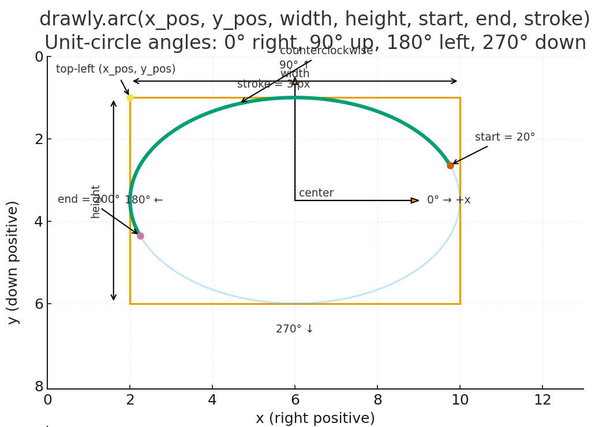
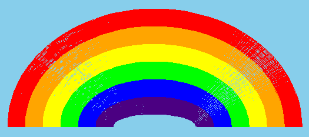
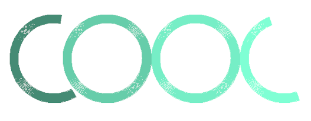

CS1400 - Thursday, January 22 - Lecture 6 - Module 1

# Topics:
* [🟥Assn 1b - Faceinator](#assn-1b---faceinator)
* [Tip: Speed-Run Testing Interactive Programs](#tip-speed-run-testing-interactive-programs)
* [How `drawly.arc` Works](#how-drawlyarc-works)
* [Code Lab Challenge 0 - Drawly Arc Rainbow](#code-lab-challenge-0---drawly-arc-rainbow)
* [Code Lab Challenge 1 - Drawly Arc COOL Logo](#code-lab-challenge-1---drawly-arc-cool-logo)

------------------------------------------------------------
# Announcements

## *THIS WEEKEND* Cache Tech Community - RAM Fundamentals & Community Projects Showcase

In this presentation, you'll learn about the fundamentals of how RAM works, why we use it, and how systems depend on it. We will also have a community project showcase where our community members are invited to showcase their personal projects! Projects can be anything that interests you and is related to technology!

*   **When**  1:30-3:30 PM Saturday, January 24th
*   **Where** Bridgerland Technical College, West Building, Room 1860, 1410 N 1000 W, Logan, UT 84321
*   **Discord** https://discord.gg/YNkqmVGZbS

https://www.cachevalley.co/posts/cache-tech-community-ram-fundementals-community-projects-showcase-january-2026/

## Global Game Jam 2026

**It's free!**  Plus, **we'll feed you!**

*   **When**  Friday, January 30th - Saturday January 31st
*   **Where** Merrill-Cazier Library
*   **Register** https://engineering.usu.edu/cs/game-jam/2026-ggj

# Action Items

*   Erik has office hours today from 1 PM to 4 PM
    -   Find me in SER 301E or on [Zoom](https://usu-edu.zoom.us/my/erik.falor?pwd=ZE4zNXRpNVl4VVhHNkN5Q2wwV3VrUT09)

# [🟥Assn 1b - Faceinator](https://usu.instructure.com/courses/794745/assignments/5122782)

| Task/Day           | **Thursday**       | **Friday**                                                     | **Saturday** | **Sunday**                             | **Monday**                          |
| ------------------ | ------------------ | -------------------------------------------------------------- | ------------ | -------------------------------------- | ----------------------------------- |
| **Classroom Time** | Classroom Lab Time |                                                                |              |                                        | 2.1: Arithmetic                     |
| **Items Due**      |                    | Exercises 1.3.2, 1.4.3, 1.5.2, 1.5.3 Quizzes 1.4, 1.5, 1.6 |              | Assignment 1b Reflection Survey 1b | Code Reviews for  Assn 1b begin |

# Tip: Speed-Run Testing Interactive Programs

Testing your code is a vital part of programming.  It's where you can "check" whether or not the computer understands what you wrote.  But testing interactive programs is slow because you need respond to your program's every request for input.  Sometimes, your tests demand that you give specific responses - if you type something wrong the test is invalid and must be re-done.  The longer the turn-around time between changing your program and seeing its results the less fun programming becomes.

-   Instead of writing answers to `input()` or `drawly.terminal_input()` each time, comment those lines out and use hard-coded values
-	Then you get to see the interesting part of your test immediately!
-   Don't forget to restore interactivity before submitting your work

*Demonstrate with the [Bob Rossinator](./bob-rossinator.py) program*

# How `drawly.arc` Works

This function's docstring says this:

    Draw an elliptical arc within the rectangle that bounds the ellipse.

    The bounding rectangle is defined by its top-left corner (x_pos, y_pos)
    and its size (width, height).  The arc is drawn counterclockwise from
    `start` to `end`, where both angles are specified in degrees according to
    the unit circle convention from trigonometry: 0° points right along the
    x-axis, 90° points up the y-axis, and so on.

    Args:
        x_pos (int): X-coordinate of the rectangle's top-left corner.
        y_pos (int): Y-coordinate of the rectangle's top-left corner.
        width (int): Width of the bounding rectangle.
        height (int): Height of the bounding rectangle.
        start (int | float): Start angle in degrees.
        end (int | float): End angle in degrees.
        stroke (int): Line thickness in pixels (>= 1). Defaults to 1.

    Notes:
        Arcs are outlines only; there is no "filled" mode for arcs.

Here's a picture that shows what the parameters mean:

*forgive the formatting - this is AI-slop*

*Practice using [grid.py](./grid.py) as a guide*

# Code Lab Challenge 0 - Drawly Arc Rainbow

In this challenge you will draw a 6 color rainbow using Drawly arcs

*Note: Students with deeper programming experience can try the extra stretch challenges in Phase 4*

### Program Requirements

0.  Bands of color should be of **equal width** and should **touch** (i.e. no gaps between colors)
0.  There will be some missing pixels in your arc - this is a limitation of Drawly, don't worry about it!

### Phase 0 - Design It

Answer each of these questions in today's Wooclap:

0.  In what order should I draw the colors so none of them get covered up?
0.  How will the radius (or size) of each arc change as I move inward?
0.  How will thickness of each arc change as I move inward?
0.  Where should the center point of all arcs be so the rainbow looks symmetrical?

### Phase 1 - Pseudocode It

Using the answers to the above questions as your guide, write *pseudocode* as a block of comments in your program.  Start by describing the flow of the program in plain English.  Refine your pseudocode until it is as specific as Python code.

### Phase 2 - Build It

When your pseudocode is basically line-for-line equivalent to real Python code, rewrite each comment as code.

### Phase 3 - Reflect On It

Answer these debrief questions in comments in today's Wooclap:

0.  Did my pseudocode line up with the code I wrote, or did I change course while coding? Why?
0.  What numbers in my program feel "magic"?
    -   In programming, *magic number* is a value in a program whose purpose is not obvious just by looking at it
    -   If someone else read this code, which values would they not immediately understand?
0.  What was the hardest part to get visually correct, and how did I debug it without a compiler error telling me what was wrong?
0.  If my rainbow looks wrong (off-center, uneven bands, gaps), which specific line of code would I check first, and why?

### Phase 4 - Stretch Challenges

Did you finish early?  Was this still too easy for you?  Here are some more features to implement:

0.  Add a sun, clouds, or simple scenery using only shapes you already know.
0.  Gradually change the arc thickness so the rainbow tapers inward.
0.  Animate the rainbow drawing from outer arc to inner arc.
0.  Use *variables* instead of hard-coded magic numbers to position the arcs
    -   Use arithmetic to update the values of *variables* for each successive arc
0.  Increase the number of bands/colors in your rainbow

# Code Lab Challenge 1 - Drawly Arc COOL Logo

In this challenge you will re-create this *COOL* logo in an arc-based font

*Note: Students with deeper programming experience can try the extra stretch challenges in Phase 4*

### Program Requirements

0.  Paint each arc in a different color
    -   For your reference, the [Pygame colors list](https://www.pygame.org/docs/ref/color_list.html)
    -   My picture uses the colors `aquamarine1`, `aquamarine2`, `aquamarine3`, and `aquamarine4`
0.  All letters should be the **same size** (same arc width/height), so the word looks like one consistent "font"
0.  Use the **same stroke width** for every letter so the thickness matches across the whole logo
0.  Space the letters so they read clearly as **C O O L** (no overlapping, no huge gaps)

### Phase 0 - Design It

Answer each of these questions in today's Wooclap:

0.  What do the start/end angle numbers mean to `drawly.arc`?
0.  What arc angles will you use to make a **C** (a circle with a "missing bite")?
0.  What arc angles will you use to make an **L** (a circle with a different "missing chunk")?
0.  What values will be the same for every letter (size, stroke width, y-position), and what values must change for each letter?
0.  How much x-distance should there be between letters so they are evenly spaced?

### Phase 1 - Pseudocode It

Using the answers to the above questions as your guide, write *pseudocode* as a block of comments in your program.  Start by describing the flow of the program in plain English.  Refine your pseudocode until it is as specific as Python code.

### Phase 2 - Build It

When your pseudocode is basically line-for-line equivalent to real Python code, rewrite each comment as code.

### Phase 3 - Reflect On It

Answer these debrief questions in comments in today's Wooclap:

* Did my pseudocode line up with the code I wrote, or did I change course while coding? Why?
* Which number(s) did I tweak the most while debugging the look of the letters (angles, spacing, size, stroke)? Why those?
* What was the hardest letter to get "right" visually, and what was your debugging strategy when nothing was *technically* "wrong"?
* If you had to move the whole word 200 pixels to the right, how many places in your code would need to change right now?
* If you wanted the logo to say **COOL COOL** (twice), what part of your code would feel most repetitive?
* What is one improvement you could make to your code so future-you can change the design faster?

### Phase 4 - Stretch Challenges

Did you finish early?  Was this still too easy for you?  Here are some more features to implement:

0.  Create more glyphs using arcs and lines to write longer messages                                        
    -   Draw inspiration from [Michelle Langlo's Circle Font](https://luc.devroye.org/fonts-83045.html) 
0.  Put your "font" settings in variables (letter size, stroke width, letter spacing) so you can resize the entire logo by changing only a few lines
0.  Write a helper function like `draw_letter_C(x, y)` / `draw_letter_O(x, y)` / `draw_letter_L(x, y)` so your main program reads like a recipe
0.  Ask the user for the 4 colors to use (or randomly choose 4 colors), then draw the logo with those colors
0.  Center the word horizontally in the window, even if you change letter size or spacing
0.  Animate it: draw one letter at a time with a small pause so it "writes" itself onto the screen

