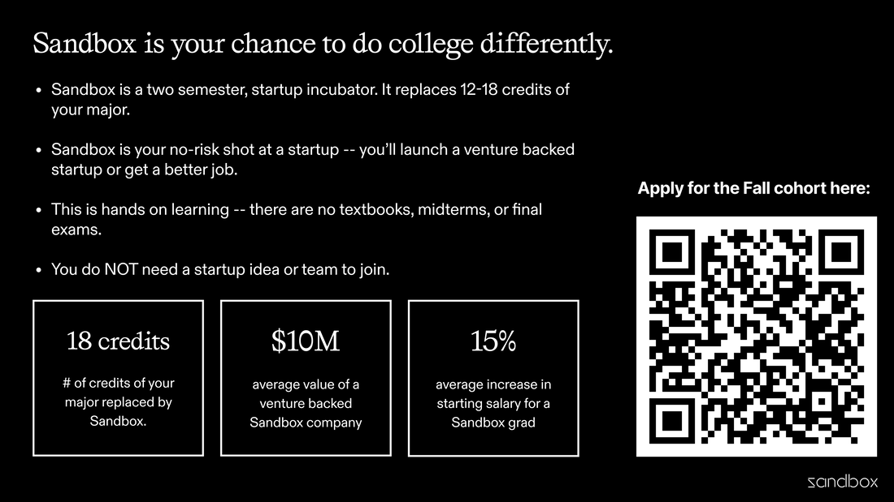

CS1400 - Thursday, January 29 - Lecture 8 - Module 2

# Topics:
* [🟥Assn 2a - Investments & Polygon Area](#assn-2a---investments--polygon-area)
* [Code Lab Challenge 0 - Average Height](#code-lab-challenge-0---average-height)
* [Code Lab Challenge 1 - Random Polka Dots](#code-lab-challenge-1---random-polka-dots)
* [Code Lab Challenge 2 - Python PRNG Bias](#code-lab-challenge-2---python-prng-bias)


------------------------------------------------------------
# Announcements

## Today's Office Hours Are Online-Only

I will be holding my office hours online today from 1 PM to 3 PM on https://usu-edu.zoom.us/my/erik.falor?pwd=ZE4zNXRpNVl4VVhHNkN5Q2wwV3VrUT09

-Erik


## *TODAY* Motorola Solutions


*   **When**  9 AM - 3 PM Thursday, January 29th
*   **Where** The Loop (SER 101 Lounge)

Representatives from Motorola Solutions are in the Loop today.  Stop by and learn about the company and what they do.

They are looking to fill Software Engineering internships, and are interested in CS students.


## *TOMORROW* Global Game Jam 2026

**It's free!**  Plus, **we'll feed you!**

*   **When**  Friday, January 30th - Saturday January 31st
*   **Where** Merrill-Cazier Library
*   **Register** https://engineering.usu.edu/cs/game-jam/2026-ggj


## Sandbox




# [🟥Assn 2a - Investments & Polygon Area](https://usu.instructure.com/courses/794745/assignments/5122783)


| Task/Day           | **Thursday**       | **Friday**                                                                | **Saturday** | **Sunday**                             | **Monday**                               |
| ------------------ | ------------------ | ------------------------------------------------------------------------- | ------------ | -------------------------------------- | ---------------------------------------- |
| **Classroom Time** | Classroom Lab Time |                                                                           |              |                                        | 2.4: Software Design <br/> 2.5: Booleans |
| **Items Due**      |                    | Exercises 2.1.2, 2.1.3, 2.2.3-a, 2.2.3-b, 2.3.1<br/>Quizzes 2.1, 2.2, 2.3 |              | Assignment 2a<br/>Reflection Survey 2a | Code Reviews for <br/>Assn 2a begin      |


# Code Lab Challenge 0 - Average Height

In this challenge you will solve a real-world task using only primitive methods.  I want you to feel the pain that motivates lists and loops.  You'll forgive me later (I hope).

### Phase 0 - Build a baseline

0.  Define 6 student variables that hold heights and compute the average.  Use this code:
    -   ```python
        student000 = 49
        student001 = 60
        student002 = 51
        student003 = 65
        student004 = 55
        student005 = 47
        ```
0.  Constraints:
    -   Use unique variable names
    -   Integer heights are in inches
    -   Compute the total in one line of code
        -   `total = student00 + student01 + ...`
    -   Compute the average as a float
    -   Identify the maximum and minimum heights
    -   Write one `print()` with a clear message like this: `There are N students with an average height of A; the maximum height is X and the minimum height is Y`
0.  Verify your program's calculations by hand to prove that your program got the right answer


### Phase 1 - Scale it up

0.  Add these 18 students to the program, using 18 new variables:
    -   58
    -   46
    -   60
    -   44
    -   56
    -   54
    -   47
    -   50
    -   52
    -   45
    -   51
    -   48
    -   66
    -   49
    -   64
    -   54
    -   60
    -   55
0.  You may introduce a `num_students` variable to help keep track of everyone
0.  Continue to compute the total in a single line of code
0.  Update the average, max, and min
0.  Can you find a way to write the call to `print()` such that you will not need to change it in the next phase?


### Phase 2 - Stress tests

0.  Rename `student007` to `bond007`
    -   Fix resulting errors
0.  Student #14 left early.
    -   Remove them, fix resulting errors, update `num_students`, and verify that your average, max, and min changed logically
0.  Print the average height both in inches *and* centimeters
    -   Use `cm = inches * 2.54`
0.  10 more students arrived late
    -   61
    -   62
    -   59
    -   52
    -   63
    -   44
    -   58
    -   56
    -   50
    -   53
    -   Time how long it takes you to add them to the program
    -   Track mistakes you make along the way
0.  Does your average land between the min and max values you identified?
    -   If not, why?

Answer each of these questions in today's Wooclap:

0.  What was hard about this program?
0.  Where did bugs appear most?
0.  Which code pattern kept repeating?
0.  Which feature would you ask Python for to remove the repetition?


### Phase 3 - It gets better

0.  Separate your program into a top and bottom half with a big comment line like `########################################`
0.  Copy the heights from the top half of the program to the bottom.
    -   Delete all of the variable names and create a list called `heights`
0.  Count the number of students by taking the length of `heights`
0.  Calculate the minimum and maximum heights with `max()` and `min()`
0.  Compute the sum of `heights` with `sum()`

Answer each of these questions in today's Wooclap:

0.  What was better about this half of the program?
0.  Which bugs does this version avoid?
0.  Explain in plain English how you imagine the functions `sum()`, `max()`, and `min()` work


# Code Lab Challenge 1 - Random Polka Dots

In this challenge you will create a generative art program that draws randomly placed polka dots. The real lessons are repetition, randomness, and why copy‑paste programming has a shelf life.


### Program Requirements

*Note: the background doesn't appear purely white in this image because windows are transparent on my computer*


0.  Make a list of color names that Drawly recognizes
    *   As a reminder: [Pygame named colors](https://www.pygame.org/docs/ref/color_list.html)
    *   You can also use colors of the form `"#DDAADD"`
1.  Import the `random` library
    *   Use the `randint(a, b)` function to pick X,Y coordinates and radii
        -   Pick lower and upper bounds that ensure the dots will appear on the screen and won't be too small to see
    *   Use `choice(lst)` to choose a color from the list
2.  Randomly choose dots'
    *   X, Y coordinates
    *   radii
    *   colors
3.  Draw dots on the screen one-at-a-time
    *   Use `set_speed()` to make the program go faster while testing

**Hint** once you write the code to draw one dot, copy & paste it 20 more times.  Soon you'll learn a better way to make a program repeat itself.


### Phase 0 - Design It

Answer each of these questions in today's Wooclap:

0. What should the user see when the program finishes running?
1. What values need to be random, and what bounds must they obey?
2. What information stays the same for every dot?
3. What steps are required to draw a single dot?
4. What would you need to change to draw *more* dots?


### Phase 1 - Pseudocode It

Using the answers above, write pseudocode that describes:

- Setting up the screen
- Choosing random values for one dot
- Drawing one dot
- Repeating the process until 21 dots exist

Your pseudocode should be specific enough that each line could be translated directly into Python.


### Phase 2 - Build It

Convert your pseudocode into working Python code.

Hints and constraints:

- Import the `random` module
- Use `randint(a, b)` for coordinates and radius
- Use `choice(colors)` to select a color
- Use `set_speed()` to speed up testing

Once you can draw one dot correctly, copy and paste the code until you have 21 dots.


### Phase 3 - Reflect On It

Answer each of these questions in today's Wooclap:

0. Which lines of code were identical across dots?
1. What kinds of mistakes appeared when copying and pasting?
2. How confident are you that all dots obey the same rules?
3. If the requirement changed to 100 dots, what would break first?
4. What feature of Python would you ask for to eliminate repetition?


### Phase 4 - Stretch Challenges

Did you finish early? Try one or more of these:

0. Store all colors in a list and reuse it cleanly
0. Replace copy‑paste dots with a loop
0. Prevent dots from overlapping
0. Randomize the number of dots each run
0. Animate dots appearing one at a time


# Code Lab Challenge 2 - Python PRNG Bias

*Note: This is a stretch task for students with deeper programming experience*

Is Python's pseudo-random number generator (PRNG) unbiased?  *They* certainly think it is.

> Python uses the Mersenne Twister as the core generator. It produces 53-bit precision floats and has a period of `2**19937-1`. The underlying implementation in C is both fast and threadsafe. The Mersenne Twister is one of the most extensively tested random number generators in existence.

**Your challenge: prove them wrong (or right)**


### Program Requirements

Create a Python program that counts how many times the numbers `0..99` are chosen at "random" and draw a live, normalized histogram as the simulation runs.


*Note: the colors may appear funny in this screengrab because windows are transparent on my computer*

0.  Use constants to make features such as the update frequency, maximum iteration count, and canvas size easy to change
0.  Create a list `slots` of length 100 initialized to zeros
0.  On each iteration, choose a slot index at random and increment it
    -   Pick a slot with `random.randint()`
0.  Every 10,000 iterations, redraw the histogram
    -   Normalize bar heights so bars always fit within the window height
        -   use `MAX = max(slots) or 1` so you can scale heights by `height * (count / MAX)`
    -   Draw the current iteration count on the window in a color that stands out against the bars and background
    -   Print timing info for progress to the terminal (use `time.time()` to track how long the program has been running)
0.  At the end, report the total duration, `min(slots)`, and `max(slots)`


### Phase 0 - Design It

Answer each of these questions in today's Wooclap:

0. What should the histogram communicate to a human observer?
0. What data must be tracked as the simulation runs?
0. How often should the visualization update, and why?
0. What does “normalized” mean in this context?
0. What evidence would convince you the generator is biased?


### Phase 1 - Pseudocode It

Using your design answers, write pseudocode that describes:

- Initializing counters
- Running the simulation loop
- Updating counts
- Redrawing the histogram periodically
- Reporting final statistics

Your pseudocode should clearly separate *simulation*, *visualization*, and *reporting*


### Phase 2 - Build It

Convert your pseudocode into Python code.

Implementation constraints and hints:

- Use constants for window size, update frequency, and iteration count
- Initialize a list `slots` of length 100 with zeros
- Choose a random index using `random.randint()`
- Every fixed number of iterations:
  - Normalize bar heights using the current maximum count
  - Redraw the histogram
  - Display the iteration count
  - Print timing information to the terminal
- At program end, print total runtime, `min(slots)`, and `max(slots)`


### Phase 3 - Reflect On It

Answer each of these questions in today's Wooclap:

0. How noisy were early results compared to later ones?
0. What patterns appeared as the iteration count increased?
0. Did visualization frequency affect your interpretation?
0. What limits does this experiment have as “proof”?
0. What would a truly biased histogram look like?


### Phase 4 - Stretch Challenges

Did you finish early?  Was that still too easy for you?  Here are some more features to implement:

0.  Test different RNG distributions. Replace the `randint()` slot choice with:
    -   `random.triangular(low, high, mode)`
    -   `random.gauss(mu, sigma)`
    -   `random.uniform(a, b)`
    -   `random.betavariate(alpha, beta)`
    -   `random.expovariate(lambd)`
    -   For the `triangular` and `gauss` distributions, choose parameters so most mass falls inside `[0, 100)`
0.  Map the sampled real value to an integer slot index `[0..99]` and compare shapes
    -   For real-valued RNGs, map to slots with clamping:
    -   ```python
        idx = int(random_value * 100.0)
        idx = max(0, min(99, idx))
        ```
0.  Compare two distributions side-by-side
    -   Run two simulations back-to-back and redraw with two colors, or in alternating passes, to see the shape change over time
0.  Stability check - after the last update, overlay a normalized "expected shape" curve for the chosen distribution
0.  Add a CLI flag or constant to set `random.seed(...)` for reproducible runs


