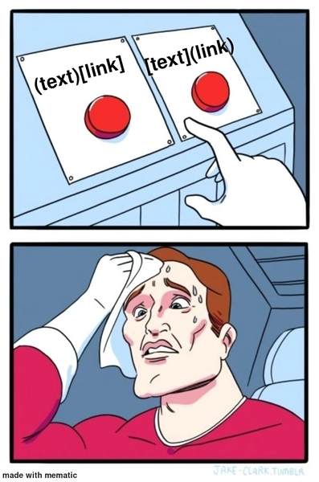

CS1400 - Tuesday, February 03 - Lecture 9 - Module 2

# Topics:
* [Assn 2b - What Kind of Aggie & Superhero Decisions](#assn-2b---what-kind-of-aggie--superhero-decisions)
* [The Markdown Markup Language](#the-markdown-markup-language)
* [Code Lab Challenge 0 - Compare All The Things](#code-lab-challenge-0---compare-all-the-things)
* [Code Lab Challenge 1 - Software Design: Shape Comparison Labels](#code-lab-challenge-1---software-design-shape-comparison-labels)
* [Code Lab Challenge 2 - Non-Overlapping Polka Dots](#code-lab-challenge-2---non-overlapping-polka-dots)


------------------------------------------------------------
# Announcements

## *TODAY* First Tuesday Thing

*   **When**  11:30 AM Tuesday, February 3rd
*   **Where** The Loop Lounge SER 101

Pizza and a Computer Science themed game of bingo.

Come and hang out with your CS peers! 


## *TOMORROW* Sandbox Info Session

*   **When**  5:00 PM Wednesday, February 4th
*   **Where** ENGR 108

Sandbox is a program that fits inside your major where some of you will have the opportunity to do school differently.

Admitted students will spend 12-18 credits over two semesters launching real tech companies on small teams. It should be noted that only 50 students will be admitted into the program, so if you're interested, [apply here](https://sandbox.ing/auth/join?redirect=/app/admissions/new/0) ASAP and come to our info session later today.

You don't need to have a team, an idea, or even consider yourself an entrepreneur to get into Sandbox, but you do need to be motivated, creative, and ambitious. Sandbox is for anyone, but it is not for everyone.

Watch [this video](https://youtu.be/4_jLg7BCfDA) or visit our [website](https://sandbox.ing/universities) for more information.


## Participants Wanted for Research Study

A research study is being conducted on **programming activity, time awareness, and self-regulation** among students enrolled in **CS1400: Introduction to Programming (Python)** during the **Spring 2026** semester (IRB protocol #15751).

This study examines whether **mere awareness of programming activity metrics,** presented through a minimal and non-intrusive interface, influences students' programming behavior and time awareness. The study evaluates DevRhythm, a lightweight PyCharm plugin that passively logs coding activity and displays a real-time status-bar indicator of active versus idle engagement without interrupting students' workflow. Researchers will analyze **usage logs from the ShowYourWork and DevRhythm PyCharm plugins**, along with responses from brief **post-assignment surveys** and a **post-study survey**, to better understand students' perceptions of time-on-task and engagement while programming.

To participate, you must be **18 years of age or older**. Participation is voluntary. To participate in the study, please review and sign the informed consent form at the link below. Signing the consent form gives researchers permission to use plugin usage logs and survey responses for research purposes. Post-assignment surveys take approximately **2 minutes**, and the post-study survey takes approximately **5 minutes**.

You will receive **15 points of extra credit** for responding to the consent form. The consent form includes an option to **decline participation**, and students who decline will still receive the extra credit.

If you have questions about the study, you may contact **Dr. John Edwards (john.edwards@usu.edu)**.

**Consent form link:** https://usu.co1.qualtrics.com/jfe/form/SV_dnyFsVZdhkNMryu


# Action Items

##  Canvas lesson to study before our next code lab on Thursday, Feb 5

*   2.6: Conditionals


# [Assn 2b - What Kind of Aggie & Superhero Decisions](https://usu.instructure.com/courses/794745/assignments/5122784)

*   This assignment has two tasks
*   Read the instructions *carefully*, but also look at the **rubric**
    *   Use the rubric as a checklist so you don't miss important requirements
*   Beginning with this assignment your **software design plan** carries much more weight
    -   In addition to the 5 point rubric items with titles like *Task 1: Software Development Design*, we will grade your design on the rubric items titled *Code Review: Describe solution in plain English*.
    -   If your plan document is lacking, you will get a **0** on that item.
*   This assignment is due **at 11:59 PM on Sunday, February 8th**


## Task 1 - What Kind of Aggie Are You?

This is a number guessing game. The computer will generate a random number from 1-10 (inclusive). The user will guess a number. You will print different messages depending on how close the guess was.

*   This is a *console* program.
*   Put your code in a file called `task1.py` and your software development plan as `design1.md`
*   You will use knowledge from these sections of Unit 2
    *   **2.4: Software Design**
    *   **2.5: Booleans**
    *   **2.6: Conditionals**


## Task 2 - Superhero Decisions

This program helps a Superhero make their decision on how to best fight. Based on the input used to design the Superhero, you will help them determine if they should punch, kick, use a sword, or shout with their thunder voice.

*   This is a *Drawly* program that also uses the *console* to take input from the user.
*   Put your code in a file called `task2.py` and your software development plan as `design2.md`
*   This task relies on the same knowledge as the previous task


| Task/Day           | **Tuesday**        | **Wednesday**     | **Thursday**       | **Friday**                                                     | **Saturday** | **Sunday**                             | **Monday**                                 |
| ------------------ | ------------------ | ----------------- | ------------------ | -------------------------------------------------------------- | ------------ | -------------------------------------- | ------------------------------------------ |
| **Classroom Time** | Classroom Lab Time | 2.6: Conditionals | Classroom Lab Time |                                                                |              |                                        | 3.1: Pickups I <br/> 3.2: Logic Operations |
| **Items Due**      |                    |                   |                    | Exercises 2.5.2, 2.6.1, 2.6.3, 2.6.5<br/>Quizzes 2.4, 2.5, 2.6 |              | Assignment 2b<br/>Reflection Survey 2b | Code Reviews for <br/>Assn 2b begin        |


# The Markdown Markup Language


Markdown is a lightweight markup language for creating formatted text using a plain-text editor.  It was created by John Gruber and Aaron Swartz in 2004.  It has become a popular format for writing documentation for code.

*   A *markup language* describes the appearance of a rich document only using plain text.
    *   A *rich document* presents text using different fonts, colors and styles, and possibly includes images and other multi-media elements
        *   e.g. a Word document or a webpage
*   HTML is a common markup language, but is hard to read in its raw form
    *   Markdown aims to produce documents that are readable to humans in their raw form, and simple to convert into HTML.

This document describes everything you need to know to write Markdown according to DuckieCorp standards. While Markdown does have additional features, you need only use what is described here. For those who are curious, you will find some links at the end of this document for further exploration.

*You will notice that content is duplicated in the sections that follow.  This is intentional!  After a Markdown feature is demonstrated it is followed by a text block that shows what the source code looks like.*


## Table of Contents
*   [Headers](#headers)
*   [Paragraphs](#paragraphs)
*   [Pre-formatted Code Blocks](#pre-formatted-code-blocks)
*   [Tables](#tables)
*   [Lists](#lists)
*   [Checkboxes](#checkboxes)
*   [Hyperlinks](#hyperlinks)
*   [Images](#images)
*   [Markdown Hints](#markdown-hints)
*   [More Resources](#more-resources)


## Headers

*   Begin a line of text with consecutive `#` to introduce a header.
*   Markdown defines six (6) levels of header, using from 1 to 6 `#`'s
    *   Lower level headers are presented in smaller fonts

# This is a level 1 Header
## This is a level 2 Header
### This is a level 3 Header
#### This is a level 4 Header
##### This is a level 5 Header
###### This is a level 6 Header

```
# This is a level 1 Header
## This is a level 2 Header
### This is a level 3 Header
#### This is a level 4 Header
##### This is a level 5 Header
###### This is a level 6 Header
```


## Paragraphs

Consecutive lines of text are formed into paragraphs.
Lines of text in paragraphs can be as long
or as short
as
you
want.

Indentation
    is not preserved
        by paragraphs.
            The text is automatically
                re-flowed
            to fit
        the width
    of the
window.

Separate paragraphs from one another with blank lines.

Inside paragraphs you can write **bold text** by surrounding words with two asterisks, `**`.
_Italicized text_ is surrounded by single underlines `_`.
~~Struck through text~~ is surrounded by double tildes `~~`.
A `code span` is created by surrounding text with a back-tick `` ` ``
(**_Hint_**: back-tick shares the same key as `~`).

```
Consecutive lines of text are formed into paragraphs.
Lines of text in paragraphs can be as long
or as short
as
you
want.

Indentation
    is not preserved
        by paragraphs.
            The text is automatically
                re-flowed
            to fit
        the width
    of the
window.

Separate paragraphs from one another with blank lines.

Inside paragraphs you can write **bold text** by surrounding words with two asterisks, `**`.
_Italicized text_ is surrounded by single underlines `_`.
~~Struck through text~~ is surrounded by double tildes `~~`.
A `code span` is created by surrounding text with a back-tick `` ` ``
(**_Hint_**: back-tick shares the same key as `~`).
```


## Pre-formatted Code Blocks

Unlike paragraphs, pre-formatted code blocks preserve your indentation and spacing *exactly*.

The following is intentionally redundant; first you will see an example of a code block followed by a code block that shows how I made the code block.

```
Pre-formatted
    blocks
        of
            text
        (i.e. code blocks)
            Are made by indenting a block of text by four spaces,
                or fencing a block of text with triple back-ticks ```
            or with triple tildes ~~~

A fence is a line that starts with and contains only 3 of the same character:

~~~
For example,
I'm surrounded by a fence of triple tildes
~~~
```


    ```
    Pre-formatted
        blocks
            of
                text
            (i.e. code blocks)
                Are made by indenting a block of text by four spaces,
                    or fencing a block of text with triple back-ticks ```
                or with triple tildes ~~~

    A fence is a line that starts with and contains only 3 of the same character:

    ~~~
    For example,
    I'm surrounded by a fence of triple tildes
    ~~~
    ```

Here is another example:

    Another way to form a code block in Markdown
    is to indent a paragraph by four spaces.


```
    Another way to form a code block in Markdown
    is to indent a paragraph by four spaces.
```


If GitLab knows about your programming language, it can present code with
**syntax highlighting**.  Write the name of the programming language
immediately after the opening triple-backquote, like this: `` ```python ``.

```python
# you can even
def code_blocks(with, programming, language, syntax, highlighting)
    """
    by writing the name of the programming language
    after the first triple-character fence
    """
    if this == pretty_cool:
        return True
```

    ```python
    # you can even
    def code_blocks(with, programming, language, syntax, highlighting)
        """
        by writing the name of the programming language
        after the first triple-character fence
        """
        if this == pretty_cool:
            return True
    ```


## Lists

*   Bulleted
*   lists
    *   may contain
    *   indented
    *   sub-lists
-   Items are prefixed with such characters as:
    *   `*` asterisks
    +   `+` plus Signs
    -   `-` minus Signs

```
*   Bulleted
*   lists
    *   may contain
    *   indented
    *   sub-lists
-   Items are prefixed with such characters as:
    *   `*` asterisks
    +   `+` plus Signs
    -   `-` minus Signs
```


0.  Ordered
0.  lists
    *   may also contain
    *   indented
    *   sub-lists
    *   bulleted or ordered are both okay
0.  List items begin with...
    1.  ...digits, followed by a period `.`
    2.  It doesn't matter which digit prefixes items at the top-level of the list
    3.  But numbered sub-lists must begin at `1.`


```
0.  Ordered
0.  lists
    *   may also contain
    *   indented
    *   sub-lists
    *   bulleted or ordered are both okay
0.  List items begin with...
    1.  ...digits, followed by a period `.`
    2.  It doesn't matter which digit prefixes items at the top-level of the list
    3.  But numbered sub-lists must begin at `1.`
```


## Task Lists

*   [X] A bulleted or numbered list becomes a **task list** when the first item after the list marker is a pair of *square brackets* containing a space ` `, `x` or tilde `~`
    *   [ ] *Incomplete* tasks are an empty pair of square brackets with a space in between `[ ]`
    *   [X] *Completed* tasks are a pair of square brackets with an `X` in between `[X]`
    *   [~] A cancelled or *inapplicable* task is a pair of square brackets surrounding a tilde `[~]`
*   [ ] Task lists appear in the Software Development Plan to help you keep track of important tasks
*   [X] These checkboxes are a *special feature* in GitLab
    *   [ ] Not every Markdown system recognizes task lists

```
*   [X] A bulleted or numbered list becomes a **task list** when the first item after the list marker is a pair of *square brackets* containing a space ` `, `x` or tilde `~`
    *   [ ] *Incomplete* tasks are an empty pair of square brackets with a space in between `[ ]`
    *   [X] *Completed* tasks are a pair of square brackets with an `X` in between `[X]`
    *   [~] A cancelled or *inapplicable* task is a pair of square brackets surrounding a tilde `[~]`
*   [ ] Task lists appear in the Software Development Plan to help you keep track of important tasks
*   [X] These checkboxes are a *special feature* in GitLab
    *   [ ] Not every Markdown system recognizes task lists
```


## Markdown Hints & More Resources

*   Paragraphs must be separated from each other with *blank* lines.
    *   If your paragraphs run together, add extra blank lines in between.
    *   Most Markdown formatting errors can be fixed by adding extra blank lines.
*   **Do not** write Markdown directly in GitLab's Web IDE.
    *   Although GitLab has a preview feature, it creates problems when syncing your code between the server and your computer.
    *   PyCharm and VS Code can display a live preview of Markdown files.
        *   If you want to see what your Markdown files will look like as you write, this is the best way to go.
        *   Be aware that some of GitLab's special Markdown extensions will not look the same in your IDE's previewer
*   [The Markdown Guide](https://www.markdownguide.org/) a free and open-source reference guide
*   [GitLab Flavored Markdown](https://gitlab.cs.usu.edu/help/user/markdown.md) describes how Markdown works on this site
*   [Markdown on John Gruber's Blog](https://daringfireball.net/projects/markdown/) straight from the horse's mouth


## Optional Markdown Elements

These formatting elements are not _necessary_ for writing software plans in this course, but may be of interest to some.
I include these for informational purposes only. You are not required to incorporate these into your documentation.


### Tables

| Tables | with     | columns |
|--------|----------|---------|
| can    | be       | made    |
| with   | pipes,   | spaces, |
| and    | a        | lot     |
| of     | patience | !       |
| The    | important| thing   |
| is     | that     | the     |
| line   | following| the     |
| header | consists | of      |
| dashes


```
| Tables | with     | columns |
|--------|----------|---------|
| can    | be       | made    |
| with   | pipes,   | spaces, |
| and    | a        | lot     |
| of     | patience | !       |
| The    | important| thing   |
| is     | that     | the     |
| line   | following| the     |
| header | consists | of      |
| dashes
```


### Hyperlinks

[Hyperlinks](https://developer.mozilla.org/en-US/docs/Learn/Common_questions/What_are_hyperlinks) are an important feature of the [World Wide Web](https://developer.mozilla.org/en-US/docs/Glossary/World_Wide_Web).  These are written in two parts:

0.  Surround the text of the link with square brackets `[]`
1.  Surround the address in parentheses `()`
2.  All together, it looks like this:
    *   Syntax: `[link text](URL)`
    *   Example: `[hyperlink example](http://example.com/)`
3.  And works like this: [hyperlink example](http://example.com/)

```
[Hyperlinks](https://developer.mozilla.org/en-US/docs/Learn/Common_questions/What_are_hyperlinks) are an important feature of the [World Wide Web](https://developer.mozilla.org/en-US/docs/Glossary/World_Wide_Web).  These are written in two parts:

0.  Surround the text of the link with square brackets `[]`
1.  Surround the address in parentheses `()`
2.  All together, it looks like this:
    *   Syntax: `[link text](URL)`
    *   Example: `[hyperlink example](http://example.com/)`
3.  And works like this: [hyperlink example](http://example.com/)
```


### Images

Images are like hyperlinks that start with a `!`.

1.  Within the square brackets `![]` write the alt-text for the image
    *   The *alt-text* is shown when the image cannot be loaded or displayed
2.  Write the address of the image surrounded by parentheses `()`
    *   **Optional** within the parentheses you may also write a *title* for the image as a quoted string
    *   The *title* is the text shown when your mouse hovers over the image
3.  All together, it looks like this:
    *   Syntax: ``
    *   Example: ``
4.  ...And works like this:
    *   

```
Images are like hyperlinks that start with a `!`.

1.  Within the square brackets `![]` write the alt-text for the image
    *   The *alt-text* is shown when the image cannot be loaded or displayed
2.  Write the address of the image surrounded by parentheses `()`
    *   **Optional** within the parentheses you may also write a *title* for the image as a quoted string
    *   The *title* is the text shown when your mouse hovers over the image
3.  All together, it looks like this:
    *   Syntax: ``
    *   Example: ``
4.  ...And works like this:
    *   
```


*Updated Tue Feb  3 2026*


# Code Lab Challenge 0 - Compare All The Things

In this challenge you will use all six comparison operators correctly on numbers and strings.

### Phase 0 - Build It

0.  Read two words from the user and store in a list called `words`
0.  Read two integers from the user and store in a list called (you guessed it) `not_words` 
0.  Print results for `<`, `<=`, `>`, `>=`, `==`, `!=` on both pairs

Example run:

```
Enter your first word: hello
Enter your second word: world
Enter your first number: 13
Enter your second number: 37

"hello" > "world" is False
"hello" >= "world" is False
"hello" < "world" is True
"hello" <= "world" is True
"hello" == "world" is False
"hello" != "world" is True

13 > 37 is False
13 >= 37 is False
13 < 37 is True
13 <= 37 is True
13 == 37 is False
13 != 37 is True
```


### Phase 1 - Break It

Write notes about your results in Wooclap.

0.  Enter the same word, once in lowercase and again in UPPERCASE
    -   Try "cat" and "CAT" - how does Python seem to make the comparison?
    -   What about different MiXtUrEs of CAseS?
0.  When your program prompts for words, enter digits
    -   For example, try `100` and `99`
0.  Change the program to convert numbers to floats
    -   Does this make any difference to the comparisons?
0.  Change the program to compare one of the `words` with one of the `not_words`
    -   Which comparisons work?
    -   Which comparisons don't work?
    -   When a comparison doesn't work, what happens to the program?
0.  If you didn't already do this accidentally, change your program by replacing one of the `==` with `=`.  Note what happens.


### Phase 2 - Reflect

Answer these debrief questions in Wooclap

0.  Did I use all six comparison operators correctly?
0.  What type of result do the comparison operators produce?
0.  Which results matched my intuition, and which perplexed me?
0.  Did I ever accidentally confuse `=` with `==`?  If this ever happens (again), how would I be able to tell?
0.  Did changing numbers to floats change any comparison results?
0.  How does Python decide the result when comparing two strings?
0.  Why did "cat" and "CAT" compare as they did?
0.  Why is "100" < "99" True?
0.  What happened when comparing a string with a number?
0.  How can I use type conversion (`int()`, `float()`, `str()`) to make comparisons meaningful?


# Code Lab Challenge 1 - Software Design: Shape Comparison Labels

Every successful project begins with a plan.  Jumping into a program before giving it much thought is a recipe for frustration.  Before the code is written it must first be **designed**

In this class you will engage in a very simplistic form of software design.  This will be added to in future courses, but for now your goal is to establish good habits that will set you up for success in the future.

You will take your first steps on your software design journey by asking yourself these questions when you start a new program:

0.  What is the user experience?
1.  How do I get the necessary data?
2.  What do I need to process and calculate?
3.  How am I going to process and calculate?
4.  What do I need to display as results?


### Program Requirements

0.  Create a Drawly window that fits your screen
0.  Prompt the user for the radii of three circles (named A, B, and C) and store these in a list
0.  Prompt the user for three different colors and store these in a list
0.  You (the programmer) decide where the centers of these circles lie
0.  Draw all three circles in 5 steps such that the circles appear to grow out from the center
    -   At every step each circle grows by 1/5th until they reach their full size
0.  Each circle is drawn in its own color
0.  Write the message "Circle X has radius ###" in this circle's color beneath the circle
0.  Create another list, and fill it with strings that contain messages like this: `It is [True/False] that Circle X is larger than Circle Y`, filling in the blank [True/False] as appropriate
    -   Compare all three circles to each other
    -   Use `str()` to convert a Boolean value into a String
0.  Set the color to black before writing the final messages near the bottom of the screen


### Phase 0 - Design It

Answer these questions in Wooclap:

0.  What is the user experience?
1.  How do I get the necessary data?
2.  What do I need to process and calculate?
3.  How am I going to process and calculate?
4.  What do I need to display as results?


### Phase 1 - Pseudocode It

Using the answers to the above questions as your guide, write *pseudocode* as a block of comments in your program.  Start by describing the flow of the program in plain English.  Refine your pseudocode until it is as specific as Python code.


### Phase 2 - Build It

When your pseudocode is basically line-for-line equivalent to real Python code, rewrite each comment as code.


### Phase 3 - Reflect On It

Answer these debrief questions in Wooclap:

0.  What coding problems did I foresee while writing the pseudocode?
0.  What problems did I *not* foresee in the pseudocode, but only discovered when writing Python code?
    *   How can I change my approach to pseudocode to catch these kinds errors sooner?
0.  Did my pseudocode match the final code line-for-line? Where did it drift?
0.  How did I choose circle centers so labels never overlap shapes?
0.  Are radii-comparison messages correct for all A/B/C orderings?
0.  Did any string say "True/False" when the geometry on screen visually disagreed? Why?
0.  If I added a fourth circle, what's the smallest edit needed to keep the program correct?


# Code Lab Challenge 2 - Non-Overlapping Polka Dots

*Note: This is a stretch task for students with deeper programming experience*

Do you remember this program from last time?


Your challenge today, if you choose to accept it, is to re-create this program with some restrictions.

### Program Requirements

*   Create a Drawly window on a white background.
*   Continually place random polka dots on the screen for as long as the Drawly window stays open
    -   Each dot has a randomly chosen
        -   center coordinate
        -   radius in the range `[3..600]`
        -   color (anything except `white` or `#FFFFFF`)
*   Dots must stay fully on screen: a dot's edge **cannot** cross the canvas boundary.
*   Ensure that no two dots overlap each other **or** cross the screen's edge.
    -   Detect dot overlap with geometry: distance between centers vs. sum of radii.
    -   Detect screen crossings when a dot's `center + radius` is greater than the screen dimensions or dot's `center - radius` is less than 0.
    -   When an overlap/crossing is detected, throw the dot out and re-roll new random attributes.
*   Speed up or slow-down the program by adjusting `drawly.set_speed()`.

Once a shape has been drawn, Drawly loses all track of it.  It is up to you to remember the vital facts about each dot that is on the screen.  The design details are yours: data structures, control flow, and function boundaries are up to you.


### Phase 0 - Design It

Answer these questions in Wooclap:

0.  What is the user experience?
1.  How do I get the necessary data?
2.  What do I need to process and calculate?
3.  How am I going to process and calculate?
4.  What do I need to display as results?


### Phase 1 - Pseudocode It

Using the answers to the above questions as your guide, write *pseudocode* as a block of comments in your program.  Start by describing the flow of the program in plain English.  Refine your pseudocode until it is as specific as Python code.


### Phase 2 - Build It

When your pseudocode is basically line-for-line equivalent to real Python code, rewrite each comment as code.


### Phase 3 - Reflect On It

Answer these debrief questions in Wooclap:

0.  What invariant guarantees non-overlap? Where is it enforced?
0.  What data structure did you use to store placed dots? Why that one?
0.  Where did most rejects come from: too large radius, crowded area, or boundary checks?
0.  Did you validate "fully on screen" before or after the overlap test? Why?
0.  What is the Big-O of your overlap detection per placement? How many comparisons per dot?
0.  If N doubles, what breaks first: runtime, readability, or parameter choices?
0.  Which single constant gives you the best control over difficulty: N, max radius, or attempt limit?
0.  If two functions had to survive a refactor, which and why?
0.  What is one bug you hit and the test you'd keep to prevent it from returning.


### Phase 4 - Stretch Challenges

Did you finish early?  Was this still too easy for you?  Here are some more features to implement:

*   Show real-time stats on the Drawly screen or in the terminal
    -   Current # of placed dots
    -   Current # of rejected attempts
    -   The min/max/avg radius
*   Randomly generate `#RRGGBB` colors
    -   Ensure that no color is re-used
*   CLI parameters: accept `N`, `min_radius`, and `max_radius`, from the command line, and provide defaults.
    -   Seed control: add `--seed S` for reproducible layouts. Print the seed used.
*   Adaptive retries: instead of re-rolling a dot, shrink its max radius slightly after `X` consecutive rejects to help packing finish.


