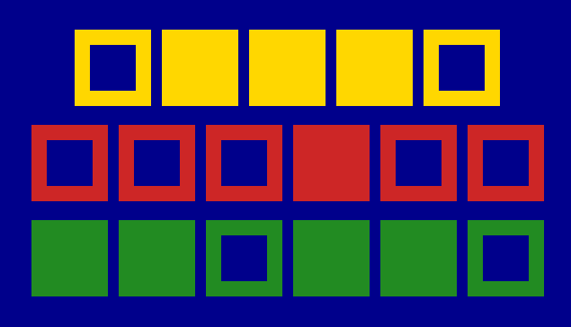

CS1400 - Thursday, February 12 - Lecture 12 - Module 3

# Topics:
* [🟥Assn 3a - Fronkian & Doofenlittle](#assn-3a---fronkian--doofenlittle)
* [Code Lab Challenge 0 - Constants and Objects](#code-lab-challenge-0---constants-and-objects)
* [Code Lab Challenge 1 - Object-Oriented Gossip Hour](#code-lab-challenge-1---object-oriented-gossip-hour)
* [Code Lab Challenge 2 - Drawly Binary Clock](#code-lab-challenge-2---drawly-binary-clock)


------------------------------------------------------------
# Announcements

## FSLC - Get Nix'ed Up With NixOS

*   **When**    6:30 PM Tuesday, Feb 17th
*   **Where**   WIDT 007
*   **Website** https://linux.usu.edu/event/a74c51b4-f66a-40a4-8230-5ca49da8bb42
*   **Discord** https://discord.gg/PvgG6N2hsU

What happens when you cross theoretically awesome functional programming with your entire computer? Let's just say you might get a bit Nix'ed up. In this meeting we dive into what it means to have a truly reproducible system and leverage the power of lazy pure evaluation. We're diving head first into the Nix programming language, Nix the package manager, and NixOS itself.


## HackUSU 2026

HackUSU is Utah's largest collegiate 24-hour innovation challenge and hackathon. Participants create innovative applications while networking with industry professionals and attending educational workshops.

*   **When**  February 27th-28th, 2026.
*   **Where** Huntsman Hall
*   [**Registration**](https://huntsman.usu.edu/hackusu/) is open to all college students and high school seniors.
    *   Register with the code `USU26` to save $5!


# Action Items

*   I have office hours today from 2 PM to 4 PM
    -   Find me in SER 301E or on [Zoom](https://usu-edu.zoom.us/my/erik.falor?pwd=ZE4zNXRpNVl4VVhHNkN5Q2wwV3VrUT09)


# [🟥Assn 3a - Fronkian & Doofenlittle](https://usu.instructure.com/courses/794745/assignments/5122785)


| Task/Day           | **Thursday**       | **Friday**                                                                       | **Saturday** | **Sunday**                             | **Monday**                       | **Tuesday**                         |
| ------------------ | ------------------ | -------------------------------------------------------------------------------- | ------------ | -------------------------------------- | -------------------------------- | ----------------------------------- |
| **Classroom Time** | Classroom Lab Time |                                                                                  |              |                                        | 3.4: While Loops                 |                                     |
| **Items Due**      |                    | Exercises 3.1.1, 3.1.3, 3.1.5, 3.1.6, 3.2.1-a, 3.2.1-b<br/>Quizzes 3.1, 3.2, 3.3 |              | Assignment 3a<br/>Reflection Survey 3a | Campus closed for Presidents Day | Code Reviews for <br/>Assn 3a begin |


# Code Lab Challenge 0 - Constants and Objects

Here is a version of the Superhero Decisions game that I saw in a Code Review. It works, but it leaves something to be desired.

The programmer used one list to hold all of the facts about the superhero instead of creating eight different variables. The list is of the form `[name, body size, x, y, arm_length, leg_length, sword_length, voice power]`.

This approach has the drawback that the programmer needs to keep track of *which list index* corresponds to *which hero fact*.


<details>
<summary><h3>Click to reveal the starter code</h3></summary>

```python
import drawly
import math

print("Welcome to Superhero Decisions")
print("For the Superhero enter...")

# The format of the list is [name, body size, x, y, arm_length, leg_length, sword_length, voice power]
the_hero=[]

the_hero.append(input("Name? "))
the_hero.append(int(input("Body size? ")))
the_hero.append(int(input("X location? ")))
the_hero.append(int(input("Y location? ")))
the_hero.append(int(input("Arm length? ")))


#this statement will check to ensure the legs are longer then the arms.
leg_length=int(input("Leg length? "))
if leg_length < the_hero[4]:
    print("The Superhero's legs can't be shorter than their arms")
    the_hero.append(int(input("Leg length? ")))
else:
    the_hero.append(leg_length)
    # I am assuming the second number is correct

# This is to check to make sure that the sword + arms is longer than the leg
sword_length = int(input("Sword length? "))
if sword_length + the_hero[4] < the_hero[5]:
    print("The Sword is too short ")
    the_hero.append(int(input("Sword length? ")))
else:
    the_hero.append(sword_length)

#this statement checks that the voice power is longer than the arm + the sword.
voice_power=int(input("Voice power? "))
if voice_power < the_hero[4] + the_hero[6]:
    print("The voice power is too small")
    the_hero.append(int(input("Voice power? ")))
else:
    the_hero.append(voice_power)
print("Welcome to the battle for good, " + str(the_hero[0]) + "!!!\n")

the_villain=[]
# the villain list is in this order [name, body size, x, y]
print("For the Villain enter...")
the_villain.append(input("Villain name: "))
the_villain.append(int(input("Body size (Diameter): ")))
the_villain.append(int(input("X location ")))
the_villain.append(int(input("Y location ")))

print(the_villain[0] + " prepare to meet your fate!\n" )

input("Press Enter to defeat " + str(the_villain[0]) + "...")

# To find the distance between the hero and the villian, Im going to use the pythogran thereom for the hypotneuse
# I can then take that distance - the body size of the villian.
# Using an If statement I can determine what range the villian is in

x_distance = abs(the_villain[2] - the_hero[2])
y_distance = abs(the_villain[3] - the_hero[3])
total_distance = math.sqrt(x_distance ** 2 + y_distance ** 2) - the_villain[1]/2


# The list [name, body size, x, y, arm_length, leg_length, sword_length, voice power]
if total_distance < the_hero[4]+the_hero[1]/2:
    print("The Fists of Fury will serve a plate of justice!")
elif total_distance < the_hero[5]+the_hero[1]/2 :
    print("Justice is served! By a kick to the face!")
elif total_distance < the_hero[6]+the_hero[1]/2 + the_hero[4]:
    print("The sword of justice will cut you down!")
elif total_distance < the_hero[7]:
    print("The sonic scream of justice is your end!")
else:
    print(str(the_villain[0]) + " is to far. :( ")


# This starts the drawing of the hero's ranged attacks.
drawly.start(str(the_hero[0]) + " vs. " + str(the_villain[0]))
drawly.set_color("black")

# superhero
drawly.circle(the_hero[2], the_hero[3], the_hero[1]/2)

#villain
drawly.circle(the_villain[2], the_villain[3], the_villain[1]/2)

#punch
drawly.set_color("green")
drawly.circle(the_hero[2], the_hero[3], the_hero[4] + the_hero[1] / 2,3)

#kick
drawly.set_color("yellow")
drawly.circle(the_hero[2], the_hero[3], the_hero[5] + the_hero[1] / 2,3)

#sword
drawly.set_color("red")
drawly.circle(the_hero[2], the_hero[3], the_hero[6] + the_hero[1] / 2 + the_hero[5],3)

#voice
drawly.set_color("blue")
drawly.circle(the_hero[2], the_hero[3], the_hero[7],3)
drawly.draw()

drawly.done()
```

</details>


### Phase 0 - Refactor the code

**Refactor** means *to rewrite existing source code in order to improve its readability, reusability or structure without affecting its meaning or behaviour.*

It **does not** mean to fix bugs or add new features.  It is only about improving the source code itself.  After a program is refactored it should function the same as before.

Refactor this program by making these changes:

0.  Define an empty `Person` class and create new variables: `hero`, and `villain`
0.  Create attributes on the `hero` and `villian` objects to store the relevant facts
0.  Rewrite the distance calculations and Drawly code to refer to these attributes 
0.  Are there any bugs that you noticed along the way?

In the interest of time I will let you make this change to the program's behavior:

0.  Replace all calls to `input()` with hard-coded values to make testing the program go faster
    -   You will find test values in a table under **Phase 1 - Test It**

### Phase 1 - Test It

Change the parameters of the hero/villain to test various cases to make sure that the logic remains sound.  Here are some test cases you can try:

| **Hero Body** | **Hero X** | **Hero Y** | **Hero Arm** | **Hero Leg** | **Hero Sword** | **Hero Voice** | **Villain Body** | **Villain X** | **Villain Y** | **Expected Output**
|:----------:|:-------:|:-------:|:---------:|:---------:|:-----------:|:-----------:|:----------:|:-------:|:-------:|--------------------
| 22   | 720 | 311 | 28  | 46  | 64    | 116   | 23   | 752 | 340 | **punch**    |
| 12   | 652 | 400 | 43  | 76  | 99    | 220   | 14   | 720 | 424 | **kick**     |
| 30   | 511 | 418 | 32  | 63  | 99    | 295   | 17   | 630 | 493 | **sword**    |
| 26   | 612 | 383 | 25  | 68  | 52    | 177   | 18   | 791 | 405 | **voice**    |
| 12   | 780 | 599 | 45  | 48  | 50    | 257   | 23   | 500 | 317 | **too far**  |


### Phase 2 - Reflect On It

Answer these debrief questions in Wooclap:

*   Which version of the program do you prefer and why?
*   Where did index-based attributes make your reasoning slow or error-prone? Give a concrete example.
*   Do you think that index-based attributes are ill-suited to this program? Why?
*   What parts of the original program were the easiest to refactor?


# Code Lab Challenge 1 - Object-Oriented Gossip Hour

People love judging each other - it's what we do best!  Let's make a program so computers can join in on the fun.  In this challenge you'll create three `Person` objects, then shamelessly compare their jobs, ages, and pets like a low-budget reality show.


### Program Requirements

In this challenge you will create three `Person` objects with attributes.

0.  Define an empty `Person` class
0.  Using the class, instantiate three `Person` objects
    -   You can store each person in their own variable, or append them to a list (do whichever you think is most convenient)
    -   Give each `Person` these attributes:
        -   `name`, a string
        -   `age`, a float
        -   `job`, a string
        -   `pets`, an integer
    -   You will put these values right into the source code - do not use `input()` to ask the user to come up with these values every time the program is run
0.  Print a message welcoming the people to our show
    -   `person0.name, person1.name, and person2.name, welcome to "Object-Oriented Gossip Hour!"`
0.  Using `if/elif/else` logic
    -   Find the `Person` with the longest name and print the message
        -   `person0.name's name is a mouthful!`
    -   Find the youngest and oldest `Person` objects and print their names
        -   Example message: `person0.name is on death's doorstep, and person1.name is just a baby!`
        -   If there is a tie, print a special message that calls it out.
            -   Example message: `It's complicated... person0.name and person2.name are both the oldest.`
            -   Example message: `Twinsies! person1.name and person2.name are equally the youngest.`
            -   If all three are the same age, print: `It's a miracle - everyone is exactly the same age. What are the chances of that happening?`
    -   Find if any of the three (or all three) have the same job - print their names and their shared occupation
        -   Example message if three match: `person0.name, person1.name, and person2.name are all person0.jobs`
        -   Example message if two match: `person0.name and person1.name are both person0.jobs`
        -   Example message if there are no matches: `These people have nothing in common!`
    -   Print the name of the `Person` with the most pets, and the number of pets
        -   Example message: `person0.name has person0.pets pets!`
        -   Use correct grammar - if the # of pets is `1`, output `person0.name has person0.pets pet!`
        -   If there is a tie, print the names of the people involved along with the number of pet(s)
        -   If the number of pets is *at least 5* add the remark `"and I bet their house smells funny!"`


### Phase 0 - Design It

Answer these questions in today's Wooclap:

0.  What is the user experience?
1.  How do I get the necessary data?
2.  What do I need to process and calculate?
3.  How am I going to process and calculate?
4.  What do I need to display as results?


### Phase 1 - Pseudocode It

Using the answers to the above questions as your guide, write *pseudocode* as a block of comments in your program.  Start by describing the flow of the program in plain English.  Refine your pseudocode until it is as specific as Python code.


### Phase 2 - Build It

When your pseudocode is basically line-for-line equivalent to real Python code, rewrite each comment as code.


### Phase 3 - Test It

Change the attributes of the people and re-run the program multiple times so that you see every message printed at least once.


### Phase 4 - Reflect On It

Answer these debrief questions in Wooclap:

* Did my pseudocode line up with the code I wrote, or did I change course while coding? Why?
* Which attributes were the easiest to work with, and which were trickiest? Why?
* Did I duplicate any code? If so, how could I have avoided it?
* How confident am I that my `if/elif/else` logic covers all possible cases? What test inputs prove it?
* Did I catch myself writing overly long conditions? How did I simplify them?
* What would happen if I added a fourth Person? How painful would it be to update my logic?
* Was it clearer to compare attributes directly (e.g., `person1.age > person2.age`) or to store comparisons in variables first?
* If I gave this code to another student, would they immediately understand what it does? Why or why not?
* What did I learn about the difference between data (the attributes) and behavior (the logic I wrote about them)?


# Code Lab Challenge 2 - Drawly Binary Clock

*Note: This is a stretch task for students with deeper programming experience*

Your challenge today is to build a Drawly animated binary clock that will show the current time down to the second and update once per second.



### Program Requirements

*   `drawly.set_speed(5)` will draw frames roughly once per second
*   Bits are drawn as squares
    -   Draw `0`s as unfilled squares
    -   Draw `1`s as filled squares
*   Numbers are drawn as rows of squares
    -   Hours at the top
    -   Minutes in the middle
    -   Seconds along the bottom
*   Hours range from 1 to 12, and can be displayed with 4 bits + 1 extra bit to represent AM or PM
    -   Alternatively, you can displayed hours in military time, 0 to 23, which also requires 5 bits
*   Minutes and seconds range from 0 to 60, and require 6 bits to display
*   There are two ways to get the hours, minutes, and seconds of the current time
    -   One approach is to decompose `time.time()` with `%` and `//`, as seen in [the previous code lab](https://gitlab.cs.usu.edu/duckiecorp/sp26-cs1400-lecturenotes/-/tree/master/Module3/Lec11-Tue_Feb_10#code-lab-challenge-0---untangling-scope-dependencies)
        -   With this approach you will need to manually account for the local Time Zone and Daylight Savings Time
    -   An alternative is to use `time.localtime()`, which returns a list containing time values.

---

### Phase 0 - Design It

Answer these questions in today's Wooclap:

0. What is the user experience?
1. How do I get the necessary data?
2. What do I need to process and calculate?
3. How am I going to process and calculate?
4. What do I need to display as results?

---

### Phase 1 - Pseudocode It

Write pseudocode as a block of comments. Make it near line-for-line code.

Questions to guide your design:

*   What calculations are needed to break apart hours, minutes, and seconds into binary?
*   How do you keep track of whether to draw a filled square or unfilled square?
*   How will you position squares for each row so they don’t overlap?
*   What colors will you use for visual elements?
*   What did you use to keep track of spacing between rows and columns?
*   How did you make sure each row of bits has the same alignment?
*   How did you decide whether to use 12-hour mode or 24-hour mode?
*   Does your design ask the computer for the time at each tick, or do you look at the real-world time once at the start and manually increment it yourself?

---

### Phase 2 - Build It

When pseudocode is code-like, implement it.

---

### Phase 3 - Reflect On It

Answer these questions in today's Wooclap:

*   What time is represented in the animated GIF above?
*   Which part was the most challenging: converting numbers to binary, drawing the squares, or timing the updates? Why?
*   How did you check that your binary output matched the actual time?
*   If someone else had to read your code, what would you want them to notice about how you organized it?
*   Do you think the binary representation or the decimal clock is easier to understand? If you said "decimal", what is wrong with you?

---

### Phase 4 - Stretch Challenges

Did you finish early?  Here are more features to implement:

*   Draw hours, minutes, seconds in different shapes
*   Experiment with colors: use one color for 1 bits and a different color for 0 bits.
*   Add labels: draw the words “HOURS,” “MINUTES,” and “SECONDS” next to each row.
    -   Label the value of each bit (1, 2, 4, 8, 16, 32)
*   Add a colon-blinking effect between rows, like a digital clock.
*   Display the 32-bit Unix Epoch Time in a row of smaller bits along the bottom
*   Add more rows to display the date


