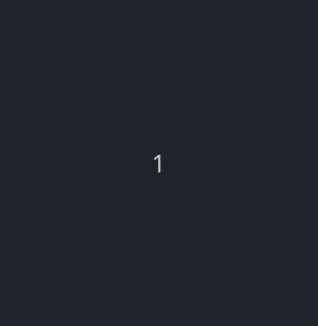

CS1400 - Thursday, February 19 - Lecture 14 - Module 3

# Topics:
* [🟥Assn 3b - Don't Play With Mathes](#assn-3b---dont-play-with-mathes)
* [Code Lab Challenge 0 - Average Height](#code-lab-challenge-0---average-height)
* [Code Lab Challenge 1 - Improved Drawly Grid](#code-lab-challenge-1---improved-drawly-grid)
* [Code Lab Challenge 2 - Sieve of Eratosthenes](#code-lab-challenge-2---sieve-of-eratosthenes)


------------------------------------------------------------
# Announcements

## HackUSU 2026

HackUSU is Utah's largest collegiate 24-hour innovation challenge and hackathon. Participants create innovative applications while networking with industry professionals and attending educational workshops.

*   **When**  February 27th-28th, 2026.
*   **Where** Huntsman Hall
*   [**Registration**](https://huntsman.usu.edu/hackusu/) is open to all college students and high school seniors.
    *   Register with the code `USU26` to save $5!


# Action Items

## Exam #1 is next week

*   This is the first of two exams. It covers material from **Units 1-3**.
*   The exam opens at 12 AM on **Monday, February 23** and closes at 11:59 PM on **Friday, February 27**
    -   You have **80 minutes** to complete the exam.
    -   You are not allowed any outside resources such as notes, books, websites, etc.
*   This exam is proctored by Proctorio, and is taken on your own computer.
    -   Ensure that you have a quiet space where you will be uninterrupted.
    -   Make sure to turn your phone off as well as other things that have pop up notifications (computer/watch/roommates/etc).
    -   Run through [Computer Setup (Remotely Proctored)](https://usu.instructure.com/courses/794745/quizzes/1417470) on Canvas to debug any issues with Proctorio.
*   We will do an exam review as part of our in-class code lab on **Tuesday, February 24**
    -   You are welcome to take the exam before Tuesday morning, or you can wait until after we do the in-class review

## Sign in to today's Wooclap

https://app.wooclap.com/events/UZSMEB/self-paced-session


# [🟥Assn 3b - Don't Play With Mathes](https://usu.instructure.com/courses/794745/assignments/5122786)


| Task/Day           | **Thursday**       | **Friday**                                                             | **Saturday** | **Sunday**                             | **Monday**                          |
| ------------------ | ------------------ | ---------------------------------------------------------------------- | ------------ | -------------------------------------- | ----------------------------------- |
| **Classroom Time** | Classroom Lab Time |                                                                        |              |                                        | 4.1: Function Introduction          |
| **Items Due**      |                    | Exercises 3.4.1, 3.5.2-a, 3.5.2-b, 3.5.2-c, 3.5.3<br/>Quizzes 3.4, 3.5 |              | Assignment 3b<br/>Reflection Survey 3b | Code Reviews for <br/>Assn 3b begin<br/>Exam 1 opens|


# Code Lab Challenge 0 - Average Height

Do you remember this challenge from a few weeks ago?

> 0.  Define 6 student variables that hold heights and compute the average.  Use this code:
>     -   ```python
>         student000 = 49
>         student001 = 60
>         student002 = 51
>         student003 = 65
>         student004 = 55
>         student005 = 47
>         ```
> 0.  Add these 18 students to the program, using 18 new variables:
>     -   58
>     -   46
>     -   60
>     -   44
>     -   56
>     -   54
>     -   47
>     -   50
>     -   52
>     -   45
>     -   51
>     -   48
>     -   66
>     -   49
>     -   64
>     -   54
>     -   60
>     -   55

You were able to simplify this program by refactoring it to use a list and the functions `sum()`, `min()`, and `max()`.  Now that you know about loops, you can re-create these functions on your own.

### Phase 0 - Setup

0.  Create a list of numbers from `[1..10]` with `list(range(1, 11))`
0.  Use `len()` to ensure that this list has exactly 10 values
0.  Use Python's built-in `sum()`, `min()` and `max()` functions to establish a baseline for comparison


### Phase 1 - Write your own functions

-   These functions each use a `for` loop to visit each item in their input lists.
-   They each take a list of numbers as input, and return numbers
-   Name them `my_sum()`, `my_min()`, and `my_max()`
-   Compare their outputs to Python's built-in functions

**Ask yourself these debrief questions**

0.  What bugs did you encounter?  How can you avoid them in the future?
0.  A few weeks ago I asked you to consider how you imagine these functions worked.  Did this experience change your mind?


### Phase 2 - Randomize

0.  Instead of hard-coding a bunch of numbers, populate a list of 100 values using `random.randint()`
    -   Choose the endpoints of the random range yourself
0.  Use `len()` to ensure that your list of student heights has exactly 100 values
    -   Adjust your loop if it's the wrong size
0.  Run the program several times.  Do the sum, min, and max values as computed by your functions change much between runs?
0.  Adjust the loop to run 1,000,000 times.  The sum will be different from when you generated 100 values, but what about the minimum and the maximum?
    -   Does the amount of time the program takes to complete change much?


### Phase 3 - Stretch Challenges

Did you finish early? Here are more things to try:

0.  Did you write your loops in this form? `for item in list`
    -   Or did you write them as `for i in range(len(list))`?
    -   Whichever way you did it, rewrite your loops to use the other technique.
    -   Now that you've seen both ways to iterate, which way do you think is better?  Why?
0.  Every `for` loop can be replaced by a `while` loop that does the same thing.
    -   Rewrite your functions to use `while` loops instead
    -   Watch out for an infinite loop!
    -   What instructions do you need to add to keep track of your progress through the loops?


# Code Lab Challenge 1 - Improved Drawly Grid

Now that you know about loops we can finally revisit a bit of code that's been bothering me all semester.  Do you remember the Drawly grid that I had ChatGPT vibe-code way back at the beginning of September?


### Starter Code

There are a couple of problems with this code:

0.  This is way too much code to draw a simple grid
    -   33 lines of code to draw the horizontal lines
    -   38 lines of code for the vertical lines
0.  The horizontal lines do not go all the way to the far edge of the screen.

```python
import drawly


drawly.start("Drawly Grid Demo", background="skyblue")
drawly.set_speed(9)

# ---------- horizontals (drawn left→right), labels at left edge ----------
drawly.set_color("magenta")
drawly.line(0, 100, 1200, 100)
drawly.draw()
drawly.set_color("darkgreen")
drawly.text(0, 100, "100")
drawly.draw()
drawly.set_color("magenta")
drawly.line(0, 200, 1200, 200)
drawly.draw()
drawly.line(0, 300, 1200, 300)
drawly.draw()
drawly.set_color("darkgreen")
drawly.text(0, 300, "300")
drawly.draw()
drawly.set_color("magenta")
drawly.line(0, 400, 1200, 400)
drawly.draw()
drawly.line(0, 500, 1200, 500)
drawly.draw()
drawly.set_color("darkgreen")
drawly.text(0, 500, "500")
drawly.draw()
drawly.set_color("magenta")
drawly.line(0, 600, 1200, 600)
drawly.draw()
drawly.line(0, 700, 1200, 700)
drawly.draw()
drawly.set_color("darkgreen")
drawly.text(0, 700, "700")
drawly.draw()
drawly.set_color("magenta")
drawly.line(0, 800, 1200, 800)
drawly.draw()

# ---------- verticals (drawn top→bottom), labels at top edge ----------
drawly.line( 100, 0,  100, 800)
drawly.draw()
drawly.set_color("darkgreen")
drawly.text(100, 0, "100")
drawly.draw()
drawly.set_color("magenta")
drawly.line( 200, 0,  200, 800)
drawly.draw()
drawly.line( 300, 0,  300, 800)
drawly.draw()
drawly.set_color("darkgreen")
drawly.text(300, 0, "300")
drawly.draw()
drawly.set_color("magenta")
drawly.line( 400, 0,  400, 800)
drawly.draw()
drawly.line( 500, 0,  500, 800)
drawly.draw()
drawly.set_color("darkgreen")
drawly.text(500, 0, "500")
drawly.draw()
drawly.set_color("magenta")
drawly.line( 600, 0,  600, 800)
drawly.draw()
drawly.line( 700, 0,  700, 800)
drawly.draw()
drawly.set_color("darkgreen")
drawly.text(700, 0, "700")
drawly.draw()
drawly.set_color("magenta")
drawly.line( 800, 0,  800, 800)
drawly.draw()
drawly.line( 900, 0,  900, 800)
drawly.draw()
drawly.set_color("darkgreen")
drawly.text(900, 0, "900")
drawly.draw()
drawly.set_color("magenta")
drawly.line(1000, 0, 1000, 800)
drawly.draw()
drawly.line(1100, 0, 1100, 800)
drawly.draw()
drawly.set_color("darkgreen")
drawly.text(1100, 0, "1100")
drawly.draw()
drawly.set_color("magenta")
drawly.line(1200, 0, 1200, 800)
drawly.draw()

drawly.done()
```

### Phase 0 - Refactor It

Your challenge is to **refactor** this program.  Refactoring is *the process of restructuring existing computer code without changing its external behavior.*

This means that you should rewrite the program to do the same thing (bugs and all), but in a better way.

After introducing 2 loops and removing redundant instructions, I was able to get this down to 6 lines for each of the horizontal and vertical lines:


<details>
<summary><h4>Click to see Erik's version</h4></summary>

```python
import drawly


drawly.start("Drawly Grid Demo", background="skyblue")
drawly.set_speed(9)

xxx x xx xxxxx(x, x):
    xxxxxx.xxxxxxxxx("xxxxxxx")
    xxxxxx.xxxx(x, xxxxx, xxxx, xxxxx)
    xx x x x xx x:
        xxxxxx.xxxxxxxxx("xxxxxxxxx")
        xxxxxx.xxxx(x, xxxxx, xxx(xxxxx))

xxx x xx xxxxx(x, x):
    xxxxxx.xxxxxxxxx("xxxxxxx")
    xxxxxx.xxxx(xxxxx, x, xxxx, xxxxx)
    xx x x x xx x:
        xxxxxx.xxxxxxxxx("xxxxxxxxx")
        xxxxxx.xxxx(xxxxx, x, xxx(xxxxx))

drawly.done()
```

</details>

Your solution may be longer or shorter than mine.  But the end result will be a program that is, to an outsider, indistinguishable from the original.

**Hints**

0.  Don't erase the original code; just write your new `for` loops below it
    -   Draw your own lines and text in different colors than in the original
    -   If your refactored code is pixel-perfect, you won't see any of the old pixels peeking through
0.  You can use either kind of loop, but I recommend a `for` loop with the `range()` function
0.  You don't have to start the range at `0`
0.  Remember that the `end` argument of `range()` is **not** included in the sequence


### Phase 1 - Fix It

Now that you've refactored the grid, fix the horizontal lines so they reach the right edge of the screen.


### Phase 2 - Reflect On It

Answer these debrief questions in Wooclap:

* Did you make any mistakes along the way?
    -   If so, what were they?
    -   What lesson can you learn from the experience?
* Why do you think I suggested that you use `for` loops instead of `while` loops?
* When is the best time to fix the `1200` -> `1280` bug - before or after refactoring?  Justify your answer.


### Phase 3 - Stretch Challenges

Did you finish early? Here are more features:

0.  Wrap this code up into a function called `drawly_grid()`
0.  Change the signature of the function to `drawly_grid(width, height)` to enable the user to adjust the size of the grid
0.  Add a third parameter to `drawly_grid()` called `color` that lets the user draw the grid lines in a different color
0.  Add a fourth parameter to `drawly_grid()` called `spacing` that enables the user to change how far apart the grid lines are


# Code Lab Challenge 2 - Sieve of Eratosthenes

In this challenge you will build a visualization of the Sieve of Eratosthenes, an ancient algorithm for finding all prime numbers up to a specified integer.  I've provided starter code so you can focus on the algorithm.





### Starter code

*   Set up the Drawly window
*   Define the function `draw_grid()` that paints a 10x10 grid of squares, colored green for "prime"
    *   Inside each square, draw the numbers from `1` to `100`
*   I'll give you one square for free: `1` is not a prime number
*   The numbers are represented in a 2D list, each element of which is a Box object that holds facts about each number:
    - the number itself
    - its X and Y coordinates
    - whether it is prime

<details>
<summary><h4>Click to view the starter code</h4></summary>

```python
import drawly

# Sieve of Eratosthenes
#
# This program demonstrates the Sieve of Eratosthenes algorithm for finding
# prime numbers. A grid of numbers from 1 to 100 is displayed. The program
# iterates through numbers, marking multiples as composite. Prime numbers
# are left unchanged.
#
# The user experience is a passive observation of the algorithm at work. The
# program requires no input. The results are the final grid, with composite
# numbers colored differently from prime numbers.


# Grid parameters
GRID_SIZE = 10
BOX_SIZE = 50
MARGIN = 25
LIMIT = GRID_SIZE**2

# Colors
PRIME = "forestgreen"
COMPOSITE = "firebrick"


class Box:
    pass

def draw_grid(boxes):
    """
    Draw the grid of numbers, color-coded according to primality
    """
    for r in range(GRID_SIZE):
        for c in range(GRID_SIZE):
            num = boxes[r][c].number
            x = boxes[r][c].x
            y = boxes[r][c].y
            prime = boxes[r][c].prime

            if prime:
                drawly.set_color(PRIME)
            else:
                drawly.set_color(COMPOSITE)
            drawly.rectangle(x, y, BOX_SIZE, BOX_SIZE)

            # Draw the number in its box
            drawly.set_color("white")
            if num < 10:
                text_x = x + BOX_SIZE // 2 - 8
            elif num < 100:
                text_x = x + BOX_SIZE // 2 - 14
            else:
                text_x = x + BOX_SIZE // 2 - 20
            text_y = y + BOX_SIZE // 2 - 10
            drawly.text(text_x, text_y, str(num), 20)
    drawly.draw()


drawly.start("Sieve of Eratosthenes", (1000, 1000), "black")
drawly.set_speed(10)

# Initialize the 2D grid of numbers
# Use a Box object to record facts about each number
#  - the number itself
#  - its X coordinate
#  - its Y coordinate
#  - whether or not it is prime
boxes = []
for y in range(GRID_SIZE):
    cols = []
    for x in range(GRID_SIZE):
        b = Box()
        b.number = y * GRID_SIZE + x + 1
        b.x = x * BOX_SIZE + MARGIN
        b.y = y * BOX_SIZE + MARGIN
        b.prime = True
        cols.append(b)
    boxes.append(cols)

boxes[0][0].prime = False  # 1 is not a prime number
draw_grid(boxes)


# TODO: roll through the boxes coloring multiples of 2, then multiples of 3,
#       then multiples of 5, and so on until all composite numbers are identified


print("Done")
drawly.done()
```

</details>


### Program Requirements

0.  Implement the Sieve of Eratosthenes algorithm to identify composite numbers.
0.  As your program identifies composite numbers, change the color of the corresponding square to indicate that it's not a prime number.


### Phase 0 - Design It

Write comments at the top of your program that answer:

0.  What is the user experience? (e.g., a window appears, grid is drawn, colors change)
1.  How will you represent the grid and the numbers? (e.g., loops, lists)
2.  What are the steps of the Sieve of Eratosthenes algorithm?
3.  How will you map a number (1-100) to its corresponding square on the grid?
4.  What will the final output look like?


### Phase 1 - Pseudocode It

Write pseudocode as a block of comments. Make it near line-for-line code. This should outline the main steps of your program, including setting up the Drawly window, drawing the initial grid, and implementing the sieve logic.


### Phase 2 - Build It

When pseudocode is code-like, implement it in Python using the Drawly library.


### Phase 3 - Reflect On It

Answer in comments:

*   What was the most challenging part of this exercise?
*   How could you extend this program to find primes up to a larger number, say 1000? What changes would you need to make to the grid visualization?
*   How could you make your program more efficient?
    *   How many times does your main loop run?
    *   What is the least number of iterations necessary to find all primes?


### Phase 4 - Stretch Challenges

Did you finish early? Here are more features:

*   Instead of just changing the color of composite numbers, use different colors for different prime factors. For example, multiples of 2 could be one color, multiples of 3 another, and so on.
*   Add text to the window to indicate which number is currently being processed in the sieve.
*   Allow the user to input the length of a side of the grid.


