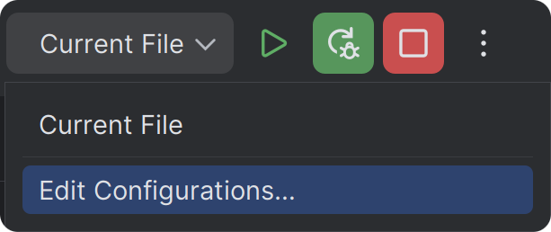
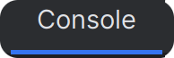
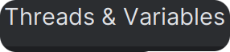
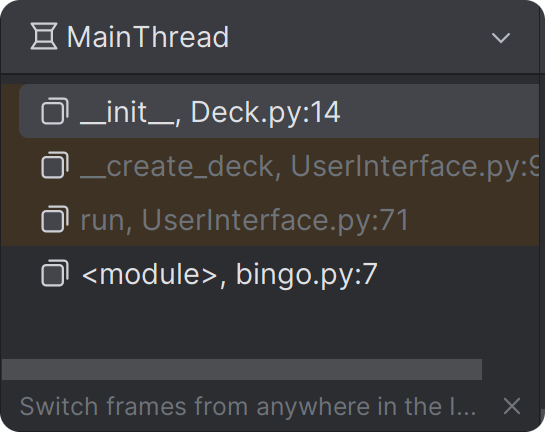
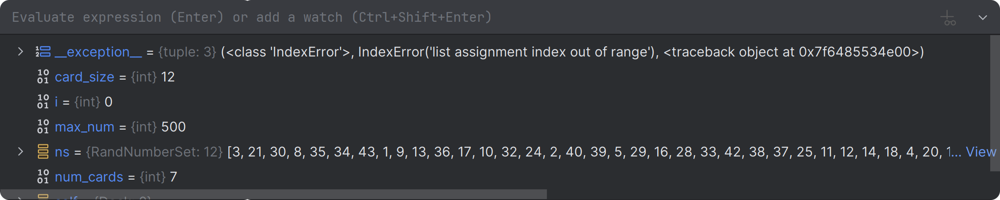
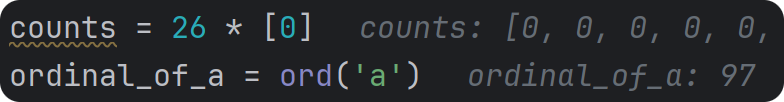

CS1400 - Tuesday, February 24 - Lecture 15 - Module 4

# Topics:
* [🟥Assn 4a - Design Number Pyramid](#assn-4a---design-number-pyramid)
* [Review for Exam 1](#review-for-exam-1)
* [Direct Debugging in the IDE](#direct-debugging-in-the-ide)
* [Code Clinic - Debugger Exercises](#code-clinic---debugger-exercises)


------------------------------------------------------------
# Announcements

## *TOMORROW* Student Organization for Cybersecurity - King of the Hill

- **When** 7 PM Wednesday, February 25th
- **Where** HH 360
- **Discord** https://discord.gg/JEVdRdfpEb

Who will rule the network? Join us for a brief King of the Hill hacking competition! Race to exploit vulnerable machines, claim your territory, and lock out the competition. Come learn, hack, and defend as we prepare for the NCL CTF competition! All skill levels are welcome!


## *THIS WEEKEND* HackUSU 2026

HackUSU is Utah's largest collegiate 24-hour innovation challenge and hackathon. Participants create innovative applications while networking with industry professionals and attending educational workshops.

*   **When**  February 27th-28th, 2026.
*   **Where** Huntsman Hall
*   [**Registration**](https://huntsman.usu.edu/hackusu/) is open to all college students and high school seniors.
    *   Register with the code `USU26` to save $5!


## Code Park Tycoon Research Project

You're invited to participate in my Educational game study!

*   Researcher: Wei-Jung Lin (Wayne) wei-jung.lin@usu.edu
*   Advisor: Dr.Yang Shi yang.shi@usu.edu
*   Research Team Member: Nnaji Uche Josiah
*   Click to take the [Pre-Survey](https://usu.co1.qualtrics.com/jfe/form/SV_2nTwrPhjfvUadMO)
*   Click to fill out the [CS1400 Research Participation and Course Credit Form](https://usu.co1.qualtrics.com/jfe/form/SV_bCLOTBW5R1dM8XY)
    +   By completing this form, you will receive 15 course points added by the course instructor to an existing graded course component in CS1400
    +   You will receive the same course points whether or not you choose to participate in the research study


# [🟥Assn 4a - Design Number Pyramid](https://usu.instructure.com/courses/794745/assignments/5122787)

*   This assignment has one task
    *   It is intentionally smaller than other assignments so you can focus on Exam #1
*   Read the instructions *carefully*, but also look at the **rubric**
    *   Use the rubric as a checklist so you don't miss important requirements
*   This assignment is due **at 11:59 PM on Sunday, March 1st**


## Task 1 - Design Number Pyramid

This task is a little different than what you've done before. You will write a program from a Software Design that is provided to you.

*   This is a *console* program
    *   You **do not** need to `import drawly`; instead, use `print()` and `input()`
*   Put your code in a file called `task1.py`
*   You will not write a full System Design for this task.
*   Write a few sentences about what the problem is with the given System Design, and how you fixed it in a file called `design1fix.md`
*   You will use knowledge from these sections of Unit 4
    *   **4.1: Function Introduction**


| Task/Day           | **Tuesday**        | **Wednesday**       | **Thursday**       | **Friday**                  | **Saturday** | **Sunday**                             | **Monday**                                              |
| ------------------ | ------------------ | ------------------- | ------------------ | --------------------------- | ------------ | -------------------------------------- | ------------------------------------------------------- |
| **Classroom Time** | Classroom Lab Time | Prepare for Exam #1 | Classroom Lab Time |                             |              |                                        | 4.2: More On Functions <br/> 4.3: Functions In Practice |
| **Items Due**      |                    |                     |                    | Exercise 4.1.2<br/>Quiz 4.1 |              | Assignment 4a<br/>Reflection Survey 4a | Code Reviews for <br/>Assn 4a begin                     |


# Review for Exam 1

*   Exam #1 can be taken this week
    *   This exam covers material from **Units 1-3** and closes at 11:59 PM on **Friday, February 27**.
        -   You have **80 minutes** to complete the exam.
        -   Don't start it too close to midnight on Friday as you will be kicked out when the due date passes.
        -   You are not allowed any outside resources such as notes, books, websites, etc.
    *   This exam is proctored by Proctorio, and is taken on your own computer.
        -   Ensure that you have a quiet space where you will be uninterrupted.
        -   Make sure to turn your phone off as well as other things that have pop up notifications (computer/watch/roommates/etc).
        -   Run through [Computer Setup (Remotely Proctored)](https://usu.instructure.com/courses/794745/quizzes/1417470) on Canvas to debug any issues with Proctorio.
        -   If your computer is incompatible, use the CS computer lab on the 1st floor of the ESLC, or the Engineering computer lab on the 3rd floor of ENGR.


# Direct Debugging in the IDE

> Everyone knows that debugging is twice as hard as writing a program in the first place.
> So if you're as clever as you can be when you write it, how will you ever debug it?
>
>    -- Brian Kernighan

The debugger is a powerful system with many useful tools.  It helps you visualize your data so you can understand your code in a whole new way.

Live by the motto:

> Don't assume it - Prove it
>
> Andrew Hunt & David Thomas "The Pragmatic Programmer"
> Tip #27

Taking some time now to master debugging will save you countless hours later. Just like `git` or the shell, debugging is a skill that improves with practice.

There's a difference between *running* your program and *debugging* it. Setting breakpoints is not enough - don't forget to click the green bug button!

These are the debugger controls in PyCharm. Most debuggers offer similar features, though the symbols may vary.

*These icons are from a previous version of PyCharm's UI; they should be similar to the current version*

* **Starting and stopping the debugger**
    *    **Run program normally** - breakpoints and debugger control are not available.
    *    **Run program in debug mode** - breakpoints and debugger control are available.
    *    **Breakpoint** - Click a line number in the gutter to set, click again to remove.  The program will pause on this line.
    *    **Exception Breakpoint** - an exception was raised while executing this line of code.  PyCharm automatically pauses the program when this happens so you can learn why the exception occurred.
    *    **Mute all breakpoints** - the debugger does not stop on muted breakpoints, but they can easily be re-enabled.
    *    **Manage breakpoints** - disable and remove breakpoints, or make a breakpoint conditional.  A conditional breakpoint will pause the program only when a specific criteria evaluates to true.
    *    **Continue** - Keep running the program until it ends, raises an exception, or another breakpoint is encountered.
    *    **Pause** - Pause the program and enter the debugger immediately.  You may be surprised where you land!
    *    and  **Stop** the debugger and terminate the program.
    *    **Restart** the program from the top and re-enter the debugger.
    *   **Edit run configurations**   By default PyCharm wants to run/debug the currently open file.  This is inconvenient when debugging large, multi-file projects because only one file has the "main" part of the program.  Use this dialog to create a "Run Configuration" so PyCharm's Run button always launches the correct program no matter which file is open in the editor.
* **Stepping through a program**
    *    **Step over** a function call.  Resume execution on the next line of code.
    *    **Step into** a function call.  The debugger stops on the first line of code inside the function that was just called.
    *    **Step into a function that _you_ wrote**.  The other "step into" button may take you into library code somebody else wrote, and that is not relevant to your bug.
    *    **Step out** of the current function call.  Execution continues until the current function returns, taking you back to the line of code following the function call that got you here.
* **Examining program state**
    *   **Program console**  Output, error messages, and input prompts are shown in this tab.
    *   **Threads & Variables tab**   The call stack and live variables can be manipulated in this tab.
    *   **Call Stack**  Live function calls shown in order of call.
    *   **View variables**  See the values and types of variables.  You can also change the values of the variables.
    *   **Inline debugging**  Values recently assigned to variables are shown right in the editor on the same line of code where the assignment happened.

For a high-level tour of the key features, check out the article [Debugging with PyCharm](https://www.jetbrains.com/help/pycharm/part-1-debugging-python-code.html). Keep practicing until debugging becomes second nature!


# Code Clinic - Debugger Exercises

0.  These little programs will give you practice with PyCharm's debugger.
0.  Copy and paste them into a new file in PyCharm.  I've suggested file names in a comment at the top of each file.
0.  Follow the instructions, and don't forget to click the debug  button.
0.  Write your reflections in today's Wooclap.


### Control flow with the `return` statement

**Objective:** program flow, step over, unreachable code.

```python
# flow_bug.py
print("0. start")

def add_nums(a, b):
    print("1. in functions")
    s = a + b
    return s
    print("2. unreachable")

print("3. before call")

r = add_nums(10, 20)

print("4. after call")
print(r)
```

0.  Set breakpoints on the lines `print("1. in functions")` and `print("2. unreachable")`
1.  Confirm that `print("2. unreachable")` never runs
    -   Lines of code that cannot be reached are also known as "dead code"

**Reflect:** What are other ways that you could create dead code?


### Scope and Shadowing

**Objective:** step into, observe name shadowing.

```python
# shadow_sum.py

def add_nums(x, y, z):
    vals = x
    vals += y
    vals += z
    return vals


vals = [100, 20, 3]

t1 = add_nums(vals[0], vals[2], vals[8])
print(t1)
```

0.  Set a breakpoint on the call to `add_nums()` and start the debugger
0.  When you reach the breakpoint, look for `vals` in the variable panel and note what it looks like
0.  Click the **step over** button
    -   Where does the debugger take you?
    -   What does `vals` look like now?
0.  Restart the debugger and click **step into** this time
0.  While in the function, can you find `vals` in the variable panel?
0.  Click **step into** until you reach the `return` statement
    -   What does `vals` look like now?
0.  Click **step into** or **step over** once more
    -   Where does the debugger take you?
    -   What does `vals` look like now?

**Reflect:** What is the difference between **step into** and **step over**?  When would you use each?


### Missing return value yields `None`

**Objective:** Experience a common source of confusing bugs

```python
# none_return.py
import random


def find_twenty(nums):
    for num in nums:
        if num == 20:
            found = True

vals = list(range(1, 21))
random.shuffle(vals)
result = find_twenty(vals)

if result:
    print("20 is in the list", vals)
else:
    print("20 IS NOT in the list", vals)

print(result, type(result))
```

This code looks plausible enough, but it harbors a bug that I'm sure you will encounter a few times before long.

0.  Run the program normally, and observe that it does not find the number 20.
1.  Prove to yourself that it *does* find 20 by setting a breakpoint on `val = True` and re-running in debug mode


**Reflect:** What can you change to make `find_twenty()` work?


### Don't be a try-hard

**Objective:** Save your programs from doing pointless work

```python
# try-hard.py
import random


def find_twenty(nums):
    found = False
    for num in nums:
        if num == 20:
            found = True
    return found

vals = list(range(1, 21))
random.shuffle(vals)
result = find_twenty(vals)

if result:
    print("20 is in the list", vals)
else:
    print("20 IS NOT in the list", vals)

print(result, type(result))
```

This code looks plausible enough, but it harbors a bug that I'm sure you will encounter a few times before long.

0.  Run the program a few times normally, and observe that it successfully finds the number 20
1.  Set a breakpoint on `found = True` and re-run in debug mode
2.  After it finds the 20, click **step over** until you reach the `return` statement
3.  Repeat this experiment a few times and note how much extra work is done each time


**Reflect:** How many more times did the `for` loop run *after* it found what it was looking for?  How can you help this program be more lazy?


### `main()` convention and call location

**Objective:** Practice step-in and step-out; experience scoping and function call position rules

```python
# main_order.py

def main():
    print(make_list(3))


def make_list(k):
    out = []
    for _ in range(k):
        out.append(42)
    return out


main()
```

0.  Set a breakpoint on the call to `main()` and start the debugger
0.  Click **step into** twice so you end up inside `make_list()`
    -   As you click, watch the functions pile up in the **MainThread** panel
    -   This listing of active functions is called the "call stack"
0.  Click **step out** twice to return to the call to `main()`
    -   As you click, watch the functions disappear from the **MainThread** panel
0.  End the program and move the definition of `make_list()` above that of `main()`
0.  Repeat the experiment
    -   What differences do you notice this time?
0.  Move the call to `main()` to the top of the file and repeat the experiment
    -   What differences do you notice this time?


**Reflect:** What order do the functions appear in the call stack?  Why do you think you can freely move the function definitions relative to each other, but not the call to `main()`?


### Hot patching

**Objective:** Try out hypothetical situations by changing variables on-the-fly

```python
# hot_patch.py

def clamp(x):
    if x < 0:
        return 0
    elif x > 100:
        return 100
    else:
        return x


def percent_to_letter(pct):
    grade = ""
    if pct >= 90:
        grade = 'A'
    elif pct >= 80:
        grade = 'B'
    elif pct >= 70:
        grade = 'C'
    elif pct >= 60:
        grade = 'D'
    else:
        grade = 'F'
    return grade


# Test with a list of student scores
for score in [-15, 72, 88, 95, 105]:
    letter = percent_to_letter(clamp(score))
    print("Original:", str(score) + "% → Letter grade:", letter)
```


0.  Run the program normally, and observe that the score of -15 is clamped to 0
0.  Set a breakpoint on the line `letter = percent_to_letter(clamp(score))`
    -   What will happen when you click **step into** at this breakpoint?
        -   Do you enter `percent_to_letter()` or `clamp()`?
        -   Make your guess
0.  Start the debugger and click **step into**
    -   Are you surprised by what happened?
0.  Set a breakpoint on the first line of `percent_to_letter()` and continue the debugger
    -   A score of `-15` should get an F, but you are feeling like a hacker today
    -   Find `pct` in the variables panel below, select it, and press F2 (alternatively, right-click it and select **Set Value...*)
    -   Input a better score, something above 60
0.  Let the program continue until the end and marvel at your hacking skills
0.  Remove that breakpoint and add a new one on the last line of `percent_to_letter()`
0.  Re-start the debugger and run until you hit your breakpoint
    -   Find `grade` in the variables panel
    -   Weave your dark magic one more time


**Reflect:** How can you use this feature of the debugger to quickly test bug fixes?  Can you think of a time when this would have come in handy?

### Crash and Burn (and Recover)

**Objective:** Let the debugger show you why a crash happened, use conditional breakpoints


```python
def calculate_reciprocals(numbers):
    reciprocals = []

    for num in numbers:
        reciprocal = 1 / num
        reciprocals.append(reciprocal)

    return reciprocals


def main():
    # List includes a zero - this will cause division by zero!
    numbers = [ 12, 3, 16, 2, 11, 19, 18, 9, 5, 17, 10, 0, 8, 4]

    print("Calculating reciprocals of", numbers)

    reciprocals = calculate_reciprocals(numbers)
    for i in range(len(numbers)):
        print("\tThe reciprocal of", numbers[i], "is", reciprocals[i])


main()
```

0.  Run the program normally and observe the crash
0.  Re-run the program in the debugger and notice what happens this time
    -   Take care to not click the red lightning bolt breakpoint! This can disable the "break on error" feature
    -   If you do disable it, simply right-click the lightning bold and select the **Enabled** checkbox
0.  Stop the debugger
0.  Set a breakpoint on the line `reciprocal = 1 / num`
0.  Restart the debugger and step through the program until `num` is `0`
    -   This is a bit tedious, no?
0.  Right-click the breakpoint and enter `num == 0` into the **Condition** text box
    -   Ensure that the **Condition** checkbox is set and click **Done**
0.  The breakpoint should now have a small question mark
0.  Click the **Continue** button to skip right to the `0`
    -   Set the value of `num` to a non-zero value so the program no longer crashes


**Reflect:** Now that you are aware of this feature can you recall a time when it would have saved you time and frustration?


### An Odd way to detect Even numbers

**Objective:** Explore the call stack, probe Python's limits

```python
def is_even(n):
    """Return True if n is even, False otherwise."""
    if n == 0:
        return True
    else:
        return is_odd(n - 1)


def is_odd(n):
    """Return True if n is odd, False otherwise."""
    if n == 0:
        return False
    else:
        return is_even(n - 1)


def main():
    for i in range(10):
        print(i, "→ even?", is_even(i), "odd?", is_odd(i))


main()
```

0.  Set a breakpoint on `print(i, "→ even?", is_even(i), "odd?", is_odd(i))` and start the debugger
0.  Click **step into** and watch the call-stack change as the program progresses
    -   What happens to the variable `n` while all of this is going on?
0.  Remove the breakpoint, increase the number in the call to `range()`, and run the debugger again
    -   Repeat this until the program crashes
    -   PyCharm might pull up another file besides your own - just ignore it
0.  What number did you put into `range()` to make the program crash?
    -   According to PyCharm, what was the actual value of `n` at the point of the crash?
    -   Start from the top of the call stack and select each stack frame until you get one that shows you its variables
0.  Scroll all the way to the bottom of the call stack and find the stack frame for `main()`.  What was the actual value of `i` that caused the program to crash


**Reflect:** Why do you think the program crashed here?


