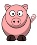

CS1400 - Tuesday, March 17 - Lecture 19 - Module 5

# Topics:
* [🟥Assn 5a - The Collector](#assn-5a---the-collector)
* [Pygame Starter Code (Boilerplate)](#pygame-starter-code-boilerplate)
* [Code Lab Challenge 0 - This Little Piggy](#code-lab-challenge-0---this-little-piggy)
* [Code Lab Challenge 1 - Fix My Bug: Arrow-Key Player Constraints](#code-lab-challenge-1---fix-my-bug-arrow-key-player-constraints)


------------------------------------------------------------
# Announcements

## *TONIGHT* FSLC - Contributing with Git

*   **When**    6:30 PM Tuesday, March 17th
*   **Where**   WIDT 007
*   **Website** https://linux.usu.edu
*   **Discord** https://discord.gg/PvgG6N2hsU

Want to contribute to open source but have never used Git in that way? Open source and industry software runs on Git, not just to keep track of work but to also share work between many people. In this presentation we'll talk about how to share your contributions with the wider world. We will talk about pull requests, lingo like "upstreams", and will be hosting a Github repository and a plain Git repository against which you can make your own pull requests. The basic Git commands will be covered but is not the focus.


## *TOMORROW* Student Organization for Cybersecurity - USU SOC CTF Kickoff

- **When** 7 PM Wednesday, March 18th
- **Where** HH 360
- **Discord** https://discord.gg/JEVdRdfpEb

Join as to kick off our in-house capture the flag game! Find teammates or compete on your own. There are challenges for all skill levels, from "this is my very first-time hearing what a CTF is" to frequent champions. The game goes a full week, with prizes for the winners! Don’t be afraid to jump in and compete; you’ll have fun and learn a lot!


## [BSidesSLC Registration is Open!](https://www.bsidesslc.org/)


BSidesSLC is a cybersecurity conference where you can meet & network with industry experts, many of whom are located throughout Utah.

*   **When**  Thursday, April 9th - Friday, April 10th
*   **Where** Conference Center at SLCC Miller Campus
    *   9750 S 300 W, Sandy, UT
*   **Students Enjoy Free Admission**
    *   Current student identification required to enter event with this ticket type
    *   Students are not eligible for conference swag, electronic badges, etc.
    *   General Admission is $22.11
*   **Bring a laptop!!!**
    *   You should bring a computer any time you go to a technology conference because workshops and classes are interactive, hands-on affairs
    *   You will need a laptop to play Capture The Flag (CTF)
*   [**BSidesSLC Discord**](https://discord.com/invite/hBcnv9gb73)


### BSidesSLC attendance replaces your lowest assignment score

*   If you attend the conference I will replace your lowest assignment score with **full credit**
    *   It is good enough if you can only make it one of the days, either Thursday or Friday
    *   I will count you as having attended the code lab if you are at BSidesSLC on *Thursday April 9th*
*   Either find me at the conference **or** send me a selfie showing you with your conference badge at the venue


# Action Items

**Ask your code reviewer to _sign_ their work**


# [🟥Assn 5a - The Collector](https://usu.instructure.com/courses/794745/assignments/5122789)

*   This assignment has one task
*   Read the instructions *carefully*, but also look at the **rubric**
    *   Use the rubric as a checklist so you don't miss important requirements
*   This assignment is due **at 11:59 PM on Sunday, March 22nd**

## Task 1 - The Collector

You are going to program a game where your character moves around to collect treasures all while avoiding a dangerous bomb. You can choose the look and feel. Your game can be a mouse collecting cheese while avoiding a cat, or anything else you want to do as long as it follows the same technical premise.

*   This is a **Pygame** program
*   Put your code in a file called `task1.py` and your software development plan as `design1.md`
*   Download the file `pygame_starter.py` from the assignment on Canvas or get it [right here](./pygame_starter.py)
*   You will submit five files:
    1.  `design1.md`
    2.  `task1.py` (renamed from `pygame_starter.py`)
    3.  `player.py`
    4.  `treasure.py`
    5.  `enemy.py`
*   You will use knowledge from these sections of Unit 5
    *   **5.1: Pygame Intro**
    *   **5.2: Flip Flop Boing**
    *   *I cannot overstate how valuable it is for you to write the entire *Flip Flop Boing* program for yourself!*


| Task/Day           | **Tuesday**        | **Wednesday**        | **Thursday**       | **Friday** | **Saturday** | **Sunday**                             | **Monday**                          |
| ------------------ | ------------------ | -------------------- | ------------------ | ---------- | ------------ | -------------------------------------- | ----------------------------------- |
| **Classroom Time** | Classroom Lab Time | 5.2: Flip Flop Boing | Classroom Lab Time |            |              |                                        | 5.3: Objects for More than Data**   |
| **Items Due**      |                    |                      |                    | Quiz 5.1   |              | Assignment 5a<br/>Reflection Survey 5a | Code Reviews for <br/>Assn 5a begin |


# Pygame Starter Code (Boilerplate)

This is the standard Pygame *boilerplate* we'll use throughout the semester.

**Boilerplate code** is repetitive but necessary setup code.  

It usually handles standard setup or routine tasks (like initializing a window, setting up keyboard events, or defining a main loop) so developers can focus on the unique logic of a program rather than rewriting common infrastructure every time.

Boilerplate is often copy/pasted between multiple projects with little thought or modification.

This file serves as the foundation for all Pygame programs you'll write in this class.
Familiarize yourself with its structure - it contains sections for every feature we'll cover, though you won't use every section in each project.

#### Features of this Boilerplate

* It creates a **1280x720** window titled **"Window Name"** 
* A basic game loop is run at **30 FPS**
* You can quit the game by closing the window or pressing `q`, `Q`, or `Escape`
* You can define a special *Game Over* state with different music and visuals
    * When in this state, the game can be restarted by pressing `Space`


<details>
<summary><h3>Click to view the <code>pygame_starter.py</code> source</h3></summary>

```python
import pygame

SCREEN_WIDTH = 1280  # Use constants here to be able to use in different places
SCREEN_HEIGHT = 720
CLOCK_TICK = 30
TITLE = "Window Name"

def main():
    # Setup the pygame window and clock
    pygame.init()
    screen = pygame.display.set_mode((SCREEN_WIDTH, SCREEN_HEIGHT))
    pygame.display.set_caption(TITLE)
    clock = pygame.time.Clock()

    ##########
    # Set up game media images, sounds
    ##########

    ##########
    # Set up game data
    ##########

    ##########
    # Game Loop
    ##########
    game_over = False
    running = True
    while running:
        ##########
        # Get Input/Events
        ##########
        for event in pygame.event.get():
            if event.type == pygame.QUIT:  # User clicked the window's X button
                running = False
            if event.type == pygame.KEYDOWN:
                if event.key == pygame.K_q or event.key == pygame.K_ESCAPE:
                    running = False
                if event.key == pygame.K_SPACE and game_over:
                    ### Do Stuff to Reset Game ###
                    game_over = False

        ##########
        # Update state of components/data
        ##########
        #### Always Update ####

        #### Update if Game is Not Over ####
        if not game_over:
            pass
        #### Update if Game is Over ####
        else:
            pass

        ##########
        # Update Display
        ##########
        #### Always Display ####

        #### Display while Game is being played ####
        if not game_over:
            pass
        #### Display while Game is Over ####
        else:
            pass

        #### Draw changes the screen ####
        pygame.display.flip()

        ##########
        # Define the refresh rate of the screen
        ##########
        clock.tick(CLOCK_TICK)


main()
```

</details>

Download [pygame_starter.py](./pygame_starter.py)


# Code Lab Challenge 0 - This Little Piggy

You can draw simple shapes using functions from the `pygame.draw` module.  There you will find functions that let you draw the same shapes that you used in Drawly.  In Pygame it is just as easy to use image files.  This program animates a circle bouncing about the screen.

Your task is to replace the bouncing black circle with a picture of a little piggy from the file `pig.png`.  Then you will add sound effects and background music.

Find my `TODO:` comments so you will know which sites to edit.




Download [pig.png](./pig.png)


### this-little-piggy.py

Notice how this program follows the structure of the Pygame boilerplate.

<details>
<summary><h3>Click to view the <code>this-little-piggy.py</code> source</h3></summary>


```python
# this-little-piggy.py
import pygame


SCREEN_WIDTH = 600
SCREEN_HEIGHT = 600
CLOCK_TICK = 30
TITLE = "This Little Piggy"


def main():
    # Setup the pygame window and clock
    pygame.init()
    pygame.mixer.init()
    screen = pygame.display.set_mode((SCREEN_WIDTH, SCREEN_HEIGHT))
    pygame.display.set_caption(TITLE)
    clock = pygame.time.Clock()

    ##########
    # Set up game media images, sounds
    ##########
    # TODO: load the image of the pig into a variable
    # TODO: load the boing sound at 50% volume
    # TODO: load the background music
    # TODO: begin playing the background music at 20% volume

    ##########
    # Set up game data
    ##########
    x_pos = 240
    y_pos = 260
    RADIUS = 25
    x_dir = 14
    y_dir = 8

    ##########
    # Game Loop
    ##########
    game_over = False
    running = True
    while running:
        ##########
        # Get Input/Events
        ##########
        for event in pygame.event.get():
            if event.type == pygame.QUIT:  # User clicked the window's X button
                running = False
            if event.type == pygame.KEYDOWN:
                if event.key == pygame.K_q or event.key == pygame.K_ESCAPE:
                    running = False
                if event.key == pygame.K_SPACE and game_over:
                    ### Do Stuff to Reset Game ###
                    game_over = False

        ##########
        # Update state of components/data
        ##########
        #### Always Update ####
        x_pos += x_dir
        y_pos += y_dir

        # TODO: use the piggy's width in this calculation
        if x_pos + RADIUS >= SCREEN_WIDTH or x_pos - RADIUS <= 0:
            print("The piggy bounced off a side wall")
            x_dir = -x_dir
            # TODO: play the boing sound

        # TODO: use the piggy's height in this calculation
        if y_pos + RADIUS >= SCREEN_HEIGHT or y_pos - RADIUS <= 0:
            print("The piggy bounced off the top or bottom wall")
            y_dir = -y_dir
            # TODO: play the boing sound

        #### Update if Game is Not Over ####
        if not game_over:
            pass
        #### Update if Game is Over ####
        else:
            pass

        ##########
        # Update Display
        ##########
        #### Always Display ####
        screen.fill("white")  # Filling the screen wipes out any previous screen content
        # TODO: remove the circle, and instead blit the piggy onto the screen
        pygame.draw.circle(screen, "black", (x_pos, y_pos), RADIUS)
        pygame.display.flip()

        #### Display while Game is being played ####
        if not game_over:
            pass
        #### Display while Game is Over ####
        else:
            pass

        #### Draw changes the screen ####
        pygame.display.flip()

        ##########
        # Define the refresh rate of the screen
        ##########
        clock.tick(CLOCK_TICK)


main()
```

</details>

Download [this-little-piggy.py](./this-little-piggy.py)


### Phase 0 - Sprite It Up

Adding a sprite (picture) to your Pygame program is as easy as 0-1-2

0.  Copy an image file into your project
    *   Common image formats such as PNG, GIF, WEBP and JPG are supported by Pygame
1.  Call the function `pygame.image.load()` with the name of the image in a string
    *   ex. `piggy = pygame.image.load("pig.png")`
    *   This function returns a new *surface* object that holds the pixels of your picture
    *   The surface object can be used as a *sprite*, which is a 2D image used as a distinct visual object in a video game
2.  Call the `.blit(image, [x, y])` function on another surface object to draw the picture on top of the other surface
    *   `blit`'s parameters are *a surface* (i.e. your image object) and a list of `[x, y]` coordinates of where you want the upper-left corner of the picture to appear
    *   For instance, use `screen.blit(piggy, [100, 200])` to put a picture on the screen at coordinates `[100, 200]`
        *   `screen` is the variable that you set up at the top of each Pygame program
        *   Pass the x, y coordinates with a list by using square brackets `[ ]`
    *   [What's a *blit*](https://en.wikipedia.org/wiki/Bit_blit)?


To make the bounce animation look correct, you'll need to change some of the math in this program.

*   Calculating the width & height of a *Pygame circle* is easy
    -   Since circles in Pygame are drawn from their center coordinate, their width & height are equal to their radius
*   Pygame makes calculating the width & height of *sprites* just as easy
    -   Retrieve the height by calling the `.get_height()` function on a sprite
    -   Retrieve the width by calling the (you guessed it) `.get_width()` function
    -   Example:
        -   ```python
            width = piggy.get_width()
            height = piggy.get_height()
            ```


### Phase 1 - Ear Force One

Add a boing sound effect from the fie `boing.mp3`


Download [boing.mp3](./boing.mp3)


Using sounds in Pygame is similar to using images.  Pygame provides functions to load sounds from files into objects.  You can then tell Pygame what to do with those objects.

*   Sounds in Pygame are manipulated with functions found in the `pygame.mixer` module (think of a sound mixer)
*   Common audio file formats such as MP3 are supported by Pygame
*   Sound effects are sounds that are played once, often in response to *game events*
    *   A game event can be user input, or an interaction between entities in the game
*   Sound effect files are loaded into variables with `pygame.mixer.Sound()`
    -   Pass the file name in as a string
    -   Example: `boing = pygame.mixer.Sound("boing.mp3")`
*   Sounds are played with `pygame.mixer.Sound.play()`
    -   Example: `pygame.mixer.Sound.play(boing)`
*   You can adjust the volume of the sound by calling its method `.set_volume()`; it takes a float between 0.0 and 1.0
    -   Example: `boing.set_volume(0.90)  # 90% volume`
    -   Example: `boing.set_volume(0.50)  # 50% volume`
    -   Example: `boing.set_volume(0.15)  # 15% volume`

**Important**

If you see an error message telling you that the mixer is not initialized, try adding the following line of code to the `# Set up game media images, sounds` section of the program, before loading your sound files:

```python
pygame.mixer.init()
```


### Phase 2 - Background Beats

Add background music to the program from the fie `music.mp3`


Download [music.mp3](./music.mp3)

*   Sound files can be looped so that background music keeps playing as the game runs
*   Load music files using `pygame.mixer.music.load()`
    -   Pass the file name in as a string
    -   Example `pygame.mixer.music.load("music.mp3")`
    -   You do not need to keep the return value of this function in a variable
*   Start the music with `pygame.mixer.music.play()`
    -   This function takes an integer - the number of times to repeat the song
    -   Pass in `-1` to loop the music *indefinitely* (I hope it is a song that you like...)
    -   Notice that it **does not** need a variable that contains the song!
*   Is your music drowning out your sound effects?
    *   Use `pygame.mixer.music.set_volume()` to adjust the volume; it takes a float between 0.0 and 1.0
    *   100% volume is achieved with `pygame.mixer.music.set_volume(1.0)`
    *   50% volume is achieved with `pygame.mixer.music.set_volume(0.5)`
    *   14% volume is achieved with `pygame.mixer.music.set_volume(0.14)`
*   Turn off the jukebox by calling `pygame.mixer.music.stop()`


### Phase 3 - Reflect On It

Answer these debrief questions in today's Wooclap:

* What is the difference between **drawing** a shape and **blitting** an image in Pygame?
* Why does the `.blit()` function use the *upper-left corner* instead of the center of the image?
* When the piggy bounces, what tells Pygame to play the "boing" sound exactly once?
* What kinds of *events* in a game are good triggers for one-time sound effects?
* How can you make sure sound volumes stay balanced when several sounds overlap?
* If you wanted different background music for different game states (e.g., game over), how would you switch tracks cleanly?
* How does adding sound change your perception of motion and impact in your game?


# Code Lab Challenge 1 - Fix My Bug: Arrow-Key Player Constraints

This program should have the following features:

0.  The game runs at 60 FPS and is played on a screen that is 800 px wide by 600 px tall
0.  The yellow player sprite is a circle that is 64 pixels wide (i.e. its radius is 32 px)
0.  The player sprite can be moved with the arrow keys
    -   It briskly moves at a rate of 16 pixels per frame
0.  At no time may any portion of the player sprite leave the screen
    -   The player must be able to touch the screen's edge, but not exceed it on any side

Some of these features were not correctly implemented.  Your job is to find and fix the mistakes.


### player-constraints.py


<details>
<summary><h3>Click to view the <code>player-constraints.py</code> source</h3></summary>

```python
# player-constraints.py
import pygame


SCREEN_WIDTH = 600
SCREEN_HEIGHT = 800
CLOCK_TICK = 60
TITLE = "Arrow-Key Player Constraints (Buggy)"
PLAYER_SPEED = 16
PLAYER_WIDTH = 64
PLAYER_COLOR = "yellow2"


class Player:
    """Represents the player on the screen"""
    pass


def move_player(player, move):
    cx, cy = player.center_pos
    cx += move[0]
    cy += move[1]
    if cx < 0:
        cx = 0
    elif cx > SCREEN_WIDTH:
        cx = SCREEN_WIDTH
    cy = max(0, min(SCREEN_HEIGHT, cy))
    player.center_pos = [cx, cy]


def main():
    # Setup the pygame window and clock
    pygame.init()
    screen = pygame.display.set_mode((SCREEN_HEIGHT, SCREEN_HEIGHT))
    pygame.display.set_caption(TITLE)
    clock = pygame.time.Clock()

    ##########
    # Set up game media images, sounds
    ##########

    ##########
    # Set up game data
    ##########
    p = Player()
    p.center_pos = [SCREEN_WIDTH // 2, SCREEN_HEIGHT - PLAYER_WIDTH]
    p.radius = PLAYER_WIDTH
    p.color = "forestgreen"

    ##########
    # Game Loop
    ##########
    game_over = False
    running = True
    while running:
        ##########
        # Get Input/Events
        ##########
        for event in pygame.event.get():
            if event.type == pygame.QUIT:  # User clicked the window's X button
                running = False
            if event.type == pygame.KEYDOWN:
                if event.key == pygame.K_q or event.key == pygame.K_ESCAPE:
                    running = False
                if event.key == pygame.K_SPACE and game_over:
                    ### Do Stuff to Reset Game ###
                    game_over = False

        ##########
        # Update state of components/data
        ##########
        #### Always Update ####
        pressed = pygame.key.get_pressed()
        dx = (pressed[pygame.K_RIGHT] - pressed[pygame.K_LEFT]) * 3
        dy = (pressed[pygame.K_DOWN] - pressed[pygame.K_UP]) * 3
        move_player(p, [dx, dy])

        #### Update if Game is Not Over ####
        if not game_over:
            pass
        #### Update if Game is Over ####
        else:
            pass

        ##########
        # Update Display
        ##########
        #### Always Display ####
        screen.fill("white")
        pygame.draw.circle(screen, p.color, [p.center_pos[0], p.center_pos[1]], p.radius)

        #### Display while Game is being played ####
        if not game_over:
            pass
        #### Display while Game is Over ####
        else:
            pass

        #### Draw changes to the screen ####
        pygame.display.flip()

        ##########
        # Define the refresh rate of the screen
        ##########
        clock.tick(CLOCK_TICK)


main()
```

</details>

Download [player-constraints.py](./player-constraints.py)


### Phase 0 - Identify The Bug(s)

Answer each of these questions in today's Wooclap:

* Does the Pygame window have the right dimensions?
* Does the game run at 60 FPS?
* Is the player sprite the correct size and color?
* Does the player sprite move at the correct rate?
* Why does the player sprite visibly clip past edges?


### Phase 1 - Fix It

Enact your proposed changes in the program.


### Phase 2 - Test It

Run the program and verify that:

0.  The screen has the correct dimensions
0.  The player sprite is the correct color and size
0.  The player sprite can be moved with the arrow keys, and at the correct speed
0.  At no time any portion of the player sprite leaves the screen


### Phase 3 - Reflect On It

Answer these debrief questions in today's Wooclap:

*   How many bugs did you find in the starter code?
*   These snippets of code perform an operation called "clamping", which ensures that a value remains within a certain range (i.e. they "clamp" the sprite's center point to stay on the screen).
    -   How would you explain these snippets of code?  Which do you like better?
    -   ```python
        if cx < 0:
            cx = 0
        elif cx > SCREEN_WIDTH:
            cx = SCREEN_WIDTH
        ```
    -   ```python
        cy = max(0, min(SCREEN_HEIGHT, cy))
        ```
*   The original clamping logic was clearly wrong.  How did you change it to keep the entire player sprite on the screen?


## Phase 4 - Stretch Challenges

Did you finish early? Here are some extra features to add to this program.

0.  Display useful debugging information on the screen to verify that the player is moving and clamping correctly
    - The player's `(x, y)` position
    - The player's radius
    - The current movement vector `(dx, dy)`
1. The program currently clamps `x` and `y` using two different styles.  Clean, consistent code is easier to maintain.  Rewrite the code so **both axes use the same style**
    -   Example approaches:
        * Use `if/elif` for both axes
        * Use `max(min())` for both axes
2.  Rewrite the boundary logic so it uses the player's `radius` instead of hard-coded "magic" numbers.
    -   Instead of clamping the player center between `0 and SCREEN_WIDTH` it should clamp between: `radius and SCREEN_WIDTH - radius`
    -   This ensures **the entire player stays on screen**, not just its center
3.  Detect presses of these keys that change the player's movement speed:
    - `1` = slow speed
    - `2` = normal speed
    - `3` = fast speed
4.  Detect presses of these keys to increase or decrease the player's radius
    - `[` = shrink player
    - `]` = grow player
    -   Your constraint logic must continue to keep the **entire sprite visible** regardless of size
5.  Support a second player circle on the screen
    -   Use this control scheme:
        0.  Player 0 = **Arrow keys**
        0.  Player 1 = **WASD keys**
    -   Both players must stay fully on screen and behave identically
6.  Right now, diagonal movement may be faster than horizontal or vertical movement
    -   Update the movement logic so **diagonal motion travels the same total speed** as straight motion
    -   Hint: normalize the movement vector
7.  Instead of stopping at the edges, add a **bounce mode**
    -   When the player hits a wall:
        - The movement direction reverses
        - The player “bounces” off the wall
    - Example:
        - hitting the right wall flips horizontal direction
        - hitting the top wall flips vertical direction
8.  Draw a rectangle somewhere on the screen that acts as a **goal area**
    -   When the player touches it:
        - Display a victory message
        - Stop the game
    -   You will need to implement **basic collision detection** between the player circle and the rectangle


