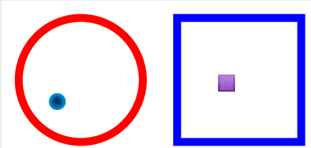
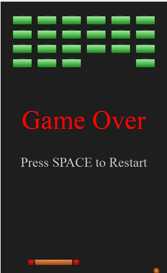

CS1400 - Thursday, March 19 - Lecture 20 - Module 5

# Topics:
* [🟥Assn 5a - The Collector](#assn-5a---the-collector)
* [Match the Case of Filenames](#match-the-case-of-filenames)
* [Code Lab Challenge 0 - Confined Bouncing Shapes](#code-lab-challenge-0---confined-bouncing-shapes)
* [Code Lab Challenge 1 - Arkanoid](#code-lab-challenge-1---arkanoid)


------------------------------------------------------------
# Announcements

## USU SOC CTF

**Hack. Defend. Control the Hill.**

A hybrid Capture The Flag / King of the Hill competition. Solve challenges, capture flags, and defend your territory to earn hourly points.

[Join the Competition](https://soc.innominate.win/)


# Action Items

*   Erik has office hours today from 1 PM to 4 PM
    -   Find me in SER 301E or on [Zoom](https://usu-edu.zoom.us/my/erik.falor?pwd=ZE4zNXRpNVl4VVhHNkN5Q2wwV3VrUT09)


# [🟥Assn 5a - The Collector](https://usu.instructure.com/courses/794745/assignments/5122789)


| Task/Day           | **Thursday**       | **Friday** | **Saturday** | **Sunday**                             | **Monday**                          |
| ------------------ | ------------------ | ---------- | ------------ | -------------------------------------- | ----------------------------------- |
| **Classroom Time** | Classroom Lab Time |            |              |                                        | 5.3: Objects for More than Data**   |
| **Items Due**      |                    | Quiz 5.1   |              | Assignment 5a<br/>Reflection Survey 5a | Code Reviews for <br/>Assn 5a begin |


# Match the Case of Filenames

When loading assets into your Pygame program or writing `import` statements, it's important to match the case of filenames *exactly as they appear in your file browser*.

For example, suppose your project folder contains these assets:

```
PlayerSprite.png
Explosion Sound.WAV
Background Music.Mp3
gameEngine.py
```

You *should not* write your imports and asset loads like this:

```python
import gameengine

player = pygame.image.load("playersprite.png")
boom = pygame.mixer.Sound("explosion sound.wav")
music = pygame.mixer.Sound("background music.mp3")
````

This *might* work fine on your computer (if you're on Windows or macOS), but it will *crash and burn* on a Linux system.

Why?  Because Linux is case-sensitive.  `PlayerSprite.png` and `playersprite.png` are two entirely different files to Linux, but on Windows they're treated as the same file.

I use Linux, and many of your graders use Linux.  If your code doesn't match filename case exactly, we'll have to dig through your code, rename files, and curse softly into our Diet Coke as we grade your work.
You don't want the person holding your fate in their hands to be muttering your name under their breath.

Here's how to do it correctly:

```python
import gameEngine  # matches filename exactly

player = pygame.image.load("PlayerSprite.png")
boom = pygame.mixer.Sound("Explosion Sound.WAV")
music = pygame.mixer.Sound("Background Music.Mp3")
```

Now your code will run smoothly everywhere - Windows, macOS, Linux, or even a Raspberry Pi taped to the ceiling of your dorm.

**TL;DR** Computers are pedantic, and Linux is a lawyer.  *Match your filename cases and nobody gets hurt!*


# Code Lab Challenge 0 - Confined Bouncing Shapes

In this challenge you will diagnose and correct boundary-collision logic for moving shapes.
You will verify that shapes bounce within the confinement of their walls, never drifting outside their zones.

The finished program should look like this:




### Assets

  [Download](./orb.png)

 [Download](./box.png)


<details>
<summary><h3>confinement.py starter code</h3></summary>

```python
# confinement.py

import pygame
import random
import math


# Use named constants to avoid writing "magic numbers" all throughout the program
SCREEN_WIDTH = 1280
SCREEN_HEIGHT = 720
CLOCK_TICK = 30
TITLE = "Confined Bouncing Shapes"
CIRCLE_FENCE_CENTER = (300, 300)
CIRCLE_FENCE_RADIUS = 250
BOX_FENCE_POS = (650, 50, 500, 500)
FENCE_THICKNESS = 30


def check_circle_collision(orb_pos, orb_radius):
    """
    Has the orb collided with its circular fence?
    """
    # TODO: implement this function
    #
    # Take into account the thickness of the wall so the orb appears
    # to bounce as soon as it touches the inside edge of the wall.
    #
    # The return statement will answer this question:
    # "Is the distance of the orb from the center of the fence plus the orb's radius greater than or equal to the radius of the circular fence minus its thickness?"
    return False


def check_box_horizontal_collision(box_pos, box_width):
    """Has the box collided with the left or right walls?"""
    # TODO: implement this function
    #
    # Take into account the thickness of the walls so the box appears
    # to bounce as soon as it touches the inside edge of the wall.
    #
    # The return statement should use the 'or' keyword, like this:
    #   return SOMETHING or SOMETHING
    # and answer these questions:
    # "has the left edge of the box touched or crossed the inner edge of the left wall?"
    #   OR
    # "has the right edge of the box touched or crossed the inner edge of the right wall?"
    return False


def check_box_vertical_collision(box_pos, box_height):
    """Has the box collided with the top or bottom walls?"""
    # TODO: implement this function
    #
    # Take into account the thickness of the walls so the box appears
    # to bounce as soon as it touches the inside edge of the wall.
    #
    # The return statement should use the 'or' keyword, like this:
    #   return SOMETHING or SOMETHING
    # and answer these questions:
    # "has the top edge of the box touched or crossed the inner edge of the top wall"?
    #   OR
    # "has the bottom edge of the box touched or crossed the inner edge of the bottom wall"?
    return False


def draw_circle_fence(surface, pos, radius):
    pygame.draw.circle(surface, "red", pos, radius, FENCE_THICKNESS)


def draw_box_fence(surface, box):
    pygame.draw.rect(surface, "blue", box, FENCE_THICKNESS)


def update_pos(pos, vect):
    return [pos[0] + vect[0], pos[1] + vect[1]]


def bounce_orb(pos, radius, mvmt):
    """Calculate and return a new movement vector after bouncing off the circular fence"""
    # Calculate normal vector from center to orb
    dx = pos[0] - CIRCLE_FENCE_CENTER[0]
    dy = pos[1] - CIRCLE_FENCE_CENTER[1]
    distance = math.sqrt(dx**2 + dy**2)

    # TODO: Why is this if statement here?
    if distance > 0.0:
        # Normalize velocity
        normal_x = dx / distance
        normal_y = dy / distance

        # Reflect velocity vector
        dot_product = mvmt[0] * normal_x + mvmt[1] * normal_y

        # Create a new movement vector by copying the old one
        new_mvmt = list(mvmt)

        # Apply the bounce direction
        new_mvmt[0] -= 2 * dot_product * normal_x
        new_mvmt[1] -= 2 * dot_product * normal_y

        # STRETCH CHALLENGE: Play the boing sound when a bounce occurs
        # STRETCH CHALLENGE: Add a little randomness to new_mvmt

        return new_mvmt


def bounce_box_horizontally(mvmt):
    """Calculate and return a new movement vector after bouncing off the box fence's horizontal walls"""
    # Create a new movement vector by copying the old one
    new_mvmt = list(mvmt)

    # invert the X direction
    new_mvmt[0] = -new_mvmt[0]

    # STRETCH CHALLENGE: Play the boing sound when a bounce occurs
    # STRETCH CHALLENGE: Add randomness to vertical component when hitting horizontal walls

    return new_mvmt


def bounce_box_vertically(mvmt):
    """Calculate and return a new movement vector after bouncing off the box fence's horizontal walls"""
    # Create a new movement vector by copying the old one
    new_mvmt = list(mvmt)

    # invert the Y direction
    new_mvmt[1] = -new_mvmt[1]

    # STRETCH CHALLENGE: Play the boing sound when a bounce occurs
    # STRETCH CHALLENGE: Add randomness to horizontal component when hitting vertical walls

    return new_mvmt


def main():
    # Setup the pygame window and clock
    pygame.init()
    screen = pygame.display.set_mode((SCREEN_WIDTH, SCREEN_HEIGHT))
    pygame.display.set_caption(TITLE)
    clock = pygame.time.Clock()


    ##########
    # Set up game media images, sounds
    ##########
    orb = pygame.image.load("orb.png")
    box = pygame.image.load("box.png")


    ##########
    # Set up game data
    ##########
    # TODO: Answer these questions
    #   - What does min() do?
    #   - If you knew the dimensions of orb.png, would this code be necessary?
    orb_radius = min(orb.get_width(), orb.get_height()) // 2
    box_width = box.get_width()
    box_height = box.get_height()

    # STRETCH CHALLENGE: Introduce an element of randomness to the starting attributes of the bouncing shapes

    # Initial Orb Movement Vector
    orb_mvmt = [3, 7]
    # Orb Initial Position - start in the center of the fence
    orb_pos = [CIRCLE_FENCE_CENTER[0], CIRCLE_FENCE_CENTER[1]]

    # Initial Box Movement Vector
    box_mvmt = [6, 4]
    # Box Initial Position - start in the center of the fence
    box_pos = [BOX_FENCE_POS[0] + BOX_FENCE_POS[2] // 2, BOX_FENCE_POS[1] + BOX_FENCE_POS[3] // 2]


    ##########
    # Game Loop
    ##########
    game_over = False
    running = True
    while running:
        ##########
        # Get Input/Events
        ##########
        for event in pygame.event.get():
            if event.type == pygame.QUIT:  # User clicked the window's X button
                running = False
            if event.type == pygame.KEYDOWN:
                if event.key == pygame.K_q or event.key == pygame.K_ESCAPE:
                    running = False
                if event.key == pygame.K_SPACE and game_over:
                    ### Do Stuff to Reset Game ###
                    game_over = False

        ##########
        # Update state of components/data
        ##########
        #### Always Update ####

        # Update Orb position
        orb_pos = update_pos(orb_pos, orb_mvmt)

        # Check collision with circle fence and bounce off the wall
        if check_circle_collision(orb_pos, orb_radius):
            orb_mvmt = bounce_orb(orb_pos, orb_radius, orb_mvmt)

        # Update box position
        box_pos = update_pos(box_pos, box_mvmt)

        # Check collisions with box fences and bounce off the walls
        if check_box_horizontal_collision(box_pos, box_width):
            box_mvmt = bounce_box_horizontally(box_mvmt)

        if check_box_vertical_collision(box_pos, box_height):
            box_mvmt = bounce_box_vertically(box_mvmt)

        #### Update if Game is Not Over ####
        if not game_over:
            pass

        #### Update if Game is Over ####
        else:
            pass

        ##########
        # Update Display
        ##########
        #### Always Display ####
        screen.fill("white")

        # draw the circle fence & orb
        draw_circle_fence(screen, CIRCLE_FENCE_CENTER, CIRCLE_FENCE_RADIUS)
        screen.blit(orb, (orb_pos[0] - orb.get_width() // 2, orb_pos[1] - orb.get_height() // 2))

        # draw the box fence & box
        draw_box_fence(screen, BOX_FENCE_POS)
        screen.blit(box, (box_pos[0] - box.get_width() // 2, box_pos[1] - box.get_height() // 2))

        #### Display while Game is being played ####
        if not game_over:
            pass
        #### Display while Game is Over ####
        else:
            pass

        #### Draw changes the screen ####
        pygame.display.flip()

        ##########
        # Define the refresh rate of the screen
        ##########
        clock.tick(CLOCK_TICK)


main()
```

</details>

Download [confinement.py](./confinement.py)


### Phase 0 - Identify The Bug(s)

Answer each of these questions in today's Wooclap:

*   How can you tell when the box shape touches a horizontal wall?
*   How can you tell when the box shape touches a vertical wall?
*   Why is this done with two functions?  How bad would it be to do this in one function?
*   How can you tell when the orb touches the circular wall?
*   What is the purpose of `if distance > 0.0` in `bounce_orb()`?
    *   What would happen if you removed it?
*   What does `min()` do?
    *   If you already knew the dimensions of `orb.png`, would it be necessary to ask Pygame to look it up?


### Phase 1 - Fix It

Enact your proposed changes in the program.

#### Debugging tips:

*   Reduce `CLOCK_TICK` so you can more easily see what's going on in the program
*   Increase the thickness of the walls so you don't need to wait as long between bounces
*   Set breakpoints inside the *check collision* functions and use the **Continue** button to skip to the interesting moments


### Phase 2 - Reflect On It

Answer these debrief questions in comments in today's Wooclap:

* Which coordinate should boundary checks use - center or draw position - and why?
* What single invariant guarantees a shape never renders off-screen?
* When two checks trigger at once (corner hit), how should the reflection be applied?
* What evidence tells you tunneling occurred (when a fast-moving object "skips through" the wall instead of colliding with it, and how would you prevent it?
* Which debug technique gave you the fastest path to the fix, and why?


### Phase 3 - Stretch Challenges

There are several comments in the source code challenging you to embellish this program:

* Play `boing.mp3` when a bounce occurs
* Introduce an element of randomness to the starting attributes of the bouncing shapes
* Add a little randomness to `new_mvmt` so the orb and box don't eternally trace the same path


# Code Lab Challenge 1 - Arkanoid

In this challenge, you will implement a brick-breaking game similar to Arkanoid. You will create collision detection between the ball and multiple game objects, control a paddle with the keyboard, and manage the game state (playing, won, lost).

The finished program should look like this:




### Program Requirements

0. Initialize the screen dimensions to be tall and narrow
1. Display a grid of colored blocks at the top of the screen
    - They can all be the same color in the first draft of the game
2. Display a ball that moves and bounces off walls
    - Initialize the ball with vertical and horizontal velocities
3. Display a paddle controlled by LEFT and RIGHT arrow keys
4. The ball bounces off the paddle, blocks, and screen walls
5. When the ball hits a block, the block is destroyed
6. Display "Game Over" when the ball falls below the paddle
7. Display "You Won!" when all blocks are destroyed
8. Allow restarting the game by pressing SPACE


### Assets

 [Download](./ball.png)

 [Download](./paddle-large.png)

 [Download](./paddle-medium.png)

 [Download](./paddle-small.png)

 [Download](./crimson_brick.png)

 [Download](./emerald_brick.png)

 [Download](./sapphire_brick.png)

 [Download](./sunset_brick.png)


<details>
<summary><h3>arkanoid.py starter code</h3></summary>

```python
# arkanoid.py
import pygame

SCREEN_WIDTH = 500
SCREEN_HEIGHT = 820
CLOCK_TICK = 30
TITLE = "Arkanoid"
PADDLE_SPEED = 10
BALL_SPEED_X = 6
BALL_SPEED_Y = 5
BLOCK_ROWS = 4
BLOCK_COLS = 6
BLOCK_SPACING = 10


class Ball:
    pass


class Paddle:
    pass


class Block:
    pass


def make_ball(filename, screen_width, screen_height):
    """Create and return a ball object"""
    ball = Ball()
    ball.image = pygame.image.load(filename)
    ball.width = ball.image.get_width()
    ball.height = ball.image.get_height()
    ball.x = screen_width // 2
    ball.y = screen_height // 2
    ball.vx = BALL_SPEED_X
    ball.vy = BALL_SPEED_Y
    return ball


def make_paddle(filename, screen_width, screen_height):
    """Create and return a paddle object"""
    paddle = Paddle()
    paddle.image = pygame.image.load(filename)
    paddle.width = paddle.image.get_width()
    paddle.height = paddle.image.get_height()
    paddle.x = screen_width // 2 - paddle.width // 2
    paddle.y = screen_height - 50
    return paddle


def make_blocks(filename, screen_width):
    """Create and return a list of block objects"""
    blocks = []
    block_image = pygame.image.load(filename)
    block_width = block_image.get_width()
    block_height = block_image.get_height()
    start_x = (screen_width - (BLOCK_COLS * block_width + (BLOCK_COLS - 1) * BLOCK_SPACING)) // 2
    start_y = 40

    for row in range(BLOCK_ROWS):
        for col in range(BLOCK_COLS):
            block = Block()
            block.img = block_image
            block.width = block_width
            block.height = block_height
            block.x = start_x + col * (block.width + BLOCK_SPACING)
            block.y = start_y + row * (block.height + BLOCK_SPACING)
            block.active = True
            blocks.append(block)

    return blocks


def get_ball_rect(ball):
    """Return the left, right, top, bottom edges of the ball"""
    left = ball.x - ball.width // 2
    right = ball.x + ball.width // 2
    top = ball.y - ball.height // 2
    bottom = ball.y + ball.height // 2
    return (left, right, top, bottom)


def get_paddle_rect(paddle):
    """Return the left, right, top, bottom edges of the paddle"""
    left = paddle.x
    right = paddle.x + paddle.width
    top = paddle.y
    bottom = paddle.y + paddle.height
    return (left, right, top, bottom)


def get_block_rect(block):
    """Return the left, right, top, bottom edges of a block"""
    left = block.x
    right = block.x + block.width
    top = block.y
    bottom = block.y + block.height
    return (left, right, top, bottom)


def rects_overlap(rect1, rect2):
    """
    Check if two rectangles overlap.
    Each rect is a tuple of (left, right, top, bottom)
    """
    # TODO: Implement this function
    # Two rectangles overlap if:
    # - rect1's right edge is past rect2's left edge, AND
    # - rect1's left edge is before rect2's right edge, AND
    # - rect1's bottom edge is past rect2's top edge, AND
    # - rect1's top edge is before rect2's bottom edge
    #
    # In other words, they do NOT overlap if:
    # - rect1 is completely to the left of rect2, OR
    # - rect1 is completely to the right of rect2, OR
    # - rect1 is completely above rect2, OR
    # - rect1 is completely below rect2
    return False


def update_ball(ball, paddle, blocks, screen_width, screen_height):
    """Update ball position and handle collisions"""
    # Move the ball
    ball.x += ball.vx
    ball.y += ball.vy

    # Bounce off top and bottom walls
    if ball.y - ball.height // 2 <= 0:
        ball.vy = -ball.vy
        ball.y = ball.height // 2

    if ball.y + ball.height // 2 >= screen_height:
        return False  # Game over (ball fell below paddle)

    # Bounce off left and right walls
    if ball.x - ball.width // 2 <= 0:
        ball.vx = -ball.vx
        ball.x = ball.width // 2

    if ball.x + ball.width // 2 >= screen_width:
        ball.vx = -ball.vx
        ball.x = screen_width - ball.width // 2

    # TODO: Implement collision detection with the paddle
    # Steps:
    # 1. Get the ball and paddle rectangles using get_ball_rect() and get_paddle_rect()
    # 2. Check if they overlap using rects_overlap()
    # 3. If they do:
    #    a. Reverse the ball's vertical velocity (ball.vy = -ball.vy)
    #    b. Move the ball to be above the paddle (ball.y = paddle.y - ball.height // 2)

    # TODO: Implement collision detection with blocks
    # For each active block in the blocks list:
    # 1. Get the block's rectangle using get_block_rect()
    # 2. Check if it overlaps with the ball using rects_overlap()
    # 3. If it does:
    #    a. Set block.active = False to destroy the block
    #    b. Determine collision direction by comparing distances:
    #       - dx = abs(ball.x - (block.x + block.width // 2))
    #       - dy = abs(ball.y - (block.y + block.height // 2))
    #       - If dx > dy: ball hit from side → reverse ball.vx
    #       - Otherwise: ball hit from top/bottom → reverse ball.vy
    #    c. Break out of the loop (only process one collision per frame)

    return True  # Game continues


def move_paddle(paddle, direction, screen_width):
    """Move paddle left or right, keeping it in bounds"""
    # TODO: Update the paddle's x position by direction * PADDLE_SPEED
    # Hint: paddle.x += direction * PADDLE_SPEED

    # TODO: Ensure the paddle stays within the screen bounds
    # The left edge should not go below 0
    # The right edge should not go beyond screen_width
    # Hint: Use if statements to check and correct paddle.x
    pass


def all_blocks_destroyed(blocks):
    """Check if all blocks have been destroyed"""
    # TODO: Implement this function
    # Return True if all blocks have active = False
    # Return False if any block still has active = True
    # Hint: Use a for loop and check block.active for each block
    return False


def main():
    # Setup the pygame window and clock
    pygame.init()
    screen = pygame.display.set_mode((SCREEN_WIDTH, SCREEN_HEIGHT))
    pygame.display.set_caption(TITLE)
    clock = pygame.time.Clock()

    ##########
    # Set up game media images
    ##########
    background_color = (30, 30, 30)
    ball = make_ball("ball.png", SCREEN_WIDTH, SCREEN_HEIGHT)
    paddle = make_paddle("paddle-large.png", SCREEN_WIDTH, SCREEN_HEIGHT)
    blocks = make_blocks("emerald_brick.png", SCREEN_WIDTH)

    ##########
    # Set up game data
    ##########
    game_over = False
    game_won = False
    running = True

    ##########
    # Game Loop
    ##########
    while running:
        ##########
        # Get Input/Events
        ##########
        for event in pygame.event.get():
            if event.type == pygame.QUIT:
                running = False
            if event.type == pygame.KEYDOWN:
                if event.key == pygame.K_q or event.key == pygame.K_ESCAPE:
                    running = False
                if event.key == pygame.K_SPACE and (game_over or game_won):
                    # Reset the game
                    game_over = False
                    game_won = False
                    ball = make_ball("ball.png", SCREEN_WIDTH, SCREEN_HEIGHT)
                    paddle = make_paddle("paddle-large.png", SCREEN_WIDTH, SCREEN_HEIGHT)
                    blocks = make_blocks("emerald_brick.png", SCREEN_WIDTH)

        ##########
        # Update state of components/data
        ##########
        #### Always Update ####
        keys = pygame.key.get_pressed()
        if keys[pygame.K_LEFT]:
            move_paddle(paddle, -1, SCREEN_WIDTH)
        if keys[pygame.K_RIGHT]:
            move_paddle(paddle, 1, SCREEN_WIDTH)

        #### Update if Game is Not Over ####
        if not game_over and not game_won:
            game_over = not update_ball(ball, paddle, blocks, SCREEN_WIDTH, SCREEN_HEIGHT)
            if not game_over:
                game_won = all_blocks_destroyed(blocks)

        ##########
        # Update Display
        ##########
        #### Always Display ####
        screen.fill(background_color)

        # Draw blocks
        for block in blocks:
            if block.active:
                screen.blit(block.img, (block.x, block.y))

        # Draw ball
        screen.blit(ball.image, (ball.x - ball.width // 2, ball.y - ball.height // 2))

        # Draw paddle
        screen.blit(paddle.image, (paddle.x, paddle.y))

        #### Display while Game is being played ####
        if not game_over and not game_won:
            pass

        #### Display while Game is Over (Lost) ####
        if game_over:
            text_font = pygame.font.SysFont("timesnewroman", 80).render("Game Over", True, (255, 0, 0))
            screen.blit(text_font, [SCREEN_WIDTH // 2 - text_font.get_width() // 2, SCREEN_HEIGHT // 2 - 100])

            text_font_small = pygame.font.SysFont("timesnewroman", 40).render("Press SPACE to Restart", True, (200, 200, 200))
            screen.blit(text_font_small, [SCREEN_WIDTH // 2 - text_font_small.get_width() // 2, SCREEN_HEIGHT // 2 + 50])

        #### Display while Game is Won ####
        if game_won:
            text_font = pygame.font.SysFont("timesnewroman", 80).render("You Won!", True, (0, 255, 0))
            screen.blit(text_font, [SCREEN_WIDTH // 2 - text_font.get_width() // 2, SCREEN_HEIGHT // 2 - 100])

            text_font_small = pygame.font.SysFont("timesnewroman", 40).render("Press SPACE to Restart", True, (200, 200, 200))
            screen.blit(text_font_small, [SCREEN_WIDTH // 2 - text_font_small.get_width() // 2, SCREEN_HEIGHT // 2 + 50])

        #### Draw changes to the screen ####
        pygame.display.flip()

        ##########
        # Define the refresh rate of the screen
        ##########
        clock.tick(CLOCK_TICK)


main()
```

</details>

Download [arkanoid.py](./arkanoid.py)


## Phase 0 - Design It

Before looking at code, think through the game mechanics:

0. **What objects do I need?** (Ball, Paddle, Blocks, etc.)
1. **What properties does each object have?** (position, size, velocity, etc.)
2. **What collisions need to be detected?** (ball-paddle, ball-block, ball-walls)
3. **How do I know when the game is won or lost?**
4. **What input does the player provide?** (keyboard controls)

Answer each of these questions in the Wooclap for this challenge.


## Phase 1 - Pseudocode It

Using the answers above, write pseudocode as comments in your program. Start by describing the flow of the game loop in plain English. Your pseudocode should answer these questions:

- How do I update the ball's position each frame?
- How do I detect when the ball hits the paddle?
- How do I detect when the ball hits a block?
- How do I know when to end the game?
- How do I draw everything on the screen?

Refine your pseudocode until it is as specific as Python code.


## Phase 2 - Build It

Start with the provided starter code. This code has the structure set up, but several key functions are incomplete. Your job is to implement the TODO items:

0. **`rects_overlap()` function** - Write the core collision detection logic
1. **`move_paddle()` function** - Move the paddle left and right, keeping it in bounds
2. **`update_ball()` function - Ball-paddle collision** - Detect when the ball hits the paddle and bounce it
3. **`update_ball()` function - Block collision** - Detect when the ball hits a block, destroy it, and bounce
4. **`all_blocks_destroyed()` function** - Check if the player has won

**Important: You will write collision detection from scratch, not using built-in Pygame functions.**

The `rects_overlap()` function is the core of collision detection. Two rectangles overlap if they share any space. Think about when rectangles do NOT overlap:

- One is completely to the left of the other
- One is completely to the right of the other
- One is completely above the other
- One is completely below the other

If none of these are true, they must overlap!

**Tips for collision detection:**

- Each rectangle is represented as `(left, right, top, bottom)` coordinates
- For ball-paddle collision: detect overlap, then reverse vertical velocity
- For ball-block collision: detect overlap, then determine bounce direction
  - Compare the distance from ball center to block center in X and Y
  - If X distance is larger, bounce horizontally (reverse `ball.vx`)
  - If Y distance is larger, bounce vertically (reverse `ball.vy`)
  - Set `block.active = False` to destroy the block
  - Break out of the loop (only process one collision per frame)

**Game Over Condition**

End the game when

-   All blocks are destroyed (you win!)
-   The ball collides with the bottom wall (game over)


## Phase 3 - Reflect On It

After you finish the implementation, answer these questions in today's Wooclap:

0. **What was the hardest part?** Was it collision detection, boundary checking, or game state management?
1. **Did your collision code work correctly on the first try?** If not, what did you need to debug?
2. **How would you improve the game?** (Hint: see the stretch challenges below)
3. **Why do we reverse velocity to simulate a bounce?** What would happen if we just stopped the ball?

Answer these questions in the Wooclap for this challenge.


## Phase 4 - Stretch Challenges

If you finish early or want to make the game more interesting, try these enhancements:

0. **Add scoring** - Give each block a point value. Display the current score on screen.
1. **Add multiple lives** - Instead of instant game over, give the player 3 lives. Lose a life when the ball falls below the paddle.
2. **Improve collision response** - Instead of always bouncing vertically off the paddle, have the ball's angle change based on where it hits (hit near the edge = sharper angle).
3. **Add sound effects** - Play a sound when the ball hits the paddle or blocks.
4. **Different colored blocks** - Use different colors for rows of blocks. Could rows have different point values?
5. **Increasing difficulty** - Make the ball move faster after hitting a certain number of blocks.
6. **Power-ups** - Randomly place power-ups in destroyed blocks (temporary paddle growth, slower ball, etc.)


