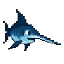
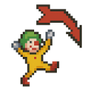

CS1400 - Tuesday, March 24 - Lecture 21 - Module 5

# Topics:
* [🟥Assn 5b - Dr. Moody & Crittery](#assn-5b---dr-moody--crittery)
* [Code Lab Challenge 0 - Cursor Hotpoint Calibrator](#code-lab-challenge-0---cursor-hotpoint-calibrator)
* [Code Lab Challenge 1 - Fix My Bug: Spawn-Safe Treasure](#code-lab-challenge-1---fix-my-bug-spawn-safe-treasure)


------------------------------------------------------------
# Announcements

## Check Out [PixelLab.AI](https://www.pixellab.ai/)

> Create unique pixel art assets for your game 10x faster with AI
>
> Try for free without a credit card


## *TONIGHT*  FSLC - Shell Shenanigans

*   **When**    6:30 PM Tuesday, March 24th
*   **Where**   WIDT 007
*   **Website** https://linux.usu.edu
*   **Discord** https://discord.gg/PvgG6N2hsU

Our next two meetings (the 24th and 31st) are all about command shells


## Cache Tech Community Meetup

*   **When**  Saturday, March 28th, 1:30 - 3:30 PM 
*   **Where** Bridgerland Technical College        

Free in-person meetup in Logan, UT! **nonopey** is presenting on RAM fundamentals: how it works, how systems use it, types, specs, troubleshooting, and more.

All skill levels welcome. Details here: https://www.cachevalley.co/posts/cache-tech-community-ram-fundamentals-march-2026/


# [🟥Assn 5b - Dr. Moody & Crittery](https://usu.instructure.com/courses/794745/assignments/5122790)

*   This assignment has two tasks
*   Read the instructions *carefully*, but also look at the **rubric**
    *   Use the rubric as a checklist so you don't miss important requirements
*   This assignment is due **at 11:59 PM on Sunday, March 29th**


## Task 1 - Dr. Moody

Dr. Moody is a typical professor. One little click and their demeanor changes in an instant. You are going to write the class to make Dr. Moody work properly with the given starter code.

*   This is a **Drawly** program (the last one of the semester!)
*   Download the file `drmoody_task2.py` from the assignment on Canvas **but do not change it!**
*   You will submit three files:
    1.  `design1.md`
    2.  `task1.py` (renamed from `drmoody_task1.py`)
        -   Do not modify this starter code one bit!
        -   Do include it with your submission
    3.  `moody.py` (100% of your code goes in here)
*   You will use knowledge from these sections of Unit 5
    *   **5.3: Objects for More than Data**


## Task 2 - Crittery

In this program the player attempts to either catch or kill critters with the mouse.

*   Put your code in a file called `task2.py` and your software development plan as `design2.md`
*   There are two starter code files to download from Canvas
    1.  `crittery_starter.py`
    2.  `cursor.py`
*   You will submit four files:
    1.  `task2.py` (renamed from `crittery_starter.py`)
    2.  `cursor.py` (you may leave this file unchanged)
    3.  `critter.py`
    4.  and `design2.md`
*   Read all of the instructions on Canvas to see how to hide the Operating System's mouse cursor so that it appears to be replaced by a sprite that follows the position of the mouse.
*   You will use knowledge from these sections of Unit 5
    *   **5.4: Objects Experience**
    *   **5.5: More Objects Experience**


| Task/Day           | **Tuesday**        | **Wednesday** | **Thursday**       | **Friday**                                  | **Saturday** | **Sunday**                             | **Monday**                          |
| ------------------ | ------------------ | ------------- | ------------------ | ------------------------------------------- | ------------ | -------------------------------------- | ----------------------------------- |
| **Classroom Time** | Classroom Lab Time |               | Classroom Lab Time |                                             |              |                                        | 6.1: More on Lists                  |
| **Items Due**      |                    |               |                    | Exercises 5.3.4, 5.3.5<br/>Quizzes 5.3, 5.4 |              | Assignment 5b<br/>Reflection Survey 5b | Code Reviews for <br/>Assn 5b begin |


# Code Lab Challenge 0 - Cursor Hotpoint Calibrator

In this code lab, you will measure and correct the **offset** between your mouse pointer's true position and the visible "tip" (hotpoint) of several custom cursor images.

When you move the mouse, Pygame reports the position of the **hotpoint** (the spot on the image that should align with what you're pointing at).
However, since each image has a different shape, that hotpoint isn't necessarily at the upper-left corner of the sprite.
To make the cursor feel right, we must apply an **offset** so that the image's visible tip sits directly under the mouse position.

  [Download](./cursor0.png)

  [Download](./cursor1.png)

  [Download](./cursor2.png)

  [Download](./cursor3.png)

  [Download](./cursor4.png)

  [Download](./cursor5.png)

  [Download](./cursor6.png)


<details>
<summary><h3>hotpoint.py Source Code</h3></summary>

```python
# hotpoint.py
import math
import pygame

from cursor import Cursor


TITLE = "Cursor Hotpoint Calibrator"
SCREEN_WIDTH = 1280
SCREEN_HEIGHT = 720
CLOCK_TICK = 30                # Framerate of the game
CLICK_FRAMES = CLOCK_TICK * 2  # Number of frames a click remains on screen
CURSOR_IMAGE = "cursor3.png"   # TODO: try each of "cursor0.png"
                               #                   "cursor1.png"
                               #                   "cursor2.png"
                               #                   "cursor3.png"
                               #                   "cursor4.png"
                               #                   "cursor5.png"
                               #                   "cursor6.png"


def main():
    # Setup the pygame window and clock
    pygame.init()
    screen = pygame.display.set_mode((SCREEN_WIDTH, SCREEN_HEIGHT))
    pygame.display.set_caption(TITLE)
    clock = pygame.time.Clock()

    ##########
    # Set up game media images, sounds
    ##########
    # TODO: create an instance of the Cursor class
    # TODO: hide your OS cursor

    ##########
    # Set up game data
    ##########
    center = (SCREEN_WIDTH // 2, SCREEN_HEIGHT // 2)
    game_over = False
    clicks = []  # list of on-screen click images

    ##########
    # Game Loop
    ##########
    running = True
    while running:

        # Reset the boolean that tracks whether the mouse was clicked on this frame
        mouse_clicked = False
        ##########
        # Get Input/Events
        ##########
        for event in pygame.event.get():
            if event.type == pygame.QUIT:  # User clicked the window's X button
                running = False
            if event.type == pygame.KEYDOWN:
                if event.key == pygame.K_q or event.key == pygame.K_ESCAPE:
                    running = False
                if event.key == pygame.K_SPACE and game_over:
                    # Not used in this lab, kept to preserve template behavior
                    game_over = False

            # TODO: Presently a click is registered for ANY mouse button
            #       Change this so that only left mouse button clicks are registered
            if event.type == pygame.MOUSEBUTTONDOWN:
                mouse_clicked = True
                # add a new Click object to the list of on-screen clicks
                clicks.append(Click(event.pos))


        ##########
        # Update state of components/data
        ##########
        #### Always Update ####
        mouse_pos = pygame.mouse.get_pos()
        cursor.update_pos(mouse_pos)

        #### Update if Game is Not Over ####
        if not game_over:
            pass
        #### Update if Game is Over ####
        else:
            pass

        ##########
        # Update Display
        ##########
        #### Always Display ####
        screen.fill("white")

        draw_crosshairs(screen)

        # Draw all clicks with fade effect, removing those that age out
        new_clicks = []
        for click in clicks:
            click.draw(screen)  # this method also decrements the Time To Live counter
            if click.ttl != 0:
                new_clicks.append(click)
        clicks = new_clicks

        # Draw the custom cursor last so it sits above the other elements
        # TODO: what happens if you move this line of code above draw_crosshairs()?
        cursor.draw(screen)

        #### Display while Game is being played ####
        if not game_over:
            pass
        #### Display while Game is Over ####
        else:
            pass

        #### Draw changes the screen ####
        pygame.display.flip()

        ##########
        # Define the refresh rate of the screen
        ##########
        clock.tick(CLOCK_TICK)


def draw_crosshairs(surface, color="black", size=3):
    """Draw calibration target at exact center of screen"""
    pygame.draw.line(surface, color, (SCREEN_WIDTH // 2, 0), (SCREEN_WIDTH // 2, SCREEN_HEIGHT))
    pygame.draw.line(surface, color, (0, SCREEN_HEIGHT // 2), (SCREEN_WIDTH, SCREEN_HEIGHT // 2))


class Click:
    """X marks the spot where the mouse button was clicked"""
    COLORS = []
    for i in range(CLICK_FRAMES, 0, -1):
        fade = i / CLICK_FRAMES
        COLORS.append((255, int(255 * fade), int(255 * fade)))

    def __init__(self, center, ttl=CLICK_FRAMES, size=15, thickness=10):
        self.center = center
        self.ttl = ttl  # ttl = Time To Live
        self.size = size
        self.thickness = thickness

    def draw(self, surface):
        """
        Put an X on the screen centered on this object's center attribute,
        and decrement the TTL counter by 1
        """
        if self.ttl > 0:
            self.ttl -= 1
            cx, cy = self.center
            pygame.draw.line(surface, Click.COLORS[self.ttl], (cx - self.size, cy - self.size), (cx + self.size, cy + self.size), self.thickness)
            pygame.draw.line(surface, Click.COLORS[self.ttl], (cx - self.size, cy + self.size), (cx + self.size, cy - self.size), self.thickness)


main()
```

</details>

[Download hotpoint.py](./hotpoint.py)


<details>
<summary><h3>cursor.py Source Code</h3></summary>

```python
# cursor.py
import pygame


class Cursor:
    def __init__(self, image, offset=[0, 0]):
        self.image = pygame.image.load(image)
        self.pos = [0, 0]
        self.offset = offset

    def update_pos(self, mouse_pos):
        self.pos = [
                mouse_pos[0] + self.offset[0],
                mouse_pos[1] + self.offset[1]
                ]

    def draw(self, screen):
        screen.blit(self.image, self.pos)
```

</details>

[Download cursor.py](./cursor.py)


### Phase 0 - Fill in the blanks

Find and address each of the `TODO` comments.  Some comments invite you to add code to make the program work, while others ask you to think about the code.

Hint: This line of code tells Pygame to hide the mouse cursor:

```python
pygame.mouse.set_visible(False)
```

Hint: `event.button` tells you which mouse button was pressed.


### Phase 1 - Measure and Adjust

Try every cursor and find the offset that "fixes" their hot points.


### Phase 2 - Reflect On It

Answer these debrief questions in comments in today's Wooclap:

*   What offsets are needed to correctly place the hotpoint for each cursor image?
    -   `cursor0.png`
    -   `cursor1.png`
    -   `cursor2.png`
    -   `cursor3.png`
    -   `cursor4.png`
    -   `cursor5.png`
    -   `cursor6.png`
*   What does the offset represent conceptually in a graphical program?
*   What happens to the cross-hairs if you change the constants `SCREEN_WIDTH` and `SCREEN_HEIGHT`?   Why?
*   Two lines of code cause our custom mouse cursor to appear at the right location on the screen.  Which lines are they?
*   What would you change to make this program respond only to right-clicks?
*   What happens if you draw the mouse cursor before calling `draw_crosshairs()`?


### Phase 3 - Stretch Challenges

0.  Create a `Cursor` object for each one of the images, and pick one at random when the program starts up
0.  Bind keys 0-6 to switch between cursors at will
    -   https://www.pygame.org/docs/ref/key.html
0.  Randomly place the cross-hairs on each click
    -   Animate the cross-hairs moving from point to point
0.  Print to the console a message indicating the Pythagorean distance between the hotpoint's position and the cross-hairs.
    -   Even though pixels are integers, the distance can be a floating-point number
    -   Print a **Winner!** message when `distance == 0.0`
0.  Draw different colored `X`s when different mouse buttons are clicked
    -   For instance, you might show a fading blue `X` on a right click, and use green for a middle-click (if your hardware can do this)
    -   https://www.pygame.org/docs/ref/mouse.html


# Code Lab Challenge 1 - Fix My Bug: Spawn-Safe Treasure

Find and fix the bugs so treasures spawn fully on-screen. Treasures *may* touch the edge, but cannot cross it.

The "treasure" is represented as a yellow ball:

 [Download](./treasure.png)


<details>
<summary><h3>spawn_safe_treasure.py Source Code</h3></summary>

```python
# spawn_safe_treasure.py
import pygame
import random


SCREEN_WIDTH = 1280  # Use constants here to be able to use in different places
SCREEN_HEIGHT = 720
CLOCK_TICK = 10
TITLE = "Spawn-Safe Treasure"

class Treasure:
    def __init__(self, image):
        self.image = image
        self.width = image.get_width()
        self.height = image.get_height()

        self.center = [random.randint(0, SCREEN_WIDTH),
                       random.randint(0, SCREEN_HEIGHT)]

        self.radius = max(self.width, self.height)

        self.draw_pos = self.center


def main():
    # Setup the pygame window and clock
    pygame.init()
    screen = pygame.display.set_mode((SCREEN_WIDTH, SCREEN_HEIGHT))
    pygame.display.set_caption(TITLE)
    clock = pygame.time.Clock()

    ##########
    # Set up game media images, sounds
    ##########
    treasure_img = pygame.image.load("treasure.png")

    ##########
    # Set up game data
    ##########
    # place 40 treasures on the screen
    treasures = []
    for i in range(40):
        treasures.append(Treasure(treasure_img))

    ##########
    # Game Loop
    ##########
    game_over = False
    running = True
    while running:
        ##########
        # Get Input/Events
        ##########
        for event in pygame.event.get():
            if event.type == pygame.QUIT:  # User clicked the window's X button
                running = False
            if event.type == pygame.KEYDOWN:
                if event.key == pygame.K_q or event.key == pygame.K_ESCAPE:
                    running = False
                if event.key == pygame.K_SPACE and game_over:
                    ### Do Stuff to Reset Game ###
                    game_over = False

        ##########
        # Update state of components/data
        ##########
        #### Always Update ####

        #### Update if Game is Not Over ####
        if not game_over:
            pass
        #### Update if Game is Over ####
        else:
            pass

        ##########
        # Update Display
        ##########
        #### Always Display ####
        screen.fill("white")
        for t in treasures:
            screen.blit(t.image, t.draw_pos)
            # draw a small dot at the center of the treasure to see the error
            pygame.draw.circle(screen, "red", t.center, 2)

        #### Display while Game is being played ####
        if not game_over:
            pass
        #### Display while Game is Over ####
        else:
            pass

        #### Draw changes the screen ####
        pygame.display.flip()

        ##########
        # Define the refresh rate of the screen
        ##########
        clock.tick(CLOCK_TICK)


main()
```

</details>

[Download spawn_safe_treasure.py](./spawn_safe_treasure.py)

### Phase 0 - Identify The Bug(s)

Answer each of these questions in today's Wooclap:

* Why do some treasures appear partially off-screen?
* What range should the treasure's **center** use to guarantee full visibility?
* Why is the red center dot *not* drawn in the center of the treasure image?
    * Which is/are wrong?
        - [ ] The computation of the center point?
        - [ ] The position of the treasure's center?
        - [ ] The position of the red center dot?
        - [ ] All of the above?
* How is `draw_pos` computed from a center and image size?
    * How *should* it be computed?
* Why should `radius = min(w, h) // 2` for circle-based edge collision detection?


### Phase 1 - Fix It

Enact your proposed changes in the program.


### Phase 2 - Test It

Run the program and verify:

* After spawning 40+ treasures, no pixel is off-screen
* Treasures can touch all four edges without clipping
* The red center dot sits visually at the sprite's center
* Adjusting image sizes still keeps treasures fully visible


### Phase 3 - Reflect On It

Answer these debrief questions in comments in today's Wooclap:

* What is the simplest invariant that keeps sprites visible on any window size?
* When would you prefer rect-based spawn constraints over circle-based ones?


### Phase 4 - Stretch Challenges

0.  Draw the treasures one-at-a-time and make them appear one frame at a time
0.  Make the screen flash red and display a text when a sprite touches an edge
0.  Make the touched edge flash red for a frame when it is touched
0.  Make the screen flash magenta and display a text message when a sprite crosses the edge
    - You carefully designed the program to *not* do this; make this possible again so that you can see if this error condition is detected and its message is displayed


