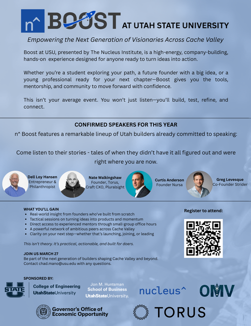

CS1400 - Thursday, March 26 - Lecture 22 - Module 5

# Topics:
* [🟥Assn 5b - Dr. Moody & Crittery](#assn-5b---dr-moody--crittery)
* [Code Lab Challenge 0 - Energy Ball Z](#code-lab-challenge-0---energy-ball-z)
* [Code Lab Challenge 1 - Buggy Bouncing Balls](#code-lab-challenge-1---buggy-bouncing-balls)


------------------------------------------------------------
# Announcements

## How to get the 🟥Assn 5b - Dr. Moody & Crittery starter code

Canvas is having a problem with embedded files.  Unfortunately, it's not the kind of problem that I can fix.  Fortunately, there is a simple work-around:

*   **DO NOT** click on the link `drmoody_task1.py` - it always shows this error: `JWT rejected: JTI has already been used`
*   **DO** click the download icon beside the link 


## *TOMORROW* n^Boost @ USU

A high-energy, hands-on event with real founders and builders.  If you're curious about startups, products, or just figuring out your next step, this is worth your time.

*   **When**  8:30 AM - 3:30 PM Friday, March 27th  
*   **Where** The Loop (SER lounge)
*   **Registration is free, but required** https://luma.com/nkmuuvnu
*   You can earn **40 points** of extra credit by attending!
    -   Simply take a selfie at the conference and email it to me.
    -   I will confirm your attendance with the organizers and award the extra credit. 




# Action Items

*   Erik has office hours today from 1 PM to 4 PM
    -   Find me in SER 301E or on [Zoom](https://usu-edu.zoom.us/my/erik.falor?pwd=ZE4zNXRpNVl4VVhHNkN5Q2wwV3VrUT09)


# [🟥Assn 5b - Dr. Moody & Crittery](https://usu.instructure.com/courses/794745/assignments/5122790)


| Task/Day           | **Thursday**       | **Friday**                                  | **Saturday** | **Sunday**                             | **Monday**                          |
| ------------------ | ------------------ | ------------------------------------------- | ------------ | -------------------------------------- | ----------------------------------- |
| **Classroom Time** | Classroom Lab Time |                                             |              |                                        | 6.1: More on Lists                  |
| **Items Due**      |                    | Exercises 5.3.4, 5.3.5<br/>Quizzes 5.3, 5.4 |              | Assignment 5b<br/>Reflection Survey 5b | Code Reviews for <br/>Assn 5b begin |


# Code Lab Challenge 0 - Energy Ball Z

In this code lab, you will finish a small game where you draw pictures with glowing energy balls.  With every click your cursor cycles through each of these colors.  A right-click clears the canvas for your next creation.

| Blue | Green | Purple | Red | Yellow |
|------|-------|--------|-----|--------|
|    <br>  [Download](./EnBallBlue.png) |  <br>  [Download](./EnBallGreen.png) |    <br>  [Download](./EnBallPurp.png) |      <br>  [Download](./EnBallRed.png) |  <br>[Download](./EnBallYellow.png)


<details>
<summary><h3>energy-ball-z.py Source Code</h3></summary>

```python
# energy-ball-z.py
import pygame


SCREEN_WIDTH = 1280 
SCREEN_HEIGHT = 720
CLOCK_TICK = 15  # TODO: try different frame rates
TITLE = "Energy Ball Z"


class EnergyBall:
    """Maintains the position and image of an energy ball"""
    def __init__(self, image, position):
        self.image = image
        self.radius = image.get_width() / 2
        self.position = position
    
    def draw(self, surface):
        """Draw the energy ball centered on its position"""
        draw_pos = [self.position[0] - self.radius,
                    self.position[1] - self.radius]
        surface.blit(self.image, draw_pos)

    def clicked(self, mouse_pos):
        """Return True|False based on whether the mouse position is within this energy ball's radius"""
        dx = mouse_pos[0] - self.position[0]
        dy = mouse_pos[1] - self.position[1]
        dist = (dx ** 2 + dy ** 2) ** 0.5
        return dist <= self.radius


def main():
    # Setup the pygame window and clock
    pygame.init()
    screen = pygame.display.set_mode((SCREEN_WIDTH, SCREEN_HEIGHT))
    pygame.display.set_caption(TITLE)
    clock = pygame.time.Clock()

    ##########
    # Set up game media images, sounds
    ##########
    # Load all EnBall sprites in sequence
    sprites = [
            pygame.image.load("EnBallBlue.png"),
            pygame.image.load("EnBallRed.png"),
            pygame.image.load("EnBallGreen.png"),
            pygame.image.load("EnBallYellow.png"),
            pygame.image.load("EnBallPurp.png"),
            ]
    
    # TODO: Hide default mouse cursor
    
    ##########
    # Set up game data
    ##########
    current_sprite_index = 0  # Index of current cursor sprite
    placed_energy_balls = []  # List of EnergyBall instances

    ##########
    # Game Loop
    ##########
    game_over = False
    running = True
    while running:
        ##########
        # Get Input/Events
        ##########
        for event in pygame.event.get():
            if event.type == pygame.QUIT:  # User clicked the window's X button
                running = False
            if event.type == pygame.KEYDOWN:
                if event.key == pygame.K_q or event.key == pygame.K_ESCAPE:
                    running = False
                if event.key == pygame.K_SPACE:
                    ### Do Stuff to Reset Game ###
                    # TODO: Remove all EnergyBalls and clear the canvas
                    print("Canvas is cleared")
            if event.type == pygame.MOUSEBUTTONDOWN:
                if event.button == 1:  # Left mouse button
                    # TODO: Create and place an EnergyBall at click position
                    print("EnergyBall placed at", event.pos)
                    # TODO: Advance to next sprite (cycle through all sprites)
                    current_sprite_index = current_sprite_index + 1
                    print("Now using sprite #" + str(current_sprite_index))
                elif event.button == 3:  # Right mouse button
                    # TODO: Remove the energy balls that were right-clicked
                    removed_count = 0
                    print("Removed", removed_count, "EnergyBalls")


        ##########
        # Update state of components/data
        ##########
        #### Always Update ####
        # TODO: get the current position of the mouse
        mouse_pos = [0, 0]

        #### Update if Game is Not Over ####
        if not game_over:
            pass
        #### Update if Game is Over ####
        else:
            pass

        ##########
        # Update Display
        ##########
        #### Always Display ####
        screen.fill("black")
        
        # Draw all placed energy balls
        for energy_ball in placed_energy_balls:
            energy_ball.draw(screen)
        
        # Draw current cursor sprite at mouse position
        current_sprite = sprites[current_sprite_index]
        cursor_rect = current_sprite.get_rect()
        cursor_rect.center = mouse_pos
        screen.blit(current_sprite, cursor_rect)

        #### Display while Game is being played ####
        if not game_over:
            pass
        #### Display while Game is Over ####
        else:
            pass

        #### Draw changes the screen ####
        pygame.display.flip()

        ##########
        # Define the refresh rate of the screen
        ##########
        clock.tick(CLOCK_TICK)


main()
```

</details>

[Download energy-ball-z.py](./energy-ball-z.py)


### Phase 0 - Fill in the blanks

Find and address each of the `TODO` comments.  You can refer back to Wednesday's code to refresh your memory on how you did certain things.  Here are some hints:

**Hint:** This line of code tells Pygame to hide the mouse cursor:

```python
pygame.mouse.set_visible(False)
```

**Hint:** `event.button` tells you which mouse button was pressed.

**Hint:** Many energy balls can be placed at (or near) the same coordinate.  Right-clicking within their boundaries will result in all of them disappearing at once.

**Hint:** Do you remember the modulo operator `%` from early in the semester?  Use it to cycle between all of the energy ball sprites for the mouse cursor.


### Phase 1 - Reflect On It

Answer these debrief questions in comments in today's Wooclap:

*   What is the purpose of the `EnergyBall` class? Could you have written this program without creating a class?
*   What variables in your program hold the ball's position?
*   What part of the program clears the canvas?  How does it work?
*   Can you tell a difference as you increase the frame rate?
*   Why does the program use a list (`placed_energy_balls`) to store all the energy balls? What would happen if you only stored a single energy ball?
*   How does the modulo operator (`%`) help you cycle through the sprite colors?
*   When you right-click to remove an energy ball, why do you need to check the distance from the click position to the ball's center? What would happen if you just checked if the click position equals the ball's position?
*   The game loop has sections for "Always Update", "Update if Game is Not Over", and "Update if Game is Over". Currently, what code runs in each section? Why might this structure be useful for future game features?


### Phase 2 - Stretch Challenges

Did you finish early?  Was this still too easy for you?  Here are some more features to implement:

0.  Add velocity to energy balls so they bounce around the screen.
    -   You'll need to add velocity attributes to the `EnergyBall` class and update their positions in the game loop.
0.  Instead of cycling through colors automatically, let users press number keys (1-5) to select a specific color before placing a ball.
    -   https://www.pygame.org/docs/ref/key.html
0.  Modify the `EnergyBall` class to store a size multiplier. Allow users to press '+' and '-' keys to increase/decrease the size of balls before placing them. You'll need to scale the image when drawing.
    -   https://www.pygame.org/docs/ref/transform.html#pygame.transform.scale
0.  Add an undo feature that removes the last placed energy ball when pressing 'u' or 'z'. You'll need to think about how to track the order of placed balls.
0.  Add functionality to save the current canvas to a file (press 's') and load it back (press 'l'). Research how to use Python's `pickle` module or JSON to serialize the list of energy balls.
    -   https://www.pygame.org/docs/ref/image.html#pygame.image.save
0.  Make energy balls pulse or glow by changing their opacity over time. You'll need to track time for each ball and use pygame's `Surface.set_alpha()` method.
    -   https://www.pygame.org/docs/ref/surface.html#pygame.Surface.set_alpha
0.  Instead of clicking to place balls, allow users to hold the left mouse button and drag to place multiple balls along the path. Use `pygame.MOUSEMOTION` events.
    -   https://www.pygame.org/docs/ref/mouse.html
    -   https://www.pygame.org/docs/ref/event.html
0.  **Merging Energy**: When two energy balls overlap, replace them with a new ball of a larger radius. This requires checking for collisions between balls and scaling them up.


# Code Lab Challenge 1 - Buggy Bouncing Balls

Find and fix the bugs in this program.  It uses the same image files as the previous challenge:

| Blue | Green | Purple | Red | Yellow |
|------|-------|--------|-----|--------|
|    <br>  [Download](./EnBallBlue.png) |  <br>  [Download](./EnBallGreen.png) |    <br>  [Download](./EnBallPurp.png) |      <br>  [Download](./EnBallRed.png) |  <br>[Download](./EnBallYellow.png)

 

<details>
<summary><h3>buggy-bouncing-balls.py Source Code</h3></summary>

```python
# buggy-bouncing-balls.py
import pygame


SCREEN_WIDTH = 1280  # Use constants here to be able to use in different places
SCREEN_HEIGHT = 720
TITLE = "Bouncy Bugs"
CLOCK_TICK = 30
BALL_SIZE = 64
BACKGROUND_COLOR = "black"


class Ball:
    def __init__(self, image_file, x, y, dx, dy):
        self.image = pygame.image.load(image_file)
        self.position = [x, y]
        self.speed = [dx, dy]

    def move(self):
        self.position[0] = self.position[0] + self.speed[0]
        self.position[1] = self.position[1] + self.speed[1]

        # TODO: is this movement logic correct?
        if self.position[0] > SCREEN_WIDTH // 2 - 80 and self.position[0] < SCREEN_WIDTH // 2 + 80:
            self.speed[0] = 0

    def bounce(self):
        # TODO: is the bounce logic correct?
        if self.position[0] < 0:
            self.speed[0] = self.speed[0] * -1
        elif self.position[0] > SCREEN_WIDTH:
            self.speed[0] = self.speed[0] * -1

        if self.position[1] < 0:
            self.speed[1] = self.speed[1] * -1
        elif self.position[1] > SCREEN_HEIGHT:
            self.speed[1] = self.speed[1] * -1

    def draw(self, screen):
        screen.blit(self.image, self.position)


def main():
    # Setup the pygame window and clock
    pygame.init()
    screen = pygame.display.set_mode((SCREEN_WIDTH, SCREEN_HEIGHT))
    pygame.display.set_caption(TITLE)
    clock = pygame.time.Clock()

    ##########
    # Set up game media images, sounds
    ##########

    balls = []
    balls.append(Ball("EnBallBlue.png", 100, 100, 6, 4))
    balls.append(Ball("EnBallGreen.png", 500, 300, -5, 3))
    balls.append(Ball("EnBallPurp.png", 900, 200, 7, -4))

    ##########
    # Set up game data
    ##########

    ##########
    # Game Loop
    ##########
    game_over = False
    running = True
    while running:
        ##########
        # Get Input/Events
        ##########
        for event in pygame.event.get():
            if event.type == pygame.KEYDOWN:
                if event.key == pygame.K_SPACE and game_over:
                    ### Do Stuff to Reset Game ###
                    game_over = False

        ##########
        # Update state of components/data
        ##########
        #### Always Update ####

        #### Update if Game is Not Over ####
        if not game_over:
            pass
        #### Update if Game is Over ####
        else:
            pass

        ##########
        # Update Display
        ##########
        #### Always Display ####

        for ball in balls:
            ball.move()
            ball.bounce()

        #### Display while Game is being played ####
        if not game_over:
            pass
        #### Display while Game is Over ####
        else:
            pass

        #### Draw changes the screen ####
        screen.fill(BACKGROUND_COLOR)
        for ball in balls:
            ball.draw(screen)
        pygame.display.flip()

        ##########
        # Define the refresh rate of the screen
        ##########
        clock.tick(CLOCK_TICK)


main()
```

</details>

[Download buggy-bouncing-balls.py](./buggy-bouncing-balls.py)


### Phase 0 - Identify The Bug(s)

Answer each of these questions in today's Wooclap:

*   Why do some balls move through the wall before they bounce back?
*   What line of code causes a ball to stop moving completely?
*   Why doesn't clicking the window's **X** button close the program?
*   Why don't presses of the `q`, `Q`, or `Esc` keys close the program?


### Phase 1 - Fix It

Enact your proposed changes in the program.


### Phase 2 - Test It

Run the program with a variety of inputs to make sure that

*   each ball stays on the screen by bouncing off all four walls
*   closing the window ends the game immediately


### Phase 3 - Reflect On It

Answer these debrief questions in comments in today's Wooclap:

* What clues helped you find each bug?
* Which bug was the easiest to fix, and which one was the trickiest?


### Phase 4 - Stretch Challenges

Did you finish early?  Was this still too easy for you?  Here are some more features to implement:

0.  The starter code has this block of code that initializes a list of three balls:
    -   ```python
        balls = []
        balls.append(Ball("EnBallBlue.png", 100, 100, 6, 4))
        balls.append(Ball("EnBallGreen.png", 500, 300, -5, 3))
        balls.append(Ball("EnBallPurp.png", 900, 200, 7, -4))
        ```
    -   Rewrite this to **not** use the `append()` method
0.  Add collision detection between balls so they bounce off each other
0.  Add a "minimum speed" rule so balls can never fully stop in either dimension (clamp velocity to a non-zero value)
0.  Gradually increase ball speed over time to make the game more chaotic
0.  Spawn a new ball every time the player clicks the screen
    *   Limit the maximum number of balls on screen (e.g., 10) and ignore additional clicks/spawns
0.  Display the total number of balls currently on screen
0.  Add a counter that increases every time a ball bounces
0.  Add a "reset" key (e.g., `R`) that clears all balls and starts fresh
0.  Add a "pause" feature toggled presssing `P`
0.  Change the ball's color (image) when it hits a wall
0.  Make balls shrink slightly every time they bounce, and disappear when too small
0.  Play a sound when a ball bounces
    *   Find `boing.mp3` in [last Thursday's lecture](../../Module5/Lec20-Thu_Mar_19)
0.  Reverse all ball directions when the user presses a key (e.g., `space`)
0.  Add a timer that tracks how long the game has been running
    *   Start by counting frames
    *   Then make it count seconds
0.  Create a "gravity mode" where balls fall downward and bounce with reduced height
0.  Add debug mode (toggle with `D`) that displays each ball's speed and position on screen


