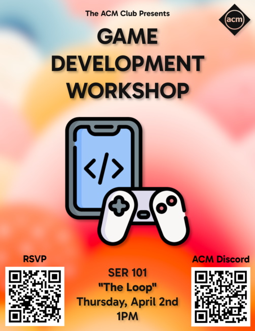
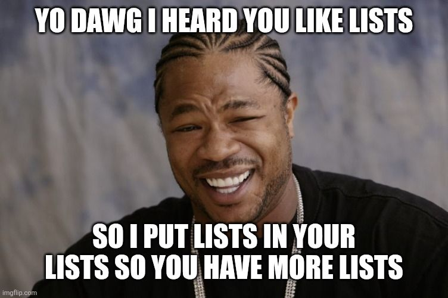

CS1400 - Tuesday, March 31 - Lecture 23 - Module 6

# Topics:
* [🟥Assn 6 - Crashtropolis](#assn-6---crashtropolis)
* [Code Lab Challenge 0 - Clicky Grid](#code-lab-challenge-0---clicky-grid)
* [Code Lab Challenge 1 - Battleship](#code-lab-challenge-1---battleship)


------------------------------------------------------------
# Announcements

## *TONIGHT* FSLC - Shell Scripting: The Gateway Drug To Automation

*   **When**    6:30 PM Tuesday, March 31st
*   **Where**   WIDT 007
*   **Website** https://linux.usu.edu
*   **Discord** https://discord.gg/PvgG6N2hsU

If you think the shell is for typing commands, think again. It's for building tools.

Join me for a no-nonsense intro to shell scripting and learn how to make your machine do the work.


## ACM Game Development Workshop

*   **When**  1:00 PM Thursday, April 2nd
*   **Where** The Loop Lounge (SER 101)



The ACM club will be holding a Game Development Workshop on Thursday, April 2nd at 1PM in The Loop (SER 101). You'll get started with the Godot game engine and learn the basics of game development by building a platformer.

Please RSVP Here: https://forms.gle/jEn5nKpxjrc6Toe17


## Register for BSidesSLC


*   **When**  Thursday, April 9th - Friday, April 10th
*   **Where** 9750 S 300 W, Sandy, UT
*   Students get in **free* with a student ID
*   BSidesSLC attendance replaces your lowest assignment score with **full credit**
*   https://www.bsidesslc.org/


# [🟥Assn 6 - Crashtropolis](https://usu.instructure.com/courses/794745/assignments/5122792)

*   This is the biggest assignment of the semester!
*   This assignment has one task
*   Read the instructions *carefully*, but also look at the **rubric**
*   Make sure to watch the demo video as there are tips on creating the program as well as the visual demonstration.
*   This assignment is due **at 11:59 PM on Sunday, April 12th**
    *   **It is a good idea to make intermediate checkpoint submissions as you work.**


## Task 1 - Crashtropolis

You will create a program that has you and a friend racing all over the city of Crashtropolis. Speed and sharp turns are the name of the game. So is crashing into walls and getting zapped by lasers...

...or not.  The theme of the game is up to you. You can use whatever kind of images and characters as you see fit as long as the technical gameplay and program structure are intact.

The requirements for this project are much looser than you've had on past assignments. You have learned a great deal this semester and you'll now take that new knowledge and skills and build this program. Most of the requirements have to do with gameplay. There are just a handful of items in regards to the structure of your program.

*   This is a *Pygame* program
*   Put your code in a file called `task1.py` and your software development plan as `design1.md`
    *   Include **UML** diagrams for each class. Include all methods and instance variables.
*   Organize your code into these modules:
    1.  `player.py` - the name may vary with your theme; contains the class that represents the entities under the players' control
    2.  `cell.py` - the name may vary with your theme; defines the cells that underlie the game board
    3.  `task1.py` - the main body of code that drives the program
    4.  You may create a `constants.py`
*   There are two starter code files to download from Canvas that you are welcome to use:
    1.  `crashtropolis_starter.py`
    2.  `crashtropolis_assets.zip` *(optional; you may use your own assets if you like)*
*   You will use knowledge from these sections of Unit 6
    *   **6.1: More on Lists**
    *   **6.2: Multi-Dimensional Lists**
    *   **6.3: Ripples Program**
    *   **6.4: Object Oriented Principles**
    *   **6.5: Snake Program**


| Task/Day           | **Wednesday**                                           | **Thursday**       | **Friday**                                       | **Saturday** | **Sunday** | **Monday**                                               |
| ------------------ | ------------------------------------------------------- | ------------------ | ------------------------------------------------ | ------------ | ---------- | -------------------------------------------------------- |
| **Classroom Time** | 6.2: Multi-Dimensional Lists <br/> 6.3: Ripples Program | Classroom Lab Time |                                                  |              |            | 6.4: Object Oriented Principles <br/> 6.5: Snake Program |
| **Items Due**      |                                                         |                    | Exercises 6.1.6, 6.4.6<br/>Quizzes 6.1, 6.2, 6.4 |              |            |                                                          |


## Extra Advice

*   I cannot overemphasize how important it is to work through the Snake Program videos on Canvas (section 6.5)
    *   If you can make **Snake**, you can make this program
*   You *will* get stuck many times: expect it to happen and **start early!**
*   You do not yet know all of the techniques needed to write this program, so *start with what you do know*.
    1.  You know enough to make the title screen, countdown, and game over screen today
    2.  We will study 2D lists this week, which will empower you to make the arena
    3.  Next, we will study UML diagrams
    4.  On your own, watch the videos in chapter 6.5 write the Snake Program
    5.  After that, you can make a single-player version of the game
    6.  Finally, add the second player to the mix (á là Flip-Flop Boing)


# Code Lab Challenge 0 - Clicky Grid

## What This Program Should Do

The program displays a grid of 60 numbered cells (0 to 59) on the screen. The program has two modes of interaction:

**Mouse Mode:**
- Click any cell to toggle its color on/off
- When you click, the terminal prints:
  - The pixel coordinates where you clicked
  - The cell's row and column in the grid
  - The upper-left pixel coordinates of that cell

**Keyboard Mode:**
- Press Enter to switch from mouse mode to keyboard mode
- In the terminal, type a cell number (0-59) and press Enter
- The corresponding cell toggles on the screen
- Type a blank line to return to mouse mode

## Project Structure

This project has three files:

- `clicky-grid.py` - the main entry point of the program
- `grid.py` - defines the Grid class that makes up the screen
- `constants.py` - contains configuration values used by the other modules

## The Problem

Currently, the program only shows a single square on the screen, and clicking it doesn't work properly. This is because three helper functions in `grid.py` are incomplete. Fixing these three functions will make the program work correctly:

- `rc_to_index(r, c, cols)` - Convert row and column to a 1D index
- `index_to_rc(index, cols)` - Convert a 1D index to row and column  
- `pixel_from_cell(r, c, cell_size, margin)` - Convert grid cell (row, col) to pixel coordinates (x, y) of upper-left corner

*Hint* The grid is stored as a 1D list.  Integer division (`//`) and modulo (`%`) help convert a 1D index back to row and column.


<details>
<summary><h3><code>clicky-grid.py</code> source code</h3></summary>

```python
import pygame

import constants
from grid import Grid, index_to_rc, pixel_from_cell


def cell_from_pixel(px, py, cell_size, cols, rows, margin):
    """Convert pixel coordinates to grid cell (row, col). Returns (-1, -1) if invalid."""
    if px < 0 or py < 0:
        return -1, -1
    block = cell_size + margin
    c = px // block
    r = py // block
    if r < 0 or r >= rows or c < 0 or c >= cols:
        return -1, -1
    # reject clicks on the margin strip
    if (px % block) >= cell_size or (py % block) >= cell_size:
        return -1, -1
    return int(r), int(c)


def draw_keyboard_mode_message(screen, font):
    """Display a message on the screen indicating keyboard mode is active."""
    line1 = "Awaiting keyboard input"
    line2 = "in terminal..."
    text1 = font.render(line1, True, constants.HIGHLIGHT_COLOR)
    text2 = font.render(line2, True, constants.HIGHLIGHT_COLOR)
    rect1 = text1.get_rect()
    rect2 = text2.get_rect()
    center_x = constants.SCREEN_WIDTH // 2
    center_y = constants.SCREEN_HEIGHT // 2
    rect1.center = (center_x, center_y - rect1.height // 2 - 5)
    rect2.center = (center_x, center_y + rect2.height // 2 + 5)
    screen.blit(text1, rect1)
    screen.blit(text2, rect2)


def print_mouse_mode_instructions():
    """Print instructions for mouse mode to the terminal."""
    print("=== Mouse Mode ===")
    print("Window controls:")
    print("  ESC or Q  → quit")
    print("Interaction:")
    print("  - Click a cell to toggle it on/off")
    print("  - Prints mouse pixel coords and grid cell (r,c)")
    print("  - Screen updates immediately")
    print("  - Press ENTER to switch to keyboard mode")
    print("--------------------------------")


def print_keyboard_mode_instructions(total_cells):
    """Print instructions for keyboard mode to the terminal."""
    print("=== Keyboard Mode ===")
    print("  - Type a cell NUMBER (0..{}) and press ENTER".format(total_cells - 1))
    print("  - Toggles that cell and prints its upper-left pixel coords")
    print("  - Invalid or out-of-range numbers are ignored")
    print("  - Press ENTER with no input to return to mouse mode")
    print("--------------------------------")


def prompt_keyboard_and_toggle(grid, screen, font):
    """Loop to get keyboard input and toggle cells. Returns when user enters blank line."""
    while True:
        raw = input("Enter a cell number (0..{}), or blank to return to mouse mode: ".format(grid.total - 1))
        if raw.strip() == "":
            print("[keyboard] returning to mouse mode")
            print_mouse_mode_instructions()
            return
        stripped = raw.strip()
        if not stripped.isdigit():
            print("[keyboard] invalid integer:", raw)
            continue
        n = int(stripped)
        if grid.toggle_index(n):
            r, c = index_to_rc(n, grid.cols)
            px, py = pixel_from_cell(r, c, constants.CELL_SIZE, constants.MARGIN)
            print(f"[keyboard] toggled cell {n} at (r={r}, c={c}); upper-left pixel=({px},{py})")
            grid.draw(screen, font)
            draw_keyboard_mode_message(screen, font)
            pygame.display.flip()
        else:
            print(f"[keyboard] out of range: {raw}")


def main():
    # Setup the pygame window and clock
    pygame.init()
    screen = pygame.display.set_mode((constants.SCREEN_WIDTH, constants.SCREEN_HEIGHT))
    pygame.display.set_caption(constants.TITLE)
    clock = pygame.time.Clock()

    ##########
    # Set up game media images, sounds
    ##########
    font = pygame.font.SysFont("consolas", 32)

    ##########
    # Set up game data
    ##########
    grid = Grid(constants.GRID_ROWS, constants.GRID_COLS)
    mouse_mode = True
    print_mouse_mode_instructions()

    ##########
    # Game Loop
    ##########
    game_over = False
    running = True
    while running:
        ##########
        # Get Input/Events
        ##########
        for event in pygame.event.get():
            if event.type == pygame.QUIT:  # User clicked the window's X button
                running = False
            if event.type == pygame.KEYDOWN:
                if event.key == pygame.K_q or event.key == pygame.K_ESCAPE:
                    running = False
                if event.key == pygame.K_SPACE and game_over:
                    ### Do Stuff to Reset Game ###
                    grid = Grid(constants.GRID_ROWS, constants.GRID_COLS)
                    game_over = False
                if event.key == pygame.K_RETURN and not game_over and mouse_mode:
                    mouse_mode = False
                    print_keyboard_mode_instructions(grid.total)
                    grid.draw(screen, font)
                    draw_keyboard_mode_message(screen, font)
                    pygame.display.flip()
                    prompt_keyboard_and_toggle(grid, screen, font)
                    mouse_mode = True

            # Mouse click toggles cell in mouse mode
            if event.type == pygame.MOUSEBUTTONDOWN and not game_over and mouse_mode:
                mx, my = event.pos
                r, c = cell_from_pixel(mx, my, constants.CELL_SIZE, constants.GRID_COLS, constants.GRID_ROWS, constants.MARGIN)
                print(f"[click] mouse=({mx},{my}) -> cell=({r},{c})")
                if r != -1 and c != -1:
                    grid.toggle_rc(r, c)
                    px, py = pixel_from_cell(r, c, constants.CELL_SIZE, constants.MARGIN)
                    print(f"[click] toggled cell at (r={r}, c={c}); upper-left pixel=({px},{py})")

        ##########
        # Update state of components/data
        ##########
        #### Always Update ####

        #### Update if Game is Not Over ####
        if not game_over:
            pass
        #### Update if Game is Over ####
        else:
            pass

        ##########
        # Update Display
        ##########
        #### Always Display ####
        grid.draw(screen, font)

        #### Display while Game is being played ####
        if not game_over:
            pass
        #### Display while Game is Over ####
        else:
            pass

        #### Draw changes the screen ####
        pygame.display.flip()

        ##########
        # Define the refresh rate of the screen
        ##########
        clock.tick(constants.CLOCK_TICK)

if __name__ == "__main__":
    main()
```

</details>

[Download clicky-grid.py](./clicky-grid.py)


<details>
<summary><h3><code>grid.py</code> source code</h3></summary>

```python
import pygame

import constants


# ===============================
# Helpers students focus on
# ===============================
def rc_to_index(r, c, cols):
    """Convert row and column to a 1D index."""
    # TODO: Implement this function
    return 0


def index_to_rc(index, cols):
    """Convert a 1D index to row and column."""
    # TODO: Implement this function
    return [0, 0]


def pixel_from_cell(r, c, cell_size, margin):
    """Convert grid cell (row, col) to pixel coordinates (x, y) of upper-left corner."""
    # TODO: Implement this function
    return [0, 0]


# ===============================
# 1D Grid model
# ===============================
class Grid:
    def __init__(self, rows, cols):
        self.rows = int(rows)
        self.cols = int(cols)
        self.total = self.rows * self.cols
        self.cells = []
        for i in range(self.total):
            self.cells.append(0)  # 0=off, 1=on

    def in_bounds(self, r, c):
        return 0 <= r < self.rows and 0 <= c < self.cols

    def get(self, r, c):
        if not self.in_bounds(r, c):
            return 0
        return self.cells[rc_to_index(r, c, self.cols)]

    def toggle_rc(self, r, c):
        if not self.in_bounds(r, c):
            return False
        idx = rc_to_index(r, c, self.cols)
        self.cells[idx] = 0 if self.cells[idx] == 1 else 1
        return True

    def toggle_index(self, index):
        if index < 0 or index >= self.total:
            return False
        r, c = index_to_rc(index, self.cols)
        return self.toggle_rc(r, c)

    def draw(self, screen, font):
        screen.fill(constants.BG)
        for r in range(self.rows):
            for c in range(self.cols):
                px, py = pixel_from_cell(r, c, constants.CELL_SIZE, constants.MARGIN)
                rect = pygame.Rect(px, py, constants.CELL_SIZE, constants.CELL_SIZE)
                color = constants.ON_CELL if self.get(r, c) == 1 else constants.OFF_CELL
                pygame.draw.rect(screen, color, rect)
                pygame.draw.rect(screen, constants.GRID_LINE, rect, 1)

                idx = rc_to_index(r, c, self.cols)
                label = font.render(str(idx), True, constants.TEXT_COLOR)
                label_rect = label.get_rect()
                label_rect.center = (px + constants.CELL_SIZE // 2, py + constants.CELL_SIZE // 2)
                screen.blit(label, label_rect)
```

</details>

[Download grid.py](./grid.py)


<details>
<summary><h3><code>constants.py</code> source code</h3></summary>

```python
# ---- Grid config ----
MARGIN = 4  # spacing between cells
CELL_SIZE = 64
GRID_ROWS = 6
GRID_COLS = 10
SCREEN_WIDTH = GRID_COLS * CELL_SIZE + (GRID_COLS - 1) * MARGIN
SCREEN_HEIGHT = GRID_ROWS * CELL_SIZE + (GRID_ROWS - 1) * MARGIN

CLOCK_TICK = 30
TITLE = "Pixel to Grid Translator"

# ---- Colors (hex RGB strings) ----
BG         = "#18181C"
GRID_LINE  = "#3C3C46"
OFF_CELL   = "#202840"
ON_CELL    = "#DCF0FF"
TEXT_COLOR = "#14181C"
HIGHLIGHT_COLOR = "#FF00FF"
```

</details>

[Download constants.py](./constants.py)


### Phase 0 - Identify The Bug(s)

Answer each of these questions in today's Wooclap:

*   What should `rc_to_index(2, 3, 10)` return? Why?
*   What should `index_to_rc(23, 10)` return? Why?
*   If a cell is at row 1, column 4, and each cell is 64 pixels wide with 4 pixels of margin, what should `pixel_from_cell(1, 4, 64, 4)` return?
*   Run the program and observe what happens. What behavior indicates that these functions are broken?


### Phase 1 - Fix It

Enact your proposed changes in the program.


### Phase 2 - Test It

Run the program with a variety of inputs to make sure that

*   All 60 cells (0-59) are visible on the screen
*   Clicking any cell toggles its color correctly
*   The terminal prints correct coordinates when you click a cell
*   Keyboard mode works: you can enter cell numbers and they toggle correctly
*   Edge cases work: clicking cells in the corners, entering cell 0, entering cell 59


### Phase 3 - Reflect On It

Answer these debrief questions in comments in today's Wooclap:

*   Why do we need to convert between 2D coordinates (row, col) and 1D indices? What problem does this solve?
*   How does the formula `r * cols + c` convert a row and column into a 1D index? Walk through an example.
*   How does integer division (`//`) and modulo (`%`) help convert a 1D index back to row and column?
*   Why does `pixel_from_cell` need to account for both `cell_size` and `margin` when calculating pixel coordinates?
*   What would happen if you forgot to include the margin in the `pixel_from_cell` calculation?


### Phase 4 - Stretch Challenges

0.  Instead of toggling cell colors, toggle between these two 64x64 sprites:
    *    [Download box2.png](./box2.png)
    *    [Download box3.png](./box3.png)
0.  `Grid.draw()` takes two parameters - a Pygame `screen` object and a font.  Make these into attributes of the class so they do not need to be passed in every time the grid is drawn.
0.  Pressing `Enter` a few times in a row makes it difficult to leave keyboard mode.  What happens is that the first `Enter` engages keyboard mode before the other `Enter` keyboard events are seen.  After keyboard mode is finished, the old `Enter` events are still on Pygame's event queue.  Find a way to "drain" the event queue before engaging keyboard mode.


# Code Lab Challenge 1 - Battleship

At the end of this code lab you can play a simple game of Battleship against a (stupid) AI opponent.  Unfortunately, the starter code doesn't work, so you'll have to address that issue first.

Begin by downloading the source code onto your computer.  Out of the files that make up this program, you need only change these three:

0.  `bs_types.py`
0.  `bs_board.py`
0.  `bs_ai.py`

Moreover, you only need to change small portions of these files.  Take care that you do not modify more than necessary!  Look for the `TODO` comments


<details>
<summary><h3><code>battleship.py</code> source code</h3></summary>

```python
# battleship.py

##
## Don't change anything below this comment
##

import pygame

import bs_ai
import bs_board
import bs_config
import bs_drawing


def main():
    # Setup the pygame window and clock
    pygame.init()
    screen = pygame.display.set_mode((bs_config.SCREEN_WIDTH, bs_config.SCREEN_HEIGHT))
    pygame.display.set_caption(bs_config.TITLE)
    clock = pygame.time.Clock()

    ##########
    # Set up game media images, sounds
    ##########
    font = pygame.font.SysFont("courier", 24)
    title_font = pygame.font.SysFont("courier", 32)

    ##########
    # Set up game data
    ##########
    # Create 2D lists for game boards
    player_board = bs_board.create_board()
    opponent_board = bs_board.create_board()

    # Place ships randomly on both boards
    bs_board.place_ships_randomly(player_board)
    bs_board.place_ships_randomly(opponent_board)

    # Game state
    player_turn = True
    last_message = "Click on the opponent's board to make a guess!"

    # AI state - list of available positions to guess
    ai_available_positions = bs_ai.initialize_available_positions()

    ##########
    # Game Loop
    ##########
    game_over = False
    running = True
    while running:
        ##########
        # Get Input/Events
        ##########
        for event in pygame.event.get():
            if event.type == pygame.QUIT:  # User clicked the window's X button
                running = False
            if event.type == pygame.KEYDOWN:
                if event.key == pygame.K_q or event.key == pygame.K_ESCAPE:
                    running = False
                if event.key == pygame.K_SPACE and game_over:
                    ### Do Stuff to Reset Game ###
                    # Reset game by creating new 2D lists and placing ships
                    player_board = bs_board.create_board()
                    opponent_board = bs_board.create_board()
                    bs_board.place_ships_randomly(player_board)
                    bs_board.place_ships_randomly(opponent_board)
                    player_turn = True
                    last_message = "Click on the opponent's board to make a guess!"
                    ai_available_positions = bs_ai.initialize_available_positions()
                    game_over = False

            # Handle mouse clicks for making guesses
            if event.type == pygame.MOUSEBUTTONDOWN and not game_over and player_turn:
                mx, my = event.pos
                # Check if click is on opponent board
                row, col = bs_drawing.cell_from_pixel(mx, my, bs_config.OPPONENT_BOARD_X, bs_config.OPPONENT_BOARD_Y)
                if row != -1 and col != -1:
                    result = bs_board.make_guess(opponent_board, row, col)
                    if result == 'hit':
                        last_message = f"Hit at {chr(ord('A') + row)}{col + 1}!"
                        # Check if all ships are sunk
                        if bs_board.all_ships_sunk(opponent_board):
                            game_over = True
                            last_message = "You Win! All enemy ships destroyed!"
                        else:
                            # Switch to AI turn
                            player_turn = False
                    elif result == 'miss':
                        last_message = f"Miss at {chr(ord('A') + row)}{col + 1}!"
                        # Switch to AI turn
                        player_turn = False
                    elif result == 'invalid':
                        last_message = "You already guessed that location!"

        ##########
        # Update state of components/data
        ##########
        #### Always Update ####

        #### Update if Game is Not Over ####
        if not game_over:
            # AI takes a turn
            if not player_turn:
                row, col = bs_ai.ai_make_guess(ai_available_positions)
                if row is not None and col is not None:
                    result = bs_board.make_guess(player_board, row, col)
                    if result == 'hit':
                        last_message = f"AI hit at {chr(ord('A') + row)}{col + 1}!"
                        # Check if all player ships are sunk
                        if bs_board.all_ships_sunk(player_board):
                            game_over = True
                            last_message = "AI Wins! All your ships destroyed! Press SPACE to play again."
                        # AI keeps turn on hit (optional - can switch if you want)
                        player_turn = True
                    elif result == 'miss':
                        last_message = f"AI missed at {chr(ord('A') + row)}{col + 1}!"
                        player_turn = True
        #### Update if Game is Over ####
        else:
            pass

        ##########
        # Update Display
        ##########
        #### Always Display ####
        screen.fill(bs_config.COLOR_BG)

        # Draw board labels
        player_label = title_font.render("Your Board", True, bs_config.COLOR_TEXT)
        opponent_label = title_font.render("Opponent Board", True, bs_config.COLOR_TEXT)
        screen.blit(player_label, (bs_config.PLAYER_BOARD_X, bs_config.PLAYER_BOARD_Y - 40))
        screen.blit(opponent_label, (bs_config.OPPONENT_BOARD_X, bs_config.OPPONENT_BOARD_Y - 40))

        #### Display while Game is being played ####
        if not game_over:
            # Draw both boards by iterating through their 2D lists
            # Player board shows ships
            bs_drawing.draw_board(screen, player_board, bs_config.PLAYER_BOARD_X, bs_config.PLAYER_BOARD_Y, True, font)
            # Opponent board doesn't show ships (only hits/misses)
            bs_drawing.draw_board(screen, opponent_board, bs_config.OPPONENT_BOARD_X, bs_config.OPPONENT_BOARD_Y, False, font)

            # Draw status message
            bs_drawing.draw_status_text(screen, font, last_message, 600)

            # Draw instructions based on whose turn it is
            if player_turn:
                instructions = "Your turn - Click on the opponent's board to make a guess"
            else:
                instructions = "AI's turn - waiting..."
            bs_drawing.draw_status_text(screen, font, instructions, 650)
        #### Display while Game is Over ####
        else:
            # Draw both boards
            bs_drawing.draw_board(screen, player_board, bs_config.PLAYER_BOARD_X, bs_config.PLAYER_BOARD_Y, True, font)
            bs_drawing.draw_board(screen, opponent_board, bs_config.OPPONENT_BOARD_X, bs_config.OPPONENT_BOARD_Y, True, font)

            # Draw game over message
            bs_drawing.draw_status_text(screen, title_font, last_message, 600)
            bs_drawing.draw_status_text(screen, font, "Press SPACE to play again", 650)

        #### Draw changes the screen ####
        pygame.display.flip()

        ##########
        # Define the refresh rate of the screen
        ##########
        clock.tick(bs_config.CLOCK_TICK)


main()
```

</details>

[Download battleship.py](./battleship.py)


<details>
<summary><h3><code>bs_ai.py</code> source code</h3></summary>

```python
# bs_ai.py

import random

import bs_config


def initialize_available_positions():
    """
    Create a shuffled list of all possible positions on the board.
    """
    positions = []
    for row in range(bs_config.BOARD_SIZE):
        for col in range(bs_config.BOARD_SIZE):
            positions.append([row, col])
    # TODO: Shuffle the list of positions so the AI's play is unpredictable
    #       Hint: read the documentation for the random module
    return positions

##
## Don't change anything below this comment
##

def ai_make_guess(available_positions):
    """
    Pick the first position from the available positions list.
    """
    if available_positions:
        return available_positions.pop(0)
    else:
        return [None, None]
```

</details>

[Download bs_ai.py](./bs_ai.py)


<details>
<summary><h3><code>bs_board.py</code> source code</h3></summary>

```python
# bs_board.py

import random

import bs_config
import by_types


def create_board():
    """
    Create an empty 2D list representing a square game board with sides of length with bs_config.BOARD_SIZE
    """
    # TODO: implement this function
    board = []
    return board


def get_cell(board, row, col):
    """
    Read a value from a 2D list board at the given row and column.
    Check that the values of 'row' and 'col' are valid before use.
    If either is invalid, return None.
    Otherwise, return the value of the cell at that position.
    """
    # TODO: implement this function
    return bs_config.EMPTY


def set_cell(board, row, col, value):
    """
    Write a value to a 2D list board at the given row and column.
    Check that the values of 'row' and 'col' are valid before use.
    If either is invalid, return without changing anything.
    Otherwise, update the value of the cell at that position.

    """
    # TODO: implement this function
    pass

##
## Don't change anything below this comment
##

def is_valid_placement(board, row, col, length, horizontal):
    """Check if a ship can be placed at the given position."""
    # Check bounds
    if horizontal:
        if col + length > bs_config.BOARD_SIZE:
            return False
        for c in range(col, col + length):
            if get_cell(board, row, c) != bs_config.EMPTY:
                return False
    else:
        if row + length > bs_config.BOARD_SIZE:
            return False
        for r in range(row, row + length):
            if get_cell(board, r, col) != bs_config.EMPTY:
                return False
    return True


def place_ship(board, row, col, length, horizontal):
    """Place a ship on the board by setting cells in the 2D list to SHIP."""
    if not is_valid_placement(board, row, col, length, horizontal):
        return False

    if horizontal:
        for c in range(col, col + length):
            set_cell(board, row, c, bs_config.SHIP)
    else:
        for r in range(row, row + length):
            set_cell(board, r, col, bs_config.SHIP)
    return True


def place_ships_randomly(board):
    """Place all ships randomly on the board."""
    for ship_name, ship_length in bs_types.SHIPS:
        placed = False
        attempts = 0
        while not placed and attempts < 100:
            row = random.randint(0, bs_config.BOARD_SIZE - 1)
            col = random.randint(0, bs_config.BOARD_SIZE - 1)
            horizontal = random.choice([True, False])
            if place_ship(board, row, col, ship_length, horizontal):
                placed = True
            attempts += 1


def make_guess(board, row, col):
    """Process a guess at the given position. Returns 'hit', 'miss', or 'invalid'."""
    cell_value = get_cell(board, row, col)
    if cell_value is None:
        return 'invalid'
    elif cell_value == bs_config.SHIP:
        set_cell(board, row, col, bs_config.HIT)
        return 'hit'
    elif cell_value == bs_config.EMPTY:
        set_cell(board, row, col, bs_config.MISS)
        return 'miss'
    else:
        return 'invalid'  # Already guessed


def count_ships(board):
    """Count remaining ship cells in the 2D list."""
    count = 0
    for row in range(bs_config.BOARD_SIZE):
        for col in range(bs_config.BOARD_SIZE):
            if get_cell(board, row, col) == bs_config.SHIP:
                count += 1
    return count


def all_ships_sunk(board):
    """Check if all ships are sunk by iterating through the 2D list."""
    return count_ships(board) == 0
```

</details>

[Download bs_board.py](./bs_board.py)


<details>
<summary><h3><code>bs_config.py</code> source code</h3></summary>

```python
# bs_config.py

##
## Don't change anything below this comment
##

# Screen constants
SCREEN_WIDTH = 1280
SCREEN_HEIGHT = 720
CLOCK_TICK = 30
TITLE = "Battleship"

# Board constants
BOARD_SIZE = 10
CELL_SIZE = 40
CELL_MARGIN = 2
LABEL_WIDTH = 30
LABEL_HEIGHT = 30

# Board offsets (two boards side by side)
PLAYER_BOARD_X = 100
PLAYER_BOARD_Y = 100
OPPONENT_BOARD_X = 700
OPPONENT_BOARD_Y = 100

# Cell state values (for 2D list)
EMPTY = 0
SHIP = 1
HIT = 2
MISS = 3

# Colors (hex RGB strings)
COLOR_BG = "#141E32"
COLOR_EMPTY = "#325096"
COLOR_SHIP = "#646464"
COLOR_HIT = "#C83232"
COLOR_MISS = "#C8C8C8"
COLOR_GRID_LINE = "#969696"
COLOR_TEXT = "#FFFFFF"
COLOR_LABEL = "#C8C8FF"
```

</details>

[Download bs_config.py](./bs_config.py)


<details>
<summary><h3><code>bs_drawing.py</code> source code</h3></summary>

```python
# bs_drawing.py

##
## Don't change anything below this comment
##

import pygame

import bs_config
import bs_board


def pixel_from_cell(row, col, offset_x, offset_y):
    """Convert grid cell (row, col) to pixel coordinates."""
    px = offset_x + bs_config.LABEL_WIDTH + col * (bs_config.CELL_SIZE + bs_config.CELL_MARGIN)
    py = offset_y + bs_config.LABEL_HEIGHT + row * (bs_config.CELL_SIZE + bs_config.CELL_MARGIN)
    return px, py


def cell_from_pixel(px, py, offset_x, offset_y):
    """Convert pixel coordinates to grid cell (row, col). Returns (-1, -1) if invalid."""
    # Adjust for label area
    px -= offset_x + bs_config.LABEL_WIDTH
    py -= offset_y + bs_config.LABEL_HEIGHT

    if px < 0 or py < 0:
        return -1, -1

    block = bs_config.CELL_SIZE + bs_config.CELL_MARGIN
    col = px // block
    row = py // block

    # Check if click is within cell bounds (not in margin)
    if (px % block) >= bs_config.CELL_SIZE or (py % block) >= bs_config.CELL_SIZE:
        return -1, -1

    if row < 0 or row >= bs_config.BOARD_SIZE or col < 0 or col >= bs_config.BOARD_SIZE:
        return -1, -1

    return row, col


def draw_cell(screen, x, y, cell_value, show_ships):
    """Draw a single cell based on its value in the 2D list."""
    rect = pygame.Rect(x, y, bs_config.CELL_SIZE, bs_config.CELL_SIZE)

    # Determine color based on cell value
    if cell_value == bs_config.HIT:
        color = bs_config.COLOR_HIT
    elif cell_value == bs_config.MISS:
        color = bs_config.COLOR_MISS
    elif cell_value == bs_config.SHIP and show_ships:
        color = bs_config.COLOR_SHIP
    else:
        color = bs_config.COLOR_EMPTY

    pygame.draw.rect(screen, color, rect)
    pygame.draw.rect(screen, bs_config.COLOR_GRID_LINE, rect, 1)


def draw_board(screen, board_state, offset_x, offset_y, show_ships, font):
    """Draw a game board by iterating through the 2D list."""
    # Draw row labels (A-J)
    for row in range(bs_config.BOARD_SIZE):
        label = chr(ord('A') + row)
        text = font.render(label, True, bs_config.COLOR_LABEL)
        text_rect = text.get_rect()
        text_rect.center = (offset_x + bs_config.LABEL_WIDTH // 2,
                           offset_y + bs_config.LABEL_HEIGHT + row * (bs_config.CELL_SIZE + bs_config.CELL_MARGIN) + bs_config.CELL_SIZE // 2)
        screen.blit(text, text_rect)

    # Draw column labels (1-10)
    for col in range(bs_config.BOARD_SIZE):
        label = str(col + 1)
        text = font.render(label, True, bs_config.COLOR_LABEL)
        text_rect = text.get_rect()
        text_rect.center = (offset_x + bs_config.LABEL_WIDTH + col * (bs_config.CELL_SIZE + bs_config.CELL_MARGIN) + bs_config.CELL_SIZE // 2,
                           offset_y + bs_config.LABEL_HEIGHT // 2)
        screen.blit(text, text_rect)

    # Draw cells by iterating through the 2D list
    for row in range(bs_config.BOARD_SIZE):
        for col in range(bs_config.BOARD_SIZE):
            px, py = pixel_from_cell(row, col, offset_x, offset_y)
            cell_value = bs_board.get_cell(board_state, row, col)
            draw_cell(screen, px, py, cell_value, show_ships)


def draw_status_text(screen, font, text, y_pos):
    """Draw status text on the screen."""
    text_surface = font.render(text, True, bs_config.COLOR_TEXT)
    text_rect = text_surface.get_rect()
    text_rect.center = (bs_config.SCREEN_WIDTH // 2, y_pos)
    screen.blit(text_surface, text_rect)
```

</details>

[Download bs_drawing.py](./bs_drawing.py)


<details>
<summary><h3><code>bs_types.py</code> source code</h3></summary>

```python
# bs_types.py

# A 2D list that defines the types of ships [name, length]
SHIPS = [
    ["Carrier", 5],
    ["Battleship", 4],
    ["Cruiser", 3],
    ["Submarine", 3],
    ["Destroyer", 2],
]
```

</details>

[Download bs_types.py](./bs_types.py)


### Phase 0 - Fix The First Bug

This program crashes with a big error message right out of the gate.

**Read the entire error message!!!**  I know it's big and cryptic, but you will be rewarded for making the effort.

Answer each of these questions in today's Wooclap:

*   Why did the starter code crash?
*   Why did the error message's suggestion work?
*   Which files were changed to effect this fix?
*   What lesson can you draw from this experience?


### Phase 1 - Implement three 2D list functions in `bs_board.py`

Once you stop the program from crashing, you'll find that it's not quite playable.

Open `bs_board.py` and find these functions which are meant to manipulate the 2D list that tracks the state of the game board:

0.  `create_board()`
0.  `get_cell(board, row, col)`
0.  `set_cell(board, row, col, value)`

Design bodies for these functions that fulfill their docstrings.  Test the game by clicking cells on the right-hand game board.  You'll know it works when your clicks change the cells colors, the AI is able to take shots at your game board, and you are able to win (or lose) the game.

The trick to understanding 2D lists is realizing that *lists can contain other lists*.  This idea is best summed up by this meme:




Answer each of these questions in today's Wooclap:

*   In what ways are these functions similar to the ones from the previous code lab program?
*   How do these functions differ from the ones from the previous code lab program?
*   Would you mind converting this game grid into a 1D list?  Why or why not?


### Phase 2 - Make the AI player less predictable

Calling this thing an "AI" is a bit of a stretch, but it beats trying to find a real person to play with you.  But the default AI's strategy is... not very good.  It is easy to give it the *appearance* of trying - just scramble the list of cells the AI picks from.  It takes but one line of code.  Scan through Python's official documentation for the [random module](https://docs.python.org/3.14/library/random.html) to see what you can find.

Answer this question in today's Wooclap:

*   What function(s) from `random` did you choose?


### Phase 3 - Stretch Challenges

*   Define a class for the game board in `bs_board.py`.
    -   You can disregard the comments that say `# Don't change anything below this comment`
*   Add sound effects and music to the game
*   Blit sprites onto the game board instead of drawing solid-color rectangles
*   Enable the player to place their ships
*   Make the AI more intelligent than *randomly picks cells*


