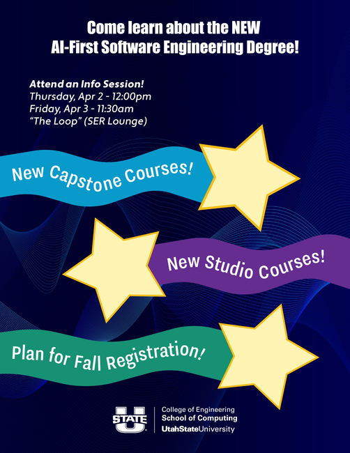
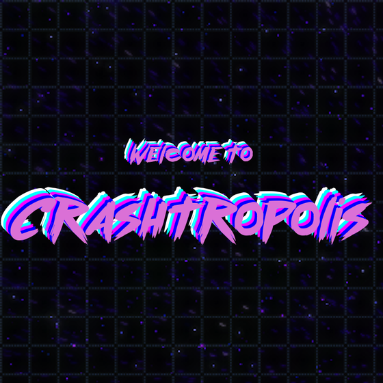

CS1400 - Thursday, April 02 - Lecture 24 - Module 6

# Topics:
* [🟥Assn 6 - Crashtropolis](#assn-6---crashtropolis)
* [Code Lab Challenge 0 - Clicky Grid Redux](#code-lab-challenge-0---clicky-grid-redux)
* [Code Lab Challenge 1 - Game State Transitions](#code-lab-challenge-1---game-state-transitions)


------------------------------------------------------------
# Announcements

## Upcoming Schedule

-   Tue, Apr 07 Code lab for Assn 6
-   Thu, Apr 09 **Canceled** See you at BSidesSLC!
-   Sun, Apr 12 *Assn 6: Crashtropolis due*
-   Tue, Apr 14 Code lab for Assn 7
-   Thu, Apr 16 Final Code Lab
-   Sun, Apr 19 *Assn 7: Deckinator due*
-   Tue, Apr 21 Review for final exam
-   Wed, Apr 22 *Finals week begins*
-   Tue, Apr 28 *End of finals week*


## *TODAY* Introducing the new AI-First Software Engineering Degree

*   **When** 
    *   12:00 PM Thursday, April 2nd
    *   11:30 AM Friday, April 3rd
*   **Where** The Loop Lounge (SER 1st floor)



This Thursday and Friday we are holding information sessions about our new AI-First Software Engineering degree, which is starting in the fall semester.  Attend one of these sessions so you can learn if this degree is something you might be interested in.  Having this information will help you know what to do for fall semester registration.


## *TODAY* ACM Game Development Workshop

*   **When**  1:00 PM Thursday, April 2nd
*   **Where** The Loop Lounge (SER 101)

The ACM club will be holding a Game Development Workshop on today at 1PM in The Loop (SER 101). You'll get started with the Godot game engine and learn the basics of game development by building a platformer.


## *TONIGHT* Student Organization for Cybersecurity - NCL Gym

- **When** 7 PM Thursday, April 2nd
- **Where** HH 320
- **Discord** https://discord.gg/JEVdRdfpEb

Come work with the team on the challenges in the NCL gym! We'll sharpen our skills and learn tools and techniques from other club members as we prepare for the upcoming NCL individual and team games.


## FSLC - Your Custom Linux Desktop

*   **When**    6:30 PM Tuesday, April 7th
*   **Where**   WIDT 007
*   **Website** https://linux.usu.edu
*   **Discord** https://discord.gg/PvgG6N2hsU

"You can customize Linux", they say. "You can do whatever you want with Linux", they say. Tonight we'll show you how! We'll start with the classic Gnome Desktop using GUI's. Then we'll take a turn for the dark side and switch it out for Niri, a scrolling (tiling) window manager and showcase your first steps in configuration with dotfiles.


# Action Items

*   Erik has office hours today from 1:00 PM to 3:30 PM
    -   Find me in SER 301E or on [Zoom](https://usu-edu.zoom.us/my/erik.falor?pwd=ZE4zNXRpNVl4VVhHNkN5Q2wwV3VrUT09)


## IDEA Surveys - Rare Extra Credit Opportunity

You should have received a notification about the IDEA Student Rating of Instruction (SRI) survey.

Your feedback is very important to me, and I really want you to take this survey.  Each semester I take many useful suggestions and incorporate them into my future courses.  If I'm doing anything right, it is due to suggestions given by previous students.

The more input I get from you the better I am able to improve as an instructor.  My goal is to reach 80% participation.  To motivate you, I'm offering *185 points* of extra credit for responding (equal to 2.5% of your final grade). Don't worry, your responses are anonymous, and I won't see them until after finals week.

*   The extra points will be automatically applied to your grade on Canvas by the University **at the end of Finals Week**
    *   There is nothing that I can do to speed this up or verify that your submission was accepted - **it's anonymous!**
    *   Your points will come through; trust the system
*   The survey closes Tuesday, April 21st at 11:59 PM

[](https://usu.campuslabs.com/eval-home/)

https://usu.campuslabs.com/eval-home/


### IDEA Survey FAQ's

* **Do professors actually read my comments?**
    * Some do, some don't.
    * Constructive criticism about things that we can control helps us improve.
    * It is okay to complain, but try not to be a jerk about it.
        * Cutting remarks don't encourage us to change, but train us to ignore your concerns.
        * If you just want to vent, try RateMyProfessor.  The University doesn't make us look at that.
    * If you have praise, be specific.
        * "Great class, 10/10 would do again" isn't as helpful as "I learned so much from the ... assignment, do more like that."
* **Why does the survey ask me to rank this course on how well it develops my awareness of "diverse perspectives, other cultures, or my creative capacities?"**
    * Identical IDEA surveys are given by schools all across the nation, in all subjects, and have been for years.
    * If each course used different surveys, we couldn't compare results between all schools and departments across time.
        * For instance, we know that math courses consistently receive lower scores across the board.
* **What do I make of all of the learning objectives?**
    * These objectives are **essential** to this course:
        * 3. Learning to apply course material (to improve thinking, problem solving, and decisions).
        * 4. Developing specific skills, competencies, and points of view needed by professionals in the field most closely related to this course.
    * These objectives are **important** to this course (weigh half as much as essentials):
        * 1. Gaining a basic understanding of the subject (e.g., factual knowledge, methods, principles, generalizations, theories).
        * 9. Learning how to find, evaluate, and use resources to explore a topic in depth.
    * The other objectives have no effect on my score.
* **What changes have you made because of IDEA feedback?**
    *   Open code reviews throughout the week
    *   Unreviewed assignment submissions can still earn up to 30% of points


# [🟥Assn 6 - Crashtropolis](https://usu.instructure.com/courses/794745/assignments/5122792)


| Task/Day           | **Thursday**       | **Friday**                                       | **Saturday** | **Sunday** | **Monday**                                               | **Tuesday**        |
| ------------------ | ------------------ | ------------------------------------------------ | ------------ | ---------- | -------------------------------------------------------- | ------------------ |
| **Classroom Time** | Classroom Lab Time |                                                  |              |            | 6.4: Object Oriented Principles <br/> 6.5: Snake Program | Classroom Lab Time |
| **Items Due**      |                    | Exercises 6.1.6, 6.4.6<br/>Quizzes 6.1, 6.2, 6.4 |              |            |                                                          |                    |


# Code Lab Challenge 0 - Clicky Grid Redux

In this challenge you will revisit the Clicky Grid "game" from the last code lab.  Recall how that program displayed a 2D grid on the screen but under the hood used a 1D list to store the cells.

Today you will change the program's underlying data structure to match its display.

**IMPORTANT!!!**

If you have already downloaded the files for the next code lab challenge (Battleship), this program will crash with a large error message.  Delete the file `types.py` and download it again after you finish this challenge.


<details>
<summary><h3><code>clicky-grid.py</code> source code</h3></summary>

```python
import pygame

import constants
from grid import Grid, index_to_rc, pixel_from_cell


def cell_from_pixel(px, py, cell_size, cols, rows, margin):
    """Convert pixel coordinates to grid cell (row, col). Returns (-1, -1) if invalid."""
    if px < 0 or py < 0:
        return -1, -1
    block = cell_size + margin
    c = px // block
    r = py // block
    if r < 0 or r >= rows or c < 0 or c >= cols:
        return -1, -1
    # reject clicks on the margin strip
    if (px % block) >= cell_size or (py % block) >= cell_size:
        return -1, -1
    return int(r), int(c)


def draw_keyboard_mode_message(screen, font):
    """Display a message on the screen indicating keyboard mode is active."""
    line1 = "Awaiting keyboard input"
    line2 = "in terminal..."
    text1 = font.render(line1, True, constants.HIGHLIGHT_COLOR)
    text2 = font.render(line2, True, constants.HIGHLIGHT_COLOR)
    rect1 = text1.get_rect()
    rect2 = text2.get_rect()
    center_x = constants.SCREEN_WIDTH // 2
    center_y = constants.SCREEN_HEIGHT // 2
    rect1.center = (center_x, center_y - rect1.height // 2 - 5)
    rect2.center = (center_x, center_y + rect2.height // 2 + 5)
    screen.blit(text1, rect1)
    screen.blit(text2, rect2)


def print_mouse_mode_instructions():
    """Print instructions for mouse mode to the terminal."""
    print("=== Mouse Mode ===")
    print("Window controls:")
    print("  ESC or Q  → quit")
    print("Interaction:")
    print("  - Click a cell to toggle it on/off")
    print("  - Prints mouse pixel coords and grid cell (r,c)")
    print("  - Screen updates immediately")
    print("  - Press ENTER to switch to keyboard mode")
    print("--------------------------------")


def print_keyboard_mode_instructions(total_cells):
    """Print instructions for keyboard mode to the terminal."""
    print("=== Keyboard Mode ===")
    print("  - Type a cell NUMBER (0..{}) and press ENTER".format(total_cells - 1))
    print("  - Toggles that cell and prints its upper-left pixel coords")
    print("  - Invalid or out-of-range numbers are ignored")
    print("  - Press ENTER with no input to return to mouse mode")
    print("--------------------------------")


def prompt_keyboard_and_toggle(grid, screen, font):
    """Loop to get keyboard input and toggle cells. Returns when user enters blank line."""
    while True:
        raw = input("Enter a cell number (0..{}), or blank to return to mouse mode: ".format(grid.total - 1))
        if raw.strip() == "":
            print("[keyboard] returning to mouse mode")
            print_mouse_mode_instructions()
            return
        stripped = raw.strip()
        if not stripped.isdigit():
            print("[keyboard] invalid integer:", raw)
            continue
        n = int(stripped)
        if grid.toggle_index(n):
            r, c = index_to_rc(n, grid.cols)
            px, py = pixel_from_cell(r, c, constants.CELL_SIZE, constants.MARGIN)
            print(f"[keyboard] toggled cell {n} at (r={r}, c={c}); upper-left pixel=({px},{py})")
            grid.draw(screen, font)
            draw_keyboard_mode_message(screen, font)
            pygame.display.flip()
        else:
            print(f"[keyboard] out of range: {raw}")


def main():
    # Setup the pygame window and clock
    pygame.init()
    screen = pygame.display.set_mode((constants.SCREEN_WIDTH, constants.SCREEN_HEIGHT))
    pygame.display.set_caption(constants.TITLE)
    clock = pygame.time.Clock()

    ##########
    # Set up game media images, sounds
    ##########
    font = pygame.font.SysFont("consolas", 32)

    ##########
    # Set up game data
    ##########
    grid = Grid(constants.GRID_ROWS, constants.GRID_COLS)
    mouse_mode = True
    print_mouse_mode_instructions()

    ##########
    # Game Loop
    ##########
    game_over = False
    running = True
    while running:
        ##########
        # Get Input/Events
        ##########
        for event in pygame.event.get():
            if event.type == pygame.QUIT:  # User clicked the window's X button
                running = False
            if event.type == pygame.KEYDOWN:
                if event.key == pygame.K_q or event.key == pygame.K_ESCAPE:
                    running = False
                if event.key == pygame.K_SPACE and game_over:
                    ### Do Stuff to Reset Game ###
                    grid = Grid(constants.GRID_ROWS, constants.GRID_COLS)
                    game_over = False
                if event.key == pygame.K_RETURN and not game_over and mouse_mode:
                    mouse_mode = False
                    print_keyboard_mode_instructions(grid.total)
                    grid.draw(screen, font)
                    draw_keyboard_mode_message(screen, font)
                    pygame.display.flip()
                    prompt_keyboard_and_toggle(grid, screen, font)
                    mouse_mode = True

            # Mouse click toggles cell in mouse mode
            if event.type == pygame.MOUSEBUTTONDOWN and not game_over and mouse_mode:
                mx, my = event.pos
                r, c = cell_from_pixel(mx, my, constants.CELL_SIZE, constants.GRID_COLS, constants.GRID_ROWS, constants.MARGIN)
                print(f"[click] mouse=({mx},{my}) -> cell=({r},{c})")
                if r != -1 and c != -1:
                    grid.toggle_rc(r, c)
                    px, py = pixel_from_cell(r, c, constants.CELL_SIZE, constants.MARGIN)
                    print(f"[click] toggled cell at (r={r}, c={c}); upper-left pixel=({px},{py})")

        ##########
        # Update state of components/data
        ##########
        #### Always Update ####

        #### Update if Game is Not Over ####
        if not game_over:
            pass
        #### Update if Game is Over ####
        else:
            pass

        ##########
        # Update Display
        ##########
        #### Always Display ####
        grid.draw(screen, font)

        #### Display while Game is being played ####
        if not game_over:
            pass
        #### Display while Game is Over ####
        else:
            pass

        #### Draw changes the screen ####
        pygame.display.flip()

        ##########
        # Define the refresh rate of the screen
        ##########
        clock.tick(constants.CLOCK_TICK)

if __name__ == "__main__":
    main()
```

</details>

[Download clicky-grid.py](./clicky-grid.py)


<details>
<summary><h3><code>grid.py</code> source code</h3></summary>

```python
import pygame

import constants


# ===============================
# Helpers students focus on
# ===============================
def rc_to_index(r, c, cols):
    """Convert row and column to a 1D index."""
    return r * cols + c


def index_to_rc(index, cols):
    """Convert a 1D index to row and column."""
    r = index // cols
    c = index % cols
    return [r, c]


def pixel_from_cell(r, c, cell_size, margin):
    """Convert grid cell (row, col) to pixel coordinates (x, y) of upper-left corner."""
    px = c * (cell_size + margin)
    py = r * (cell_size + margin)
    return [px, py]


# ===============================
# 1D Grid model
# ===============================
class Grid:
    def __init__(self, rows, cols):
        self.rows = int(rows)
        self.cols = int(cols)
        self.total = self.rows * self.cols
        self.cells = []
        for i in range(self.total):
            self.cells.append(0)  # 0=off, 1=on

    def in_bounds(self, r, c):
        return 0 <= r < self.rows and 0 <= c < self.cols

    def get(self, r, c):
        if not self.in_bounds(r, c):
            return 0
        return self.cells[rc_to_index(r, c, self.cols)]

    def toggle_rc(self, r, c):
        if not self.in_bounds(r, c):
            return False
        idx = rc_to_index(r, c, self.cols)
        self.cells[idx] = 0 if self.cells[idx] == 1 else 1
        return True

    def toggle_index(self, index):
        if index < 0 or index >= self.total:
            return False
        r, c = index_to_rc(index, self.cols)
        return self.toggle_rc(r, c)

    def draw(self, screen, font):
        screen.fill(constants.BG)
        for r in range(self.rows):
            for c in range(self.cols):
                px, py = pixel_from_cell(r, c, constants.CELL_SIZE, constants.MARGIN)
                rect = pygame.Rect(px, py, constants.CELL_SIZE, constants.CELL_SIZE)
                color = constants.ON_CELL if self.get(r, c) == 1 else constants.OFF_CELL
                pygame.draw.rect(screen, color, rect)
                pygame.draw.rect(screen, constants.GRID_LINE, rect, 1)

                idx = rc_to_index(r, c, self.cols)
                label = font.render(str(idx), True, constants.TEXT_COLOR)
                label_rect = label.get_rect()
                label_rect.center = (px + constants.CELL_SIZE // 2, py + constants.CELL_SIZE // 2)
                screen.blit(label, label_rect)
```

</details>

[Download grid.py](./grid.py)


<details>
<summary><h3><code>constants.py</code> source code</h3></summary>

```python
# ---- Grid config ----
MARGIN = 4  # spacing between cells
CELL_SIZE = 64
GRID_ROWS = 6
GRID_COLS = 10
SCREEN_WIDTH = GRID_COLS * CELL_SIZE + (GRID_COLS - 1) * MARGIN
SCREEN_HEIGHT = GRID_ROWS * CELL_SIZE + (GRID_ROWS - 1) * MARGIN

CLOCK_TICK = 30
TITLE = "Pixel to Grid Translator"

# ---- Colors (hex RGB strings) ----
BG         = "#18181C"
GRID_LINE  = "#3C3C46"
OFF_CELL   = "#202840"
ON_CELL    = "#DCF0FF"
TEXT_COLOR = "#14181C"
HIGHLIGHT_COLOR = "#FF00FF"
```

</details>

[Download constants.py](./constants.py)


### Phase 0 - Design It

You may be surprised to learn that effecting this change requires only *small* changes to *one* file.  This is possible because of this program's modular design.

Change these methods in the `Grid` class to promote `self.cells` from a 1D to 2D.

0.  `Grid.__init__`
    -   The biggest code change is here
    -   You will need to write two calls of the `append()` method on lists
        -   In a temporary variable, build up one list that contains the cells in a row of the grid
        -   After a row is built up, `append()` it to the list `self.cells`
    -   You will write a `for` loop within another `for` loop
        -   The loops will count the values of `self.rows` and `self.cols`
        -   You need to decide which counter goes with which loop
1.  `Grid.get`
    -   This short method becomes even shorter after you're done
2.  `Grid.toggle_rc`
    -   This short method becomes even shorter after you're done
    -   You can eliminate an entire variable from this function's body


### Phase 1 - Pseudocode It

Using the answers to the above questions as your guide, write *pseudocode* as a block of comments in your program.  Start by describing the flow of the program in plain English.  Refine your pseudocode until it is as specific as Python code.


### Phase 2 - Build It

When your pseudocode is basically line-for-line equivalent to real Python code, rewrite each comment as code.


### Phase 3 - Reflect On It

Answer these debrief questions in comments in today's Wooclap:

*   What surprised you about the difficulty of this challenge?
*   Which version of the `Grid` class do you prefer - 1D or 2D - and why?
*   Why is it possible to make this change without modifying the other files in the project?


# Code Lab Challenge 1 - Game State Transitions

In this challenge you will implement multiple game states in a simple "game" (Title screen, Countdown, Play, Win, Game Over) and learn how to manage state transitions in a game loop using conditional logic and flags.

The focus of this challenge is on understanding how game states interact and transition between each other, rather than building a real game with gameplay mechanics.

*Note: Students with deeper programming experience can try the extra stretch challenges in Phase 4*


### "Game" Requirements

0.  Define the game state constants (TITLE_STATE, COUNTDOWN_STATE, PLAY_STATE, WIN_STATE, GAME_OVER_STATE) by reading the code and identifying all the states used throughout the program
0.  Set `countdown_total` to 3 seconds worth of frames at the specified CLOCK_TICK frame rate
0.  Implement the spacebar handler to start the countdown from the Title screen, or reset the game from one of the "terminal" screens (WIN_STATE or GAME_OVER_STATE)
0.  Implement the PLAY_STATE controls: pressing W should win the game, and pressing L should lose the game
0.  Implement the countdown logic: while in COUNTDOWN_STATE, increment `countdown_frames` each frame, and switch to PLAY_STATE after enough frames have elapsed


<details>
<summary><h3><code>winlose.py</code> source code</h3></summary>

```python
# winlose.py
import pygame


SCREEN_WIDTH = 1280
SCREEN_HEIGHT = 720
CLOCK_TICK = 30
TITLE = "The WIN/LOSE Game"

# ===== States =====
# TODO: read the code and identify the states of the game
# TODO: define the constants, giving each a unique value


def center(screen, surface, y):
    """Center a surface horizontally on the screen."""
    x = (SCREEN_WIDTH - surface.get_width()) // 2
    screen.blit(surface, (x, y))


def main():
    pygame.init()
    screen = pygame.display.set_mode((SCREEN_WIDTH, SCREEN_HEIGHT))
    pygame.display.set_caption(TITLE)
    clock = pygame.time.Clock()

    ##########
    # Fonts 
    ##########
    font_big = pygame.font.SysFont("mono", 96)
    font_med = pygame.font.SysFont("mono", 48)
    font_sm  = pygame.font.SysFont("mono", 28)

    ##########
    # Game data
    ##########
    state = TITLE_STATE
    game_over = False  # "terminal state" flag (true for WIN or GAME OVER)

    countdown_frames = 0
    countdown_total = 3 # TODO: set to 3 seconds at CLOCK_TICK fps

    ##########
    # Game Loop
    ##########
    running = True
    while running:

        for event in pygame.event.get():
            if event.type == pygame.QUIT:
                running = False

            if event.type == pygame.KEYDOWN:
                if event.key == pygame.K_q or event.key == pygame.K_ESCAPE:
                    running = False

                if event.key == pygame.K_SPACE:
                    # TODO: start the countdown from the Title screen
                    # TODO: or, reset the game from one of the "terminal" screens
                    pass

                # PLAY-state controls: W to win, L to lose
                if state == PLAY_STATE:
                    # TODO: win the game if W is pressed
                    # TODO: lose the game if L is pressed
                    # Hint: Pygame doesn't distinguish between upper- and lower-case letters
                    # Hint: https://www.pygame.org/docs/ref/key.html
                    pass

        clock.tick(CLOCK_TICK)

        if not game_over:
            if state == COUNTDOWN_STATE:
                # TODO: while in COUNTDOWN_STATE, increment countdown_frames 
                # TODO: switch to PLAY_STATE after enough countdown_frames have ticked by
                pass
        else:
            pass

        screen.fill('#121418')

        if not game_over:
            if state == TITLE_STATE:
                t1 = font_big.render("WIN/LOSE", True, '#E6F0FF')
                t2 = font_med.render("Press SPACE to start", True, '#C8D2DC')
                center(screen, t1, y=SCREEN_HEIGHT // 2 - 80)
                center(screen, t2, y=SCREEN_HEIGHT // 2 + 10)

            elif state == COUNTDOWN_STATE:
                remaining = countdown_total - countdown_frames
                if remaining < 0:
                    remaining = 0
                n = 1 + (remaining // CLOCK_TICK)
                txt = font_big.render(str(n), True, '#FFE678')
                center(screen, txt, y=SCREEN_HEIGHT // 2 - 40)
                hint = font_sm.render("Get ready...", True, '#D2DCE6')
                center(screen, hint, y=SCREEN_HEIGHT // 2 + 60)

            elif state == PLAY_STATE:
                msg1 = font_med.render("Press W to win.", True, '#C8F0C8')
                msg2 = font_med.render("Press L to lose.", True, '#F0C8C8')
                center(screen, msg1, y=SCREEN_HEIGHT // 2 - 30)
                center(screen, msg2, y=SCREEN_HEIGHT // 2 + 30)

        else:
            if state == WIN_STATE:
                win1 = font_big.render("YOU WIN!", True, '#B4FFB4')
                win2 = font_med.render("Press SPACE to return to Title", True, '#DCE6F0')
                center(screen, win1, y=SCREEN_HEIGHT // 2 - 60)
                center(screen, win2, y=SCREEN_HEIGHT // 2 + 20)
            elif state == GAME_OVER_STATE:
                over1 = font_big.render("GAME OVER", True, '#FF7878')
                over2 = font_med.render("Press SPACE to return to Title", True, '#DCE6F0')
                center(screen, over1, y=SCREEN_HEIGHT // 2 - 60)
                center(screen, over2, y=SCREEN_HEIGHT // 2 + 20)

        pygame.display.flip()


main()
```

</details>

[Download winlose.py](./winlose.py)


### Phase 0 - Design It

0.  Create a new Markdown file called `design.md`
0.  Sketch out your design for each of the requirements above
0.  Use `` ``` `` blocks for pseudocode
0.  Use `` ```python `` blocks for snippets of code


### Phase 1 - Build It

When your pseudocode is basically line-for-line equivalent to real Python code, replace each `# TODO` comment with code.


### Phase 2 - Reflect On It

Answer these debrief questions in comments in today's Wooclap:

*   Did your pseudocode line up with the code you wrote, or did you change course while coding? Why?
*   What was the most challenging part of implementing the state transitions? Why?
*   How did you ensure that the countdown logic worked correctly? What would happen if you forgot to reset `countdown_frames` when starting a new game?
*   What is the purpose of the `game_over` flag? Could you have implemented the game without it? Why or why not?
*   If you were to add another state to this game (e.g., a PAUSE_STATE), what changes would you need to make to the code?


### Phase 3 - Stretch Challenges

Did you finish early?  Was this still too easy for you?  Here are some more features to implement:

0.  Write a function that renders a string onto the screen as a stack of offset surfaces to give this effect:
    
    *   This function might take these inputs:
        1.  A string
        1.  X and Y coordinates
        1.  A list of colors for each copy of the text
        1.  An optional pixel offset to separate each layer in the stack
    *   Design it in pseudocode in a Markdown file before implementing it
0.  Add music and sound effects to this "game"
    1.  Title screen music
    1.  Countdown music & sounds
    1.  Gameplay music
    1.  Sound effects for key presses: `W`, `L`, and any other key
    1.  **You win!** music
    1.  **You lose!** music
        *   Download sounds from:
            *   https://opengameart.org/ 
            *   https://www.youtube.com/audiolibrary
            *   https://www.sounds-resource.com/


