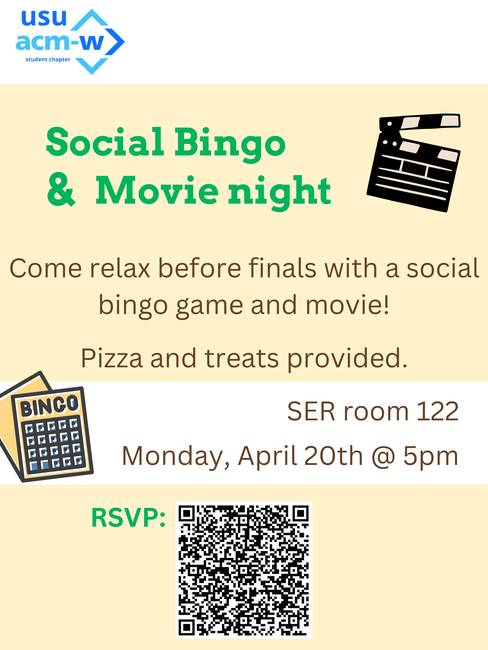

CS1400 - Thursday, April 16 - Lecture 27 - Module 7

# Topics:
* [🟥Assn 7 - Deckinator](#assn-7---deckinator)
* [Code Lab Challenge 0 - Hunting for Duplicates](#code-lab-challenge-0---hunting-for-duplicates)
* [Code Lab Challenge 1 - Shopping List Optimizer](#code-lab-challenge-1---shopping-list-optimizer)


------------------------------------------------------------
# Announcements

## ACM-W Social Bingo & Movie Night

*   **When**  5:00 PM Monday, April 20th
*   **Where** SER room 122

ACM-W is hosting their final event of the semester—come unwind before finals with social bingo and a movie. Pizza and treats will be provided.

**Please RSVP here:**

https://docs.google.com/forms/d/e/1FAIpQLSf-2H-VXAGlbDMLeHUnT1O3Q_z16qgCSbSn5mHiAWzvXicoSw/viewform




## FSLC - Playing Archipelago

*   **When**    6:30 PM Tuesday, April 21st
*   **Where**   WIDT 007
*   **Website** https://linux.usu.edu
*   **Discord** https://discord.gg/PvgG6N2hsU

Our final meeting of the semester, and it's going to be a chill one. We'll start up an Archipelago multiworld on this day and play our first couple of hours together! Come unwind from the stress of finals with snacks!


# Action Items

*   Erik has office hours today from 1:00 PM to 3:30 PM
    -   Find me in SER 301E or on [Zoom](https://usu-edu.zoom.us/my/erik.falor?pwd=ZE4zNXRpNVl4VVhHNkN5Q2wwV3VrUT09)
* [Take the IDEA Survey](https://usu.campuslabs.com/eval-home/)
    *   So far we're at a 51% response rate!
        *   My goal for the class is 80%
    *   It's worth 185 points of extra credit
    *   The survey closes 04/21/2026 at 11:59 PM


# [🟥Assn 7 - Deckinator](https://usu.instructure.com/courses/794745/assignments/5122793)


| Task/Day           | **Thursday**       | **Friday** | **Saturday** | **Sunday**   | **Monday** | **Tuesday**           |
| ------------------ | ------------------ | ---------- | ------------ | ------------ | ---------- | --------------------- |
| **Classroom Time** | Classroom Lab Time |            |              |              |            | Review for Final Exam |
| **Items Due**      |                    |            |              | Assignment 7 |            | Code Review Survey    |


# Code Lab Challenge 0 - Hunting for Duplicates

In this challenge you will help analyze a noisy log of numeric "event codes."  You will generate a shuffled list of random integers, sort it, use binary search to locate a chosen target value, and then scan linearly to count how many times that value appears consecutively in the sorted list.

Imagine this as a tiny data-analysis tool: given a pile of event codes, you want to quickly find a particular code and see whether it shows up as a short blip or in a longer streak.

Here is an example of what your randomly generated unsorted list might look like (your exact numbers will differ):

```text
[7, 0, 13, 7, 29, 4, 7, 18, 29, 4, 21, 7, 13, 0, 4, 29, 18, 7, 7, 4, ...]
```

After sorting, the same data might look like this:

```text
[0, 0, 4, 4, 4, 7, 7, 7, 7, 13, 13, 18, 18, 21, 29, 29, ...]
```

Use `random.randint()` in a `for` loop to build a list of 50 integers between 0 and 30.  This guarantees that you will see duplicates in the sorted list.  For early testing and debugging, you are strongly encouraged to start with a small, hardcoded list whose contents you already know.


*Note: Students with deeper programming experience can try the extra stretch challenges in Phase 4*


### Program Requirements

0.  Generate a list of random integers and print the unsorted list.
0.  Sort the list in ascending order and print the sorted list.
    *   Because the point of this code challenge is not sorting algorithms, you may use Python's built-in `sorted()` function, the list's `.sort()` method, or copy one of the sorting functions from the lecture videos to put the list in order.
0.  Choose a target value (either hard-code it or randomly select one of the list elements) and print it.
0.  Implement a `binary_search(sorted_list, target)` function that returns a list `[index, comparisons]` where:
    *   `index` is the location where `key` is found, or `-1` if it is not in the list.
    *   `comparisons` is the number of comparisons performed.
    *   Because the point of this code challenge is not the binary search algorithm, you may copy the `binary_search()` function from a previous challenge.
0.  In `main()`, call `binary_search()` on the sorted list and the chosen target and report the result to the user.
    *   Keep track of the number of comparisons made by the search routine.
0.  If the target is found, scan linearly left and right from the found index to count how many times the target appears consecutively and report the starting index, ending index, and total count.
    *   Keep track of the number of comparisons made by during the left-right scan.
0.  Print the total number of comparisons used by this algorithm.


### Phase 0 - Design It

Answer each of these questions in today's Wooclap:

0.  How do I prepare the necessary data?
1.  What do I need to process and calculate?
2.  How am I going to process and calculate?
3.  What do I need to display as results?


### Phase 1 - Pseudocode It

Using the answers to the above questions as your guide, write *pseudocode* as a block of comments in your program.  Start by describing the flow of the program in plain English.  Refine your pseudocode until it is as specific as Python code.


### Phase 2 - Build It

When your pseudocode is basically line-for-line equivalent to real Python code, rewrite each comment as code.


### Phase 3 - Reflect On It

Answer these debrief questions in comments in today's Wooclap:

* When you stepped through `binary_search` in the debugger, how did `low`, `high`, and `mid` change over time?  Describe one specific iteration in your own words.
* Did you make any off-by-one or infinite-loop mistakes in `binary_search` at first?  If so, how did the debugger help you spot and fix them?
* In the duplicate-counting step, how did you make sure you did not read past index 0 or past the last index in the list?
* Explain why binary search requires the list to be sorted.  What would go wrong if you ran the same code on the unsorted list?
* If the list contained thousands of elements instead of a few dozen, what practical difference would you expect between using linear search to look for the target versus your binary search?


### Phase 4 - Stretch Challenges

Did you finish early?  Was this still too easy for you?  Here are some more features to implement:

0.  Add an option that performs a linear search for the target and compares the number of comparisons it takes to the number of comparisons in your binary search.
0.  Allow the user to choose the list size and value range, then repeat the experiment and observe how the search behavior changes.
0.  After finding the consecutive block of duplicates, replace all of those values with a special marker (for example, `None` or `0`) and print the modified list.
0.  Let the user run the search multiple times in a loop with different targets without regenerating the list, so they can see different duplicate patterns.


# Code Lab Challenge 1 - Shopping List Optimizer

In this challenge you will tame a messy grocery shopping list by grouping and summarizing its items.  You will start with a list of strings like `"milk"`, `"eggs"`, and `"bread"`, then write code that counts how many times each item appears.

Imagine your roommate keeps a chaotic text list such as:

```python
["milk", "eggs", "bread", "milk", "apple", "bread", "milk"]
```

Your program will turn that into a clean summary like:

```text
3x milk
2x bread
1x eggs
1x apple
```

You will first implement a simple (but inefficient) counting approach that repeats work, then redesign it to use a single pass through the list.  Along the way you will use the debugger to watch how often each version examines the same elements.

*Note: Students with deeper programming experience can try the extra stretch challenges in Phase 4*


### Program Requirements

0.  Begin with a small, **hardcoded shopping list** of strings so you can easily predict the correct counts while you are first writing and testing your code. For example:
    -   ```python
        items = ["milk", "eggs", "bread", "milk", "apple", "bread", "milk"]
        ```
1.  Implement a **naïve counting function**, e.g.
   -    ```python
       def count_items_naive(items):
           ...
       ```
    -   This function should return a list of `(item_name, count)` pairs. It will look like this:
        -   ```python
            [("milk", 3), ("eggs", 1), ("bread", 2), ("apple", 1)]
            ```
    -   It should deliberately do extra work by scanning the list multiple times (for example, with nested loops or by calling a helper function that scans the whole list once for each distinct item).
2.  Implement an **improved single-pass counting function**, e.g.
    -   ```python
        def count_items_single_pass(items):
            ...
        ```
    -   This function should walk through the list **once** and build up the `(item_name, count)` pairs without repeating work.
    -   Hint: you can maintain two parallel lists - one for the item names you have seen so far and one for their counts.
3.  In `main`, call **both** counting functions on the same `items` list and print their results.
    -   Verify that they produce the same item names and counts, even if the order of the pairs is different.
4.  Print a **nicely formatted summary** of the results, one line per item, such as:
    -   ```text
        3x milk
        2x bread
        1x eggs
        1x apple
        ```
5. After your hardcoded version works, optionally allow the **user to type in extra items** (one per line) to extend the list.
    -   When the user enters a blank line, stop reading input, recompute the counts using your functions, and print the updated summary.


### Phase 0 - Design It

Answer each of these questions in today's Wooclap:

0.  In plain English or pseudocode, describe the full sequence of steps your program will perform, from starting with a hardcoded list to printing the final grouped summary.
0.  Design the behavior of your naïve counting function: what inputs and outputs does it have, and how exactly will it repeat work when counting item frequencies?
0.  Design the behavior of your single-pass counting function: how will it track which items it has already seen, and how will it update the associated counts without scanning the list again?
0.  List at least three specific test cases you plan to use (for example: a list with all items different, a list where one item dominates, a list where some items appear exactly once, and the empty list).


### Phase 1 - Code It

0.  Implement the naïve counting function you designed in Phase 0.
    -   Keep the code as simple and direct as possible so it is easy to reason about in the debugger, even if it repeats work.
0.  Implement the single-pass counting function you designed in Phase 0.
    -   Use clear variable names and small, well-labeled steps so you can see exactly how the counts change as you step through the loop.
0.  Write a short `main` function that builds your hardcoded list, calls both counting functions, and prints their results in a readable format.
0.  Add a few extra hardcoded test lists (you can comment them in and out) to exercise edge cases such as: an empty list, a list where all items are the same, and a list where every item is different.


### Phase 2 - Debug It

0.  In your naïve counting function, set a breakpoint inside the inner loop (or inside the helper that scans the whole list).
    -   Run the program in debug mode and step through until you see the same list element being examined multiple times.
    -   Record one specific example of this repeated work.
0.  Still in the naïve version, watch the variables that track the current item and its count.
    -   Use the debugger's variables pane to confirm your mental model of how the nested loops behave.
0.  In your single-pass counting function, set a breakpoint inside the main loop.
    -   Step through the program and watch how the "seen items" structure and the counts are updated on each iteration.
    -   Verify that each list element is examined exactly once.
0.  Use at least two different test lists (for example, one with a dominant item and one with all unique items) while debugging so you can see different behaviors.


### Phase 3 - Reflect On It

Answer these debrief questions in comments in today's Wooclap:

* When you stepped through your naïve counting function in the debugger, how many times did it examine the same list element?
    -   Describe one concrete example of repeated work that you observed.
* What differences did you notice in the debugger between the naïve version and the single-pass version in terms of loop structure and variable changes?
* How did you make sure your two implementations produced the same counts for every item?
    -   Describe at least one test that gave you confidence.
* If your shopping list grew to hundreds or thousands of items, which implementation would you trust more and why?
* Looking back at your final code, what (if anything) would you refactor to make the counting logic clearer for a future reader?


### Phase 4 - Stretch Challenges

Did you finish early?  Was this still too easy for you?  Here are some more features to implement:

0.  Sort your summary so that the most frequently purchased items appear first (for example, `milk` before `apple` in the example above).
0.  Allow the user to type in additional items (one per line) until they enter a blank line, then recompute and display the updated summary.
0.  Add a simple report that says which item(s) had the highest count, labeling them as "top items" in the output.
0.  If you are comfortable with dictionaries, write a third implementation that uses a dictionary to count items and compare its code size and clarity with your list-based single-pass version.


