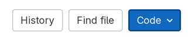
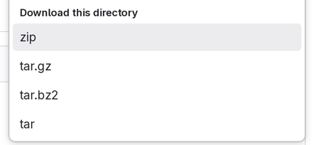

# Sp26 CS 1400 Lecture Notes Repository

## How To Use This Repository

This Git repository contains supplementary material presented in class.  Demos, code examples written in class, and other important resources are published here.

*   Navigate to the desired lecture
    *   Lectures are organized into *Modules*, which correspond to modules/units in Canvas
    *   Each lecture is identified by its sequence number and date
    *   Find a lecture by topic or date in the [Table of Contents](#table-of-contents) below
*   Once you are in the lecture folder on GitLab, open the **Code** menu on the tool bar
    *   
*   Go to the very bottom of the menu and select **zip** under the heading **Download this directory**
    *   
*   Locate the `.zip` file on your computer and extract it
*   The directory structure of the website is replicated on your computer, so you'll need to navigate through all of the folders to access the files
    *   For example:
        *   `fa24-cs1400-lecturenotes-master-Module0-Lec01-Mon_Aug_26`
        *   `Module0`
        *   `Lec01-Mon_Aug_26`

Can't access this website on campus?  Connect to the **Eduroam** network instead of **USU-Guest**.

## Table of Contents

<h3>Module 0</h3>

01. [Tuesday, January 06](./Module0/Lec01-Tue_Jan_06/README.md)
	* [Get To Know Your Professor](./Module0/Lec01-Tue_Jan_06/README.md#get-to-know-your-professor)
	* [Let's Get To Know Each Other](./Module0/Lec01-Tue_Jan_06/README.md#lets-get-to-know-each-other)
	* [How To Find These Lecture Notes](./Module0/Lec01-Tue_Jan_06/README.md#how-to-find-these-lecture-notes)
	* [What To Expect From This Course](./Module0/Lec01-Tue_Jan_06/README.md#what-to-expect-from-this-course)
	* [Installing Python and PyCharm on macOS](./Module0/Lec01-Tue_Jan_06/README.md#installing-python-and-pycharm-on-macos)
	* [Installing Python and PyCharm on Windows](./Module0/Lec01-Tue_Jan_06/README.md#installing-python-and-pycharm-on-windows)
02. [Thursday, January 08](./Module0/Lec02-Thu_Jan_08/README.md)
	* [🟥Assn 0 - PyCharm Setup](./Module0/Lec02-Thu_Jan_08/README.md#assn-0---pycharm-setup)
	* [Assignment 0 - PyCharm Setup](./Module0/Lec02-Thu_Jan_08/README.md#assignment-0---pycharm-setup)
	* [Setting Up PyCharm](./Module0/Lec02-Thu_Jan_08/README.md#setting-up-pycharm)
	* [How To Create Projects And Python Files In PyCharm](./Module0/Lec02-Thu_Jan_08/README.md#how-to-create-projects-and-python-files-in-pycharm)
	* [Test the ShowYourWork Plugin](./Module0/Lec02-Thu_Jan_08/README.md#test-the-showyourwork-plugin)
	* [How To Submit Assignments](./Module0/Lec02-Thu_Jan_08/README.md#how-to-submit-assignments)
	* [Python vs. PyCharm](./Module0/Lec02-Thu_Jan_08/README.md#python-vs-pycharm)
	* [How Code Reviews Will Work](./Module0/Lec02-Thu_Jan_08/README.md#how-code-reviews-will-work)
	* [Statement on Academic Integrity](./Module0/Lec02-Thu_Jan_08/README.md#statement-on-academic-integrity)

<h3>Module 1</h3>

03. [Tuesday, January 13](./Module1/Lec03-Tue_Jan_13/README.md)
	* [🟥Assn 1a - What is CS & Snowman](./Module1/Lec03-Tue_Jan_13/README.md#assn-1a---what-is-cs--snowman)
	* [Code Lab Challenge 0 - Hello, Octothorpe](./Module1/Lec03-Tue_Jan_13/README.md#code-lab-challenge-0---hello-octothorpe)
	* [Code Lab Challenge 1 - Drawly Grid Builder](./Module1/Lec03-Tue_Jan_13/README.md#code-lab-challenge-1---drawly-grid-builder)
	* [Code Lab Challenge 2 - Fix My Bug](./Module1/Lec03-Tue_Jan_13/README.md#code-lab-challenge-2---fix-my-bug)
04. [Thursday, January 15](./Module1/Lec04-Thu_Jan_15/README.md)
	* [🟥Assn 1a - What is CS & Snowman](./Module1/Lec04-Thu_Jan_15/README.md#assn-1a---what-is-cs--snowman)
	* [Responsible AI Use](./Module1/Lec04-Thu_Jan_15/README.md#responsible-ai-use)
	* [Code Lab Challenge 0 - The Bob Rossinator](./Module1/Lec04-Thu_Jan_15/README.md#code-lab-challenge-0---the-bob-rossinator)
05. [Tuesday, January 20](./Module1/Lec05-Tue_Jan_20/README.md)
	* [🟥Assn 1b - Faceinator](./Module1/Lec05-Tue_Jan_20/README.md#assn-1b---faceinator)
	* [Basic Python I/O](./Module1/Lec05-Tue_Jan_20/README.md#basic-python-io)
	* [The Drawly Terminal](./Module1/Lec05-Tue_Jan_20/README.md#the-drawly-terminal)
	* [Code Lab Challenge 0 - What Does + Mean In Python](./Module1/Lec05-Tue_Jan_20/README.md#code-lab-challenge-0---what-does--mean-in-python)
	* [Code Lab Challenge 1 - Drawing Happy Little Trees Interactively](./Module1/Lec05-Tue_Jan_20/README.md#code-lab-challenge-1---drawing-happy-little-trees-interactively)
06. [Thursday, January 22](./Module1/Lec06-Thu_Jan_22/README.md)
	* [🟥Assn 1b - Faceinator](./Module1/Lec06-Thu_Jan_22/README.md#assn-1b---faceinator)
	* [Tip: Speed-Run Testing Interactive Programs](./Module1/Lec06-Thu_Jan_22/README.md#tip-speed-run-testing-interactive-programs)
	* [How `drawly.arc` Works](./Module1/Lec06-Thu_Jan_22/README.md#how-drawlyarc-works)
	* [Code Lab Challenge 0 - Drawly Arc Rainbow](./Module1/Lec06-Thu_Jan_22/README.md#code-lab-challenge-0---drawly-arc-rainbow)
	* [Code Lab Challenge 1 - Drawly Arc COOL Logo](./Module1/Lec06-Thu_Jan_22/README.md#code-lab-challenge-1---drawly-arc-cool-logo)

<h3>Module 2</h3>

07. [Tuesday, January 27](./Module2/Lec07-Tue_Jan_27/README.md)
	* [🟥Assn 2a - Investments & Polygon Area](./Module2/Lec07-Tue_Jan_27/README.md#assn-2a---investments--polygon-area)
	* [Code Lab Challenge 0 - Omni Calculator](./Module2/Lec07-Tue_Jan_27/README.md#code-lab-challenge-0---omni-calculator)
	* [Code Lab Challenge 1 - Formula Translation](./Module2/Lec07-Tue_Jan_27/README.md#code-lab-challenge-1---formula-translation)
	* [Code Lab Challenge 2 - One-Line Fix Programs](./Module2/Lec07-Tue_Jan_27/README.md#code-lab-challenge-2---one-line-fix-programs)
08. [Thursday, January 29](./Module2/Lec08-Thu_Jan_29/README.md)
	* [🟥Assn 2a - Investments & Polygon Area](./Module2/Lec08-Thu_Jan_29/README.md#assn-2a---investments--polygon-area)
	* [Code Lab Challenge 0 - Average Height](./Module2/Lec08-Thu_Jan_29/README.md#code-lab-challenge-0---average-height)
	* [Code Lab Challenge 1 - Random Polka Dots](./Module2/Lec08-Thu_Jan_29/README.md#code-lab-challenge-1---random-polka-dots)
	* [Code Lab Challenge 2 - Python PRNG Bias](./Module2/Lec08-Thu_Jan_29/README.md#code-lab-challenge-2---python-prng-bias)
09. [Tuesday, February 03](./Module2/Lec09-Tue_Feb_03/README.md)
	* [Assn 2b - What Kind of Aggie & Superhero Decisions](./Module2/Lec09-Tue_Feb_03/README.md#assn-2b---what-kind-of-aggie--superhero-decisions)
	* [The Markdown Markup Language](./Module2/Lec09-Tue_Feb_03/README.md#the-markdown-markup-language)
	* [Code Lab Challenge 0 - Compare All The Things](./Module2/Lec09-Tue_Feb_03/README.md#code-lab-challenge-0---compare-all-the-things)
	* [Code Lab Challenge 1 - Software Design: Shape Comparison Labels](./Module2/Lec09-Tue_Feb_03/README.md#code-lab-challenge-1---software-design-shape-comparison-labels)
	* [Code Lab Challenge 2 - Non-Overlapping Polka Dots](./Module2/Lec09-Tue_Feb_03/README.md#code-lab-challenge-2---non-overlapping-polka-dots)
10. [Thursday, February 05](./Module2/Lec10-Thu_Feb_05/README.md)
	* [🟥Assn 2b - What Kind of Aggie & Superhero Decisions](./Module2/Lec10-Thu_Feb_05/README.md#assn-2b---what-kind-of-aggie--superhero-decisions)
	* [Code Lab Challenge 0 - Grading Helper](./Module2/Lec10-Thu_Feb_05/README.md#code-lab-challenge-0---grading-helper)
	* [Code Lab Challenge 1 - Blindfolded Dart Throw](./Module2/Lec10-Thu_Feb_05/README.md#code-lab-challenge-1---blindfolded-dart-throw)
	* [Code Lab Challenge 7 - Two-Decision Adventure (Design & Write)](./Module2/Lec10-Thu_Feb_05/README.md#code-lab-challenge-7---two-decision-adventure-design--write)

<h3>Module 3</h3>

11. [Tuesday, February 10](./Module3/Lec11-Tue_Feb_10/README.md)
	* [🟥Assn 3a - Fronkian & Doofenlittle](./Module3/Lec11-Tue_Feb_10/README.md#assn-3a---fronkian--doofenlittle)
	* [Code Lab Challenge 0 - Untangling Scope Dependencies](./Module3/Lec11-Tue_Feb_10/README.md#code-lab-challenge-0---untangling-scope-dependencies)
	* [Code Lab Challenge 1 - Lucky Number Detector](./Module3/Lec11-Tue_Feb_10/README.md#code-lab-challenge-1---lucky-number-detector)
	* [Code Lab Challenge 2 - Regular Polygon Painter](./Module3/Lec11-Tue_Feb_10/README.md#code-lab-challenge-2---regular-polygon-painter)
12. [Thursday, February 12](./Module3/Lec12-Thu_Feb_12/README.md)
	* [🟥Assn 3a - Fronkian & Doofenlittle](./Module3/Lec12-Thu_Feb_12/README.md#assn-3a---fronkian--doofenlittle)
	* [Code Lab Challenge 0 - Constants and Objects](./Module3/Lec12-Thu_Feb_12/README.md#code-lab-challenge-0---constants-and-objects)
	* [Code Lab Challenge 1 - Object-Oriented Gossip Hour](./Module3/Lec12-Thu_Feb_12/README.md#code-lab-challenge-1---object-oriented-gossip-hour)
	* [Code Lab Challenge 2 - Drawly Binary Clock](./Module3/Lec12-Thu_Feb_12/README.md#code-lab-challenge-2---drawly-binary-clock)
13. [Tuesday, February 17](./Module3/Lec13-Tue_Feb_17/README.md)
	* [🟥Assn 3b - Don't Play With Mathes](./Module3/Lec13-Tue_Feb_17/README.md#assn-3b---dont-play-with-mathes)
	* [Code Lab Challenge 0 - Broken Loop Lab](./Module3/Lec13-Tue_Feb_17/README.md#code-lab-challenge-0---broken-loop-lab)
	* [Code Lab Challenge 1 - Countdown to Blast Off](./Module3/Lec13-Tue_Feb_17/README.md#code-lab-challenge-1---countdown-to-blast-off)
	* [Code Lab Challenge 2 - Crash-Proof Guessing Game](./Module3/Lec13-Tue_Feb_17/README.md#code-lab-challenge-2---crash-proof-guessing-game)
14. [Thursday, February 19](./Module3/Lec14-Thu_Feb_19/README.md)
	* [🟥Assn 3b - Don't Play With Mathes](./Module3/Lec14-Thu_Feb_19/README.md#assn-3b---dont-play-with-mathes)
	* [Code Lab Challenge 0 - Average Height](./Module3/Lec14-Thu_Feb_19/README.md#code-lab-challenge-0---average-height)
	* [Code Lab Challenge 1 - Improved Drawly Grid](./Module3/Lec14-Thu_Feb_19/README.md#code-lab-challenge-1---improved-drawly-grid)
	* [Code Lab Challenge 2 - Sieve of Eratosthenes](./Module3/Lec14-Thu_Feb_19/README.md#code-lab-challenge-2---sieve-of-eratosthenes)

<h3>Module 4</h3>

15. [Tuesday, February 24](./Module4/Lec15-Tue_Feb_24/README.md)
	* [🟥Assn 4a - Design Number Pyramid](./Module4/Lec15-Tue_Feb_24/README.md#assn-4a---design-number-pyramid)
	* [Review for Exam 1](./Module4/Lec15-Tue_Feb_24/README.md#review-for-exam-1)
	* [Direct Debugging in the IDE](./Module4/Lec15-Tue_Feb_24/README.md#direct-debugging-in-the-ide)
	* [Code Clinic - Debugger Exercises](./Module4/Lec15-Tue_Feb_24/README.md#code-clinic---debugger-exercises)
16. [Thursday, February 26](./Module4/Lec16-Thu_Feb_26/README.md)
	* [🟥Assn 4a - Design Number Pyramid](./Module4/Lec16-Thu_Feb_26/README.md#assn-4a---design-number-pyramid)
	* [Code Park Tycoon](./Module4/Lec16-Thu_Feb_26/README.md#code-park-tycoon)
	* [Code Lab Challenge 0 - Taking Home The Gold](./Module4/Lec16-Thu_Feb_26/README.md#code-lab-challenge-0---taking-home-the-gold)
	* [Code Lab Challenge 1 - Function Arguments](./Module4/Lec16-Thu_Feb_26/README.md#code-lab-challenge-1---function-arguments)
17. [Tuesday, March 03](./Module4/Lec17-Tue_Mar_03/README.md)
	* [🟥Assn 4b - Chessmate & Patterns](./Module4/Lec17-Tue_Mar_03/README.md#assn-4b---chessmate--patterns)
	* [Exam #1 Recap](./Module4/Lec17-Tue_Mar_03/README.md#exam-1-recap)
	* [Code Lab Challenge 0 - Explore Python Types](./Module4/Lec17-Tue_Mar_03/README.md#code-lab-challenge-0---explore-python-types)
	* [Code Lab Challenge 1 - Python Object IDs](./Module4/Lec17-Tue_Mar_03/README.md#code-lab-challenge-1---python-object-ids)
	* [Code Lab Challenge 2 - Fix My Module Bug](./Module4/Lec17-Tue_Mar_03/README.md#code-lab-challenge-2---fix-my-module-bug)
18. [Thursday, March 05](./Module4/Lec18-Thu_Mar_05/README.md)
	* [🟥Assn 4b - Chessmate & Patterns](./Module4/Lec18-Thu_Mar_05/README.md#assn-4b---chessmate--patterns)
	* [Code Lab Challenge 0 - Traffic Light](./Module4/Lec18-Thu_Mar_05/README.md#code-lab-challenge-0---traffic-light)
	* [Code Lab Challenge 1 - Cookie Cutter Neighborhood](./Module4/Lec18-Thu_Mar_05/README.md#code-lab-challenge-1---cookie-cutter-neighborhood)

<h3>Module 5</h3>

19. [Tuesday, March 17](./Module5/Lec19-Tue_Mar_17/README.md)
	* [🟥Assn 5a - The Collector](./Module5/Lec19-Tue_Mar_17/README.md#assn-5a---the-collector)
	* [Pygame Starter Code (Boilerplate)](./Module5/Lec19-Tue_Mar_17/README.md#pygame-starter-code-boilerplate)
	* [Code Lab Challenge 0 - This Little Piggy](./Module5/Lec19-Tue_Mar_17/README.md#code-lab-challenge-0---this-little-piggy)
	* [Code Lab Challenge 1 - Fix My Bug: Arrow-Key Player Constraints](./Module5/Lec19-Tue_Mar_17/README.md#code-lab-challenge-1---fix-my-bug-arrow-key-player-constraints)
20. [Thursday, March 19](./Module5/Lec20-Thu_Mar_19/README.md)
	* [🟥Assn 5a - The Collector](./Module5/Lec20-Thu_Mar_19/README.md#assn-5a---the-collector)
	* [Match the Case of Filenames](./Module5/Lec20-Thu_Mar_19/README.md#match-the-case-of-filenames)
	* [Code Lab Challenge 0 - Confined Bouncing Shapes](./Module5/Lec20-Thu_Mar_19/README.md#code-lab-challenge-0---confined-bouncing-shapes)
	* [Code Lab Challenge 1 - Arkanoid](./Module5/Lec20-Thu_Mar_19/README.md#code-lab-challenge-1---arkanoid)
21. [Tuesday, March 24](./Module5/Lec21-Tue_Mar_24/README.md)
	* [🟥Assn 5b - Dr. Moody & Crittery](./Module5/Lec21-Tue_Mar_24/README.md#assn-5b---dr-moody--crittery)
	* [Code Lab Challenge 0 - Cursor Hotpoint Calibrator](./Module5/Lec21-Tue_Mar_24/README.md#code-lab-challenge-0---cursor-hotpoint-calibrator)
	* [Code Lab Challenge 1 - Fix My Bug: Spawn-Safe Treasure](./Module5/Lec21-Tue_Mar_24/README.md#code-lab-challenge-1---fix-my-bug-spawn-safe-treasure)
22. [Thursday, March 26](./Module5/Lec22-Thu_Mar_26/README.md)
	* [🟥Assn 5b - Dr. Moody & Crittery](./Module5/Lec22-Thu_Mar_26/README.md#assn-5b---dr-moody--crittery)
	* [Code Lab Challenge 0 - Energy Ball Z](./Module5/Lec22-Thu_Mar_26/README.md#code-lab-challenge-0---energy-ball-z)
	* [Code Lab Challenge 1 - Buggy Bouncing Balls](./Module5/Lec22-Thu_Mar_26/README.md#code-lab-challenge-1---buggy-bouncing-balls)

<h3>Module 6</h3>

23. [Tuesday, March 31](./Module6/Lec23-Tue_Mar_31/README.md)
	* [🟥Assn 6 - Crashtropolis](./Module6/Lec23-Tue_Mar_31/README.md#assn-6---crashtropolis)
	* [Code Lab Challenge 0 - Clicky Grid](./Module6/Lec23-Tue_Mar_31/README.md#code-lab-challenge-0---clicky-grid)
	* [Code Lab Challenge 1 - Battleship](./Module6/Lec23-Tue_Mar_31/README.md#code-lab-challenge-1---battleship)
24. [Thursday, April 02](./Module6/Lec24-Thu_Apr_02/README.md)
	* [🟥Assn 6 - Crashtropolis](./Module6/Lec24-Thu_Apr_02/README.md#assn-6---crashtropolis)
	* [Code Lab Challenge 0 - Clicky Grid Redux](./Module6/Lec24-Thu_Apr_02/README.md#code-lab-challenge-0---clicky-grid-redux)
	* [Code Lab Challenge 1 - Game State Transitions](./Module6/Lec24-Thu_Apr_02/README.md#code-lab-challenge-1---game-state-transitions)
25. [Tuesday, April 07](./Module6/Lec25-Tue_Apr_07/README.md)
	* [🟥Assn 6 - Crashtropolis](./Module6/Lec25-Tue_Apr_07/README.md#assn-6---crashtropolis)
	* [Code Lab Challenge 0 - The Perfectly Safe Radio Collar Hunt](./Module6/Lec25-Tue_Apr_07/README.md#code-lab-challenge-0---the-perfectly-safe-radio-collar-hunt)
	* [Code Lab Challenge 1 - Sprite Transformer](./Module6/Lec25-Tue_Apr_07/README.md#code-lab-challenge-1---sprite-transformer)

<h3>Module 7</h3>

26. [Tuesday, April 14](./Module7/Lec26-Tue_Apr_14/README.md)
	* [BSidesSLC Debrief](./Module7/Lec26-Tue_Apr_14/README.md#bsidesslc-debrief)
	* [🟥Assn 7 - Deckinator](./Module7/Lec26-Tue_Apr_14/README.md#assn-7---deckinator)
	* [Code Lab Challenge 0 - Lost & Found Linear Search](./Module7/Lec26-Tue_Apr_14/README.md#code-lab-challenge-0---lost--found-linear-search)
	* [Code Lab Challenge 1 - Number Guessing & Binary Search](./Module7/Lec26-Tue_Apr_14/README.md#code-lab-challenge-1---number-guessing--binary-search)
27. [Thursday, April 16](./Module7/Lec27-Thu_Apr_16/README.md)
	* [🟥Assn 7 - Deckinator](./Module7/Lec27-Thu_Apr_16/README.md#assn-7---deckinator)
	* [Code Lab Challenge 0 - Hunting for Duplicates](./Module7/Lec27-Thu_Apr_16/README.md#code-lab-challenge-0---hunting-for-duplicates)
	* [Code Lab Challenge 1 - Shopping List Optimizer](./Module7/Lec27-Thu_Apr_16/README.md#code-lab-challenge-1---shopping-list-optimizer)
28. [Tuesday, April 21](./Module7/Lec28-Tue_Apr_21/README.md)
	* [Two Truths and a Lie Exam Review](./Module7/Lec28-Tue_Apr_21/README.md#two-truths-and-a-lie-exam-review)

